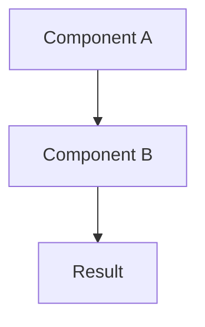

# Pattern Schema

This document defines the schema for pattern files in this repository. All patterns MUST follow this schema to ensure consistent validation, parsing, and rendering.

---

## File Location

Patterns are stored as Markdown files in the `patterns/` directory at the repository root:

```
patterns/
  pattern-slug.md
  another-pattern.md
```

The canonical pattern template lives at `TEMPLATE.md` in the repository root, not inside `patterns/`.

---

## File Structure

Each pattern file consists of:

1. **YAML front matter** (metadata)
2. **Markdown body** (content sections)

---

## Front Matter Schema

### Required Fields

Every pattern MUST include these fields:

| Field | Type | Description | Example |
|-------|------|-------------|---------|
| `title` | string | Human-readable pattern name | `Reflection Loop` |
| `status` | enum | Status tier (see values below) | `production` |
| `authors` | array of strings | Contributors with GitHub handles | `["Nikola Balic (@nibzard)"]` |
| `category` | enum | Primary category (see values below) | `Feedback Loops` |
| `source` | string (URL) | Primary reference/origin | `https://arxiv.org/abs/2303.11366` |
| `tags` | array of strings | Keywords for discovery | `[self-feedback, iterative-improvement]` |
| `summary` | string | One sentence that says what the pattern does (the solution) | `Critiques and revises its own draft before it returns the answer` |
| `signals` | array of strings | When this pattern helps (2-4 items, shown as "Use when") | `["Quality-critical output", "Iterative refinement possible"]` |
| `anti_signals` | array of strings | When to avoid it (2-3 items, shown as "Avoid when") | `["Single-pass generation", "Tight latency budget"]` |
| `updated_at` | string (date) | Last content change (YYYY-MM-DD); required so generated data stays deterministic | `2025-01-13` |

#### Status Values

`status` is one of four tiers. Each tier has an objective entry criterion, so a reviewer can audit the claim against public evidence.

```yaml
status: "proposed"      # 0-1 public implementations
status: "emerging"      # 2+ independent implementations, or 1 detailed production write-up
status: "production"    # Proven across multiple independent production systems
status: "foundational"  # Industry-default baseline whenever its signals apply
```

| Status | Objective entry criterion | Catalog role |
|--------|---------------------------|--------------|
| `proposed` | 0-1 public implementations: the contributor's own repo, a single paper, or a launch-stage startup. | Incubator or single-source proposal. |
| `emerging` | 2+ independent implementations or teams, or 1 detailed production write-up or major lab paper with active industry iteration. | Standard catalog entry. |
| `production` | Proven across multiple independent production systems, with documented failure modes and operational trade-offs. | Eligible for Pattern Packs and primary Decision Explorer recommendations. |
| `foundational` | Industry-default architectural baseline whenever its `signals` apply. Every pattern has `anti_signals`, so this tier replaces the old `best-practice`. | Core starting building block (about 12-18 patterns in total). |

The earlier seven-value scale (`established`, `validated-in-production`, `best-practice`, `experimental-but-awesome`, `rapidly-improving`) is retired. Re-justify a migrated pattern against these criteria; do not map its old value by name. A submission backed only by a contributor-owned repo or a single launch-stage product enters as `proposed` (see "Status Tiers & Independent-Adoption Bar" in `CONTRIBUTING.md`).

#### Category Values

```yaml
category: "Orchestration & Control"
category: "Context & Memory"
category: "Feedback Loops"
category: "Learning & Adaptation"
category: "Reliability & Eval"
category: "Security & Safety"
category: "Tool Use & Environment"
category: "UX & Collaboration"
category: "Uncategorized"
```

#### Authors Format

```yaml
authors: ["Full Name (@githubusername)"]
# Multiple authors:
authors: ["Alice (@alice)", "Bob (@bob)"]
```

### Optional Fields

These fields MAY be included to enhance pattern metadata:

| Field | Type | Description | Example |
|-------|------|-------------|---------|
| `based_on` | array of strings | Originators/inspiration | `["Shinn et al. (2023)"]` |
| `slug` | string | URL identifier (auto-generated if omitted) | `reflection-loop` |
| `evidence_grade` | enum | Strength of the evidence behind the pattern (see values below) | `high` |
| `evidence_snapshot` | string | 1-2 high-signal findings and the key uncertainty behind the grade | `"Two independent production write-ups agree on the latency cost; neither documents failure modes"` |
| `maturity` | enum | **Deprecated.** Superseded by the four-tier `status`; retained only for backward compatibility | `maturing` |
| `complexity` | enum | Implementation difficulty | `medium` |
| `effort` | enum | Time to implement | `days` |
| `impact` | enum | Potential benefit | `high` |
| `prerequisites` | array of strings | Required setup | `["Evaluation metric", "Iterative loop support"]` |
| `related` | array of strings | Related pattern IDs | `["self-critique-evaluator-loop"]` |
| `anti_patterns` | array of strings | Opposing patterns | `["one-shot-generation"]` |
| `tools` | array of strings | Required tool types | `["evaluator", "loop-controller"]` |
| `domains` | array of strings | Use cases | `["coding", "writing", "research"]` |

#### Evidence Grade Values

```yaml
evidence_grade: "high"    # Strong, independent, verifiable evidence
evidence_grade: "medium"  # Credible evidence with gaps in independence or depth
evidence_grade: "low"     # Single-source or anecdotal evidence
evidence_grade: "mixed"   # Strong for some claims, weak for others
evidence_grade: "unknown" # Not yet assessed
```

`evidence_grade` backs the `status` claim. The validator flags a `production` or `foundational` pattern whose `evidence_grade` is `low`, or whose primary source is contributor-owned with no independent references.

#### Maturity Values (deprecated)

`maturity` is superseded by the four-tier `status`. Do not add it to new patterns; the validator accepts it in existing files for backward compatibility.

```yaml
maturity: "early"      # Initial concept
maturity: "maturing"   # Active development
maturity: "mature"     # Stable and proven
```

#### Complexity Values

```yaml
complexity: "low"      # Simple implementation
complexity: "medium"   # Moderate complexity
complexity: "high"     # Complex or challenging
```

#### Effort Values

```yaml
effort: "hours"        # < 1 day
effort: "days"         # 1-5 days
effort: "weeks"        # > 5 days
```

#### Impact Values

```yaml
impact: "low"      # Minor benefit
impact: "medium"   # Moderate benefit
impact: "high"     # Significant benefit
```

---

## Body Structure (Markdown Sections)

### Required Sections

Every pattern MUST include these sections (in order):

1. **Problem** - What challenge does this pattern solve?
2. **Solution** - How does the pattern address the problem?
3. **How to use it** - Practical implementation guidance
4. **Trade-offs** - Pros and cons, plus the recommended **Failure modes** subsection (see below)
5. **References** - Source links and further reading

#### Section Format

```markdown
## Section Name

Section content goes here. Use:
- Bullet points for lists
- Code blocks for examples
- Tables where appropriate
- Mermaid diagrams for visualizations
```

### Optional Sections

These sections MAY be added after required sections:

- **Evidence** - Research-backed findings and their grade; `TEMPLATE.md` places it between Solution and How to use it
- **Failure modes** / **Gotchas** - Recommended as a `###` subsection inside `Trade-offs`, not as its own `##` section, so the required section order stays intact. List 2-4 concrete ways a naive implementation breaks: the symptom, the cause, and the guard or fix.
- **When to use** - Specific scenarios where this pattern shines
- **When not to use** - Situations to avoid this pattern
- **Signals** - Indicators this pattern is a good fit
- **Implementation checklist** - Step-by-step guidance
- **Variations** - Adaptations and alternatives
- **Pitfalls** - Common mistakes to avoid
- **Benchmarks** - Performance data if available

### Length Target

Keep each pattern file between **70 and 180 lines**. This range is the target that `scripts/validate-patterns.ts` names. Its guardrails are warnings only: under 55 lines (stub) and over 220 lines (bloat). To stay in range, use one short illustrative snippet (about 15-25 lines) for each mechanism in place of long synthetic classes, and do not restate the same list across sections.

### Code Blocks

Use fenced code blocks with language identifiers:

````markdown
```pseudo
for attempt in range(max_iters):
    draft = generate(prompt)
    score = evaluate(draft)
```
````

Supported languages: `pseudo`, `python`, `javascript`, `typescript`, `bash`, etc.

### Mermaid Diagrams

Use Mermaid for architectural visualizations:

````markdown

````

---

## Complete Example

```yaml
---
title: Reflection Loop
status: production
authors: ["Nikola Balic (@nibzard)"]
based_on: ["Shinn et al. (2023)"]
category: Feedback Loops
source: "https://arxiv.org/abs/2303.11366"
tags: [self-feedback, iterative-improvement, evaluation]
summary: Improves model outputs via iterative self-feedback and evaluation
evidence_grade: high
evidence_snapshot: "Independent teams report the same quality gains and the same latency cost; results depend on a well-defined metric"
complexity: medium
effort: days
impact: high
signals: ["Quality-critical output", "Iterative refinement possible"]
anti_signals: ["Single-pass generation", "Tight latency budget"]
prerequisites: ["Evaluation metric", "Iterative loop support"]
related: ["self-critique-evaluator-loop"]
domains: ["coding", "writing", "research"]
updated_at: "2025-01-13"
---
```

````markdown
## Problem
Generative models may produce subpar output if they never review or critique their own work.

## Solution
After generating a draft, have the model grade it against a given metric and refine the response using that feedback.

```pseudo
for attempt in range(max_iters):
    draft = generate(prompt)
    score, critique = evaluate(draft, metric)
    if score >= threshold:
        return draft
    prompt = incorporate(critique, prompt)
```

## How to use it
Use when you care about quality or adherence to explicit criteria—writing, reasoning, or code. Loop until the score meets your bar or max iterations are reached.

## Trade-offs
* **Pros:** Improves outputs with little supervision.
* **Cons:** Extra compute; may stall if the metric is poorly defined.

## References
* [Reflexion: Language Agents with Verbal Reinforcement Learning](https://arxiv.org/abs/2303.11366) - Shinn et al., 2023
* [Self-Refine: Iterative Refinement with Self-Feedback](https://arxiv.org/abs/2303.17651) - Madaan et al., 2023
````

---

## Validation

Patterns are validated by `scripts/validate-patterns.ts`:

1. **Front-matter validator** - Checks required fields, enum values, the `source` URL, and the `updated_at` date (`bun run validate:patterns`)
2. **Content checker** - The same run with `--check-content` (`bun run validate:patterns:content`), which adds:

   - Required sections: `## Problem`, `## Solution`, `## How to use it`, `## Trade-offs`, and `## References` must be present. A missing section is an error; out-of-order or duplicate headings are warnings.
   - Referential integrity: every slug in `related:` must resolve to an existing pattern file, relative Markdown links must resolve, and `/patterns/<slug>` links in packs and guides must resolve.
   - Status vs. evidence: a pattern that claims `production` or `foundational` is flagged when its `evidence_grade` is `low`, or when its primary source is contributor-owned and it has no independent references.
   - Length guardrails: a warning for a file under 55 lines (stub) or over 220 lines (bloat). The recommended target is 70-180 lines (see "Length Target").

`scripts/build-data.ts` also fails on any pattern whose `updated_at` is missing or not in `YYYY-MM-DD` form.

Validation runs during:

- Local checks before you open a PR (see "Local checks" in `CONTRIBUTING.md`)
- The CI pipeline, where `bun run validate:patterns:content` must pass with 0 errors, and `bun run build:data` and `bun run build` must succeed with generated files that match `patterns/*.md`

---

## Migration from Old Schema

Patterns using the old schema (missing `id`, `summary`, `slug`) will be automatically migrated:

- `id`: Auto-generated from `title` (kebab-case)
- `summary`: Extracted from first paragraph if missing
- `slug`: Auto-generated from `title` if missing

---

## LLM Output Formats

This repository provides AI-friendly text files for LLM consumption.

### llms.txt

A minimal index file listing all patterns with canonical URLs. Located at `/llms.txt`.

**Format:**
```
# Awesome Agentic Patterns

A curated catalogue of AI agent design patterns.

## Patterns

### reflection-loop
Reflection Loop: Improves model outputs via iterative self-feedback and evaluation
URL: https://agentic-patterns.com/patterns/reflection-loop

### parallel-tool-execution
Conditional Parallel Tool Execution: Execute read-only tools concurrently, state-modifying tools sequentially
URL: https://agentic-patterns.com/patterns/parallel-tool-execution

### tree-of-thought-reasoning
Tree-of-Thought Reasoning: Explore a search tree of intermediate thoughts instead of a single chain
URL: https://agentic-patterns.com/patterns/tree-of-thought-reasoning
```

**Purpose:**
- Quick LLM discovery of available patterns
- Canonical URL references for citation
- Minimal token cost for LLM ingestion

**Generation:** Auto-generated by `scripts/build-data.ts`

### llms-full.txt

Complete pattern content for LLM context. Located at `/llms-full.txt`.

**Format:**
```
# Awesome Agentic Patterns - Full Content

## Reflection Loop

**Status:** production
**Category:** Feedback Loops
**Authors:** Nikola Balic (@nibzard)
**Source:** https://arxiv.org/abs/2303.11366

### Problem
Generative models may produce subpar output if they never review or critique their own work.

### Solution
After generating a draft, have the model grade it against a given metric and refine the response using that feedback.

### How to use it
Use when you care about quality or adherence to explicit criteria...

### Trade-offs
**Pros:** Improves outputs with little supervision.
**Cons:** Extra compute; may stall if the metric is poorly defined.

### References
- Reflexion: https://arxiv.org/abs/2303.11366
- Self-Refine: https://arxiv.org/abs/2303.17651

---

## [Next Pattern]
...
```

**Purpose:**
- Full context for LLM reasoning
- Detailed pattern descriptions
- Includes all sections (Problem, Solution, Trade-offs, etc.)

**Generation:** Auto-generated by `scripts/build-data.ts`

---

## Schema Version

Current version: `1.0.0`

Last updated: 2026-11-25
