## Problem

LLM-based agent execution is expensive (both in costs and latency) and non-deterministic. Running the same workflow multiple times yields different results and incurs repeated LLM costs.

- **Cost explosion**: Every workflow run burns LLM tokens even for identical tasks
- **Non-determinism**: Same input produces different outputs across runs
- **No regression testing**: Impossible to verify fixes don't break existing workflows
- **Slow iteration**: Can't quickly test changes without paying LLM costs
- **No CI/CD integration**: Automated testing of agent workflows is impractical

## Solution

Record every action during execution with precise metadata (XPaths, frame indices, execution details), enabling deterministic replay without LLM calls. The cache captures enough information to replay actions even when page structure changes slightly.

This pattern builds on **experience replay** from reinforcement learning, where agents learn by reusing past successful actions rather than exploring anew each time.

**Action cache entries** store complete execution metadata:

```typescript
interface ActionCacheEntry {
  stepIndex: number;   // Order in workflow
  instruction: string; // Natural language description
  elementId: string;   // Encoded frameIndex-backendNodeId
  method: string;      // click, fill, type, etc.
  arguments: string[]; // Method parameters
  frameIndex: number;  // Frame context for iframes
  xpath: string;       // Normalized XPath for element
  actionType: string;  // Action category
  success: boolean;    // Execution result
  message: string;     // Output or error message
}

interface ActionCacheOutput {
  actions: ActionCacheEntry[];
  finalState: { success: boolean; error?: string; duration: number };  // outcome of the whole run
}
```

**Building cache entries** during the LLM-powered first run:

```typescript
const entry: ActionCacheEntry = {
  stepIndex,
  instruction: extractInstruction(action),
  elementId,                                    // frameIndex-backendNodeId
  method: extractMethod(action),                // click, fill, type, ...
  arguments: extractArguments(action),
  frameIndex: extractFrameIndex(elementId),
  xpath: normalizeXPath(domState.xpathMap?.[elementId] || extractXPathFromDebug(actionOutput)),
  actionType: action.type,
  success: actionOutput.success,
  message: actionOutput.message,
};
```

**Replay with intelligent fallback:**

```typescript
const replay = await page.runFromActionCache(cache, {
  maxXPathRetries: 3,   // Retry XPath resolution up to 3 times
  fallbackToLLM: true,  // Use LLM if XPath resolution fails
});

// 1. Try cached XPath directly
// 2. If it fails, retry with normalized XPath variations
// 3. If it still fails, invoke the LLM for element resolution
// 4. Update the cache with the successful resolution
```

**Generate standalone scripts** from a cache for manual debugging or CI:

```typescript
const script = generateScriptFromCache(cache);  // e.g. page.click('div[data-testid="login-button"]')
```

### Architecture

```mermaid
graph TB
    subgraph "First Run (LLM-Powered)"
        A[User Request] --> B[Agent with LLM]
        B --> C[Action 1: Click Login]
        C --> D[Build Cache Entry #1]
        D --> E[Action 2: Fill Email]
        E --> F[Build Cache Entry #2]
        F --> G[Complete]
    end
    subgraph "Subsequent Runs (Cache-Powered)"
        H[User Request] --> I{Cache Exists?}
        I -->|Yes| J[Load Action Cache]
        J --> K[Replay Action 1]
        K --> L{XPath Works?}
        L -->|Yes| M[Replay Action 2]
        L -->|No| N[LLM Fallback]
        N --> M
        M --> O{XPath Works?}
        O -->|Yes| P[Complete - Zero LLM Cost]
        O -->|No| Q[LLM Fallback]
        Q --> P
    end
    style B fill:#f9f,stroke:#333
    style P fill:#9f9,stroke:#333
```



## How to use it

### 1. Enable action caching

Most agent frameworks have caching options. Enable them during execution:

```typescript
const agent = new HyperAgent(browser);
const cache = await agent.executeTask("Login and navigate to dashboard", {
  enableActionCache: true,
});
```

### 2. Persist and replay the cache

Save the cache as JSON, then load it for later runs with the same fallback options:

```typescript
fs.writeFileSync('workflows/login-cache.json', JSON.stringify(cache, null, 2));

const savedCache = JSON.parse(fs.readFileSync('workflows/login-cache.json', 'utf-8'));
const result = await page.runFromActionCache(savedCache, {
  maxXPathRetries: 3,
  fallbackToLLM: true,
});
```

### 3. Run the replay in CI

Cached workflows double as deterministic regression tests. To debug one outside the agent, export a standalone TypeScript script with `npx hyperagent script workflows/login-cache.json > login.test.ts`.

```typescript
it('should login successfully', async () => {
  const cache = JSON.parse(readFileSync('workflows/login-cache.json'));
  const result = await page.runFromActionCache(cache);

  expect(result.finalState.success).toBe(true);
});
```

## Trade-offs

**Pros:**

- **Dramatic cost reduction**: Replay costs near-zero LLM spend when cached XPaths still resolve; the closest measured analogue, plan caching for agent serving, reports 50.31% average cost reduction (arXiv:2506.14852)
- **Deterministic regression testing**: Verify fixes don't break existing workflows
- **Performance**: Replays skip LLM inference entirely, so they run at browser-automation speed rather than model latency
- **Debugging**: Cache provides complete execution history
- **Script generation**: Export workflows as standalone automation scripts
- **Graceful degradation**: LLM fallback handles page structure changes

**Cons:**

- **Cache management overhead**: Need to store, version, and invalidate caches
- **Brittle to significant UI changes**: Major redesigns break XPaths
- **Initial LLM cost**: First run still requires full LLM execution
- **Storage complexity**: Caches accumulate and need cleanup
- **Not universal**: Only works for deterministic workflows

**Mitigation strategies:**

- Implement cache versioning and automatic expiration
- Use LLM fallback with cache update for failed replays
- Store caches alongside workflow definitions in version control
- Set up automated cache validation in CI pipelines

## References

- [HyperAgent GitHub Repository](https://github.com/hyperbrowserai/HyperAgent) - Original implementation
- [HyperAgent Documentation](https://docs.hyperbrowser.ai/hyperagent/introduction) - Usage guide
- [Cost-Efficient Serving of LLM Agents via Test-Time Plan Caching](https://arxiv.org/abs/2506.14852) (Zhang et al., 2025) - Academic foundation reporting 50.31% average cost and 27.28% latency reduction from reusing cached plans
- [Deterministic Replay for AI Agent Systems](https://arxiv.org/abs/2607.16200) (2026) - independent 2026 evidence for replaying agent runs by reusing recorded external interactions
- [Docker Cagent](https://github.com/docker/cagent) - Proxy-and-cassette model for deterministic agent testing
- Related patterns: [Structured Output Specification](structured-output-specification.md), [Schema Validation Retry](schema-validation-retry-cross-step-learning.md)
