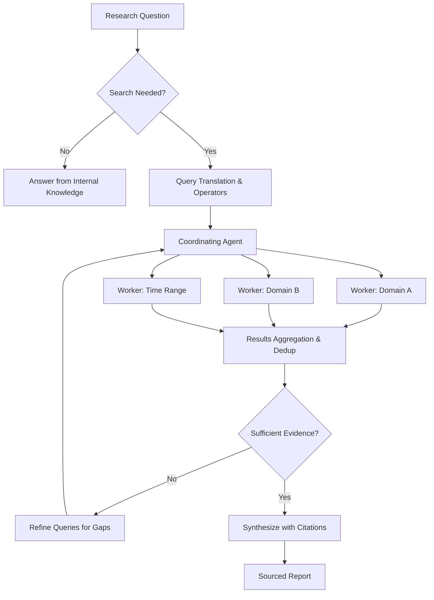

## Problem

Traditional research methods and static retrieval systems cannot adapt search strategy based on emerging results. Complex research tasks need multi-round investigation, cross-source synthesis, and dynamic strategy adjustment.

The same gap appears in question answering. A model with a training cutoff does not know recent facts, and simply connecting it to a search API is not enough. Something still has to:

- Decide when searching is necessary versus using internal knowledge
- Translate conversational context into effective search queries
- Find diverse, long-tail results rather than only popular pages
- Iterate and refine searches based on intermediate results
- Cite sources properly to build user trust and reduce hallucination

## Solution

Allow an AI agent to independently conduct the research process, ending only when its own criteria are met. Given a research question, the agent:

- Creates its own search queries through dynamic planning.
- Executes the searches across multiple sources.
- Examines the data and evaluates quality and relevance.
- Reflects on whether sufficient information has been gathered.
- Adjusts its search strategy based on findings and gaps.
- Repeats until satisfaction criteria or a step budget is reached.
- Synthesizes findings into a comprehensive, well-sourced report.

The key mechanism is a self-reflective iteration loop: after each search cycle, the agent evaluates results against its research goals and autonomously determines the next exploration direction. Production implementations typically combine four subsystems: planning (task decomposition), memory (context + vector store), action (tool orchestration), and reflection (quality evaluation).

**Coordinator and parallel search workers.** A common production shape splits the loop into two roles. A coordinating agent translates the question into search queries and fans out worker agents that run at the same time, then aggregates what they return:

1. **Query translation**: Extract keywords from conversational context (SERP APIs impose a 32 keyword limit) and rewrite natural language into standardized semantic expressions
2. **Operator selection**: Choose domain filters (one site, or one community), temporal filters (results from the last N months), and content-type filters
3. **Parallel fan-out**: Spawn worker agents that each search a different domain, angle, or time range, and use different query variations
4. **Deduplication and filtering**: The coordinator merges worker results, removes duplicates, and drops low-relevance snippets
5. **Reflection on gaps**: The coordinator identifies questions the findings raised but did not answer, and spawns more workers with narrower queries
6. **Cited synthesis**: Maintain a per-session index that ties each claim to its source, so the final report can cite properly

**Search depth follows need.** The source article describes three levels, analogous to autonomy levels: L1, where the model decides on its own when to search; L2, where the user explicitly triggers search; and L3, a multi-step iterative research mode for comprehensive coverage.

## How to use it

**When to implement:**

- Open-ended research requiring strategy adaptation and multi-source synthesis
- Assistants that need real-time information or factual, source-attributed answers
- Research tools that need diverse, long-tail web content

**Implementation considerations:**

- **Termination**: Define clear stopping conditions, either satisfaction-based or resource-limited, so the loop cannot run without end
- **Search API choice**: Classic SERP APIs (Google, Bing, DuckDuckGo) are optimized for humans. They curate a top-10 list rather than providing breadth, and some have deprecated advanced operators. Agent-native search APIs such as [Exa](https://exa.ai) and [Tavily](https://www.tavily.com) address this gap directly
- **Caching**: Consider a cached web index for quick retrieval, using search APIs primarily for URL discovery and then pulling content directly
- **Parallelization**: Web search is easily parallelizable; spawn multiple workers for speed
- **Search like a person**: Do not stop at the first result; check multiple sources and iterate with refined queries

**Combinations:** Pair with a reflection loop for self-correction, and with agentic RAG for document retrieval over private sources.

## Trade-offs

* **Pros:** Enables autonomous multi-round investigation; adapts strategy based on findings; produces comprehensive, well-sourced outputs; grounding in cited sources reduces hallucination; parallel workers keep latency manageable.
* **Cons:** Higher token cost; operators commonly estimate 5-10x versus single-round retrieval, though this is an estimate rather than a benchmarked figure. Increased latency from multiple LLM calls; external dependencies on search APIs; planning stability challenges; orchestration complexity adds states to debug; reliable tool calls require trained models.

## References

- Primary source: [36kr interview with Connie Fan and Danny Tarlow (Gemini team) on agentic coding and search](https://eu.36kr.com/en/p/3352908436796289) — Tarlow on how developers work in a large codebase: "You would use code search, look at the file structure, click around, read some code" and "The agentic model mimics this approach."
- [How AI web search works | Amplify Partners](https://www.amplifypartners.com/blog-posts/how-ai-web-search-works) - written by Justin Gage, published January 15, 2026; source for query translation, parallel workers, and the three search levels
- [Exa](https://exa.ai) and [Tavily](https://www.tavily.com) - agent-native search APIs that replace raw SERP integration
- [Building Effective Agents](https://www.anthropic.com/research/building-effective-agents) (Anthropic) — orchestrator and agent-loop patterns behind production research agents
- ReAct (Reasoning + Acting): Foundational pattern establishing the Thought → Action → Observation loop; Yao et al., Princeton University & Google Research, ICLR 2023, [arXiv:2210.03629](https://arxiv.org/abs/2210.03629)
- "The AI Scientist: Towards Fully Automated Open-Ended Scientific Discovery": Automated research lifecycle from idea generation to manuscript writing; Sakana AI + Oxford + UBC, arXiv:2408.06292, 2024
- "From AI for Science to Agentic Science: A Survey on Autonomous Scientific Discovery": Survey of autonomous research agents; Shanghai AI Lab, arXiv:2508.14111, 2025
- Tongyi DeepResearch: Open-source agent-driven research system; Alibaba Tongyi Lab, [arXiv:2510.24701](https://arxiv.org/abs/2510.24701), 2025; code at [Alibaba-NLP/DeepResearch](https://github.com/Alibaba-NLP/DeepResearch)
- [Retrieval-Augmented Generation (RAG) | Lewis et al., NeurIPS 2020](https://arxiv.org/abs/2005.11401)
- [Toolformer | Schick et al., NeurIPS 2023](https://arxiv.org/abs/2302.04761)
