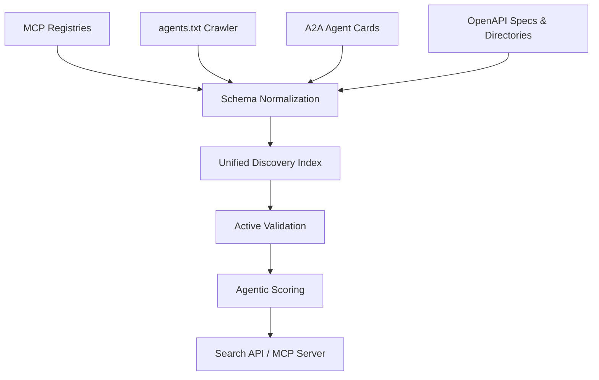

## Problem

Agent and tool discovery is spread across several mechanisms that do not reference each other:

- **MCP**: an official community registry (in preview since September 2025) coexists with earlier third-party directories, each with partial coverage
- **agents.txt**: a robots.txt-style convention, a plain-text file at `<origin>/agents.txt` that advertises which agent-facing protocols and features a site supports, with a machine-readable `agents.json` companion
- **A2A (Agent2Agent)**: an open protocol for agent discovery and collaboration, contributed by Google and now an open-source project under the Linux Foundation
- **OpenAPI specs and platform directories**: individual services describe themselves, and vendor marketplaces each keep their own listings

An agent listed in an MCP registry will not appear in an A2A agent card or an agents.txt file, and vice versa. Meanwhile, tool catalogs are hardcoded into system prompts or require a human to search documentation written for people. When an agent needs a capability it lacks, there is no programmatic search that returns structured, verified results across all of these surfaces. This is a discovery gap analogous to the web before meta-search engines.

## Solution

Build or use a search index designed for agent consumers that normalizes across registries and protocols. Key components:

1. **Registry crawling**: Periodically ingest listings from each registry via its API or structured feed
2. **Schema normalization**: Map each registry's metadata to a common record (name, description, base URL, capabilities, transport, endpoint, protocol, authentication type)
3. **Protocol tagging**: Label each entry with its supported protocol or protocols, enabling cross-protocol search and comparison
4. **Machine-readable search API**: A REST or MCP endpoint that returns structured JSON rather than HTML
5. **Agentic scoring**: Rank results by agent-relevant signals rather than SEO metrics: API uptime, documentation completeness, MCP compliance, response latency, schema availability
6. **Validation**: Actively probe endpoints to confirm they respond correctly, support claimed protocols, and return valid schemas, instead of trusting self-reported metadata
7. **Protocol-native access**: Expose search through the same protocols agents already speak (MCP JSON-RPC, REST with OpenAPI spec, `llms.txt`), so discovery does not need a different integration path than usage

```pseudo
agent_needs("calendar integration")
  → query tool_discovery_index("calendar API", filters={protocol: "mcp"})
  → receive [{name: "cal-service", url: "...", auth: "api_key", mcp_verified: true, score: 92}]
  → agent evaluates candidates by score, protocol match, auth requirements
  → agent connects to top candidate directly
```



The workflow replaces the human loop of "search Google, read docs, evaluate, integrate" with a single programmatic query that returns agent-ready results. As of October 2026 we could not verify a neutral, cross-registry implementation of the full aggregation architecture, so treat that part as a proposal built from the listed protocol sources.

## How to use it

**Best for:**

- Autonomous agents that need to acquire new capabilities at runtime without human guidance
- Agent orchestrators that route tasks to specialized tools or agents based on capability matching, across protocol boundaries
- Developer tooling where agents suggest or auto-configure integrations, or IDEs and CLIs surface agents without the developer knowing which registry hosts them

**Implementation considerations:**

- Index at minimum: service name, description, base URL, supported protocols, authentication method, and a machine-parseable capability schema
- Build on the official MCP Registry API where possible instead of crawling ad hoc: it already provides standardized `server.json` metadata, DNS-verified namespaces, and a REST API designed for clients and aggregators
- Start with the highest-coverage registries for your use case and expand incrementally
- Use incremental sync with per-registry rate limits rather than full re-crawls, and cache normalized metadata with TTLs matched to each registry's update frequency
- Active verification (probing endpoints, validating MCP handshakes) improves result quality over passive catalogs
- Expose discovery via the same protocol the tools use: if indexing MCP servers, offer discovery as an MCP server itself so agents can discover other agents programmatically
- Publish `llms.txt` and OpenAPI specs at well-known URLs so agents can find the discovery service

**Relationship to other patterns:**

- Extends [Static Service Manifest for Agents](static-service-manifest-for-agents.md): manifests describe a single service; this pattern indexes across many services
- Complements [Progressive Tool Discovery](progressive-tool-discovery.md): this pattern finds candidates; progressive discovery handles runtime detail-loading after selection

## Trade-offs

**Pros:**

- Removes the human from the tool-selection loop entirely
- Structured results eliminate HTML parsing and prompt-injection risks from web scraping
- One search surface for every protocol, so it adapts as protocols emerge or fade and reduces lock-in to any single registry
- Verification filters out dead or non-compliant services before the agent wastes calls
- Protocol-native access means zero additional integration work for agents already using MCP or REST

**Cons:**

- Requires a maintained index with active crawling and verification, plus a crawler per registry; not free to operate
- Aggregation adds latency over direct registry queries, and stale data is a risk if registries update faster than sync cycles
- Schema normalization loses protocol-specific metadata
- Coverage depends on index breadth; niche or private tools may not be indexed
- Discovery does not equal trust: the index verifies listing accuracy, not agent quality, and agents must trust the index operator's scoring methodology
- Adds a dependency; if the discovery service is down, agents cannot find new tools

## References

- [The MCP Registry](https://modelcontextprotocol.io/registry/about) — primary source: the official centralized metadata repository for public MCP servers, backed by Anthropic, GitHub, Microsoft, and PulseMCP. Provides `server.json` metadata, namespace verification, and a REST API for clients and aggregators (in preview).
- [MCP Registry repository](https://github.com/modelcontextprotocol/registry) — the official community-driven registry for MCP servers, in preview since September 2025, with its API in a v0.1 freeze since October 2025
- [Smithery](https://smithery.ai) — production registry that indexes MCP servers with structured metadata (descriptions, tools, auth, pricing); an example of the aggregator role the MCP Registry documentation describes
- [agents.txt](https://agents-txt.com) — the agents.txt convention: a well-known file that advertises supported agent protocols (MCP, A2A, payments, and others) with an `agents.json` machine-readable companion. It documents one discovery layer this pattern aggregates, not the aggregation itself
- [A2A Protocol](https://github.com/a2aproject/A2A) — open agent-to-agent protocol repository, an open-source project under the Linux Foundation (contributed by Google)
- [Introducing the Agents API (OpenAI, October 2026)](https://openai.com/index/introducing-the-agents-api) — adjacent 2026 evidence: a managed service whose built-in tool search loads relevant tool definitions as needed at runtime. It manages definitions within one provider rather than cross-registry discovery.
- llms.txt community specification: https://llmstxt.org
- Model Context Protocol (MCP): https://modelcontextprotocol.io — background on the protocol, not on cross-registry aggregation
- An earlier revision linked agentsprotocol.ai for an "ACDP" specification; that domain no longer resolves, so it was removed
- Community example (author-affiliated): https://nothumansearch.ai
