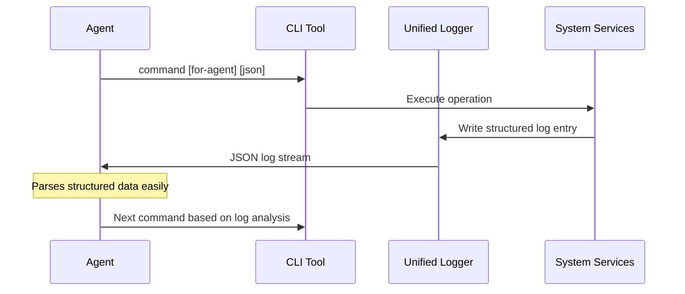

## Problem

Most developer tools, CLIs, and application logs are designed for human consumption. They use color-coded, multi-line, or summarized outputs that are easy for a person to scan but can be difficult for an AI agent to parse reliably. This "human-centric" design creates noise and ambiguity, forcing the agent to waste tokens and effort on interpreting output rather than acting on it.

## Solution

Consciously design and adapt tooling and logging to be "agent-first," prioritizing machine-readability over human ergonomics. The environment should cater to the agent's need for clear, structured, and unambiguous information.

- **Unified Logging:** Instead of multiple log streams (client, server, database), consolidate them into a single, unified log. This gives the agent a single source of truth to monitor.
- **Verbose, Structured Output:** Prefer verbose, structured formats like JSON lines over concise, human-readable text. An agent can parse structured data far more effectively and is not constrained by screen space. Use schemas like Pydantic (Python) or Zod (TypeScript) for type-safe structured outputs.
- **Agent-Aware CLIs:** Design new tools or add flags to existing tools (`--for-agent`, `--json`) that modify their output to be more explicit and less ambiguous for an AI. Assume the agent, not a human, is the primary consumer.
- **Standardized Tool Protocol:** Use the Model Context Protocol (MCP) as the standard interface for agent-tool communication. Introduced in 2024 and donated to the Linux Foundation's Agentic AI Foundation in December 2025, MCP provides a universal "USB interface for agents."
- **Code-First Tool Interface:** For complex workflows, LLMs generate code that calls tools rather than invoking them directly. Measured input-token reductions for code-mode tool calling range from 58.2% to 92.8% in Bifrost's benchmarks, because intermediate results stay in the execution environment instead of model context. See [Code-Over-API Pattern](code-over-api-pattern.md) for the full treatment.

This shift in design philosophy acknowledges that as agents perform more development work, the tools they use must adapt to serve them directly. An agent-friendly environment is a prerequisite for reliable and efficient agent performance.

## Example

## How to use it

1. **Audit Current Tools:** Identify tools that produce human-centric output and either find agent-friendly alternatives or add structured output flags
2. **Implement Unified Logging:** Consolidate multiple log sources into a single, structured stream that agents can monitor
3. **Create Agent-Aware APIs:** When building new tools, prioritize machine-readable output formats and clear, unambiguous responses
4. **Use Structured Formats:** Default to JSON, YAML, or other structured formats instead of free-form text output

## Trade-offs

- **Pros:**
  - Dramatically improves agent parsing accuracy and speed
  - Reduces token waste on output interpretation
  - Enables more reliable automation and decision-making
  - Single source of truth for system state

- **Cons/Considerations:**
  - May sacrifice human readability and debugging convenience
  - Requires investment in tooling modifications
  - Teams need to maintain both human and agent interfaces (dual-interface pattern)
  - Learning curve for developers used to human-centric tools
  - Code-first patterns require additional infrastructure (sandboxed execution)

## References

- Thorsten Ball's advocacy for agent-first tooling (one unified log stream instead of separate client, browser, and database logs, with JSON-line output the agent can parse) is the paraphrased source of the unified-logging bullet above; no verbatim, citable transcript of that passage could be located, so it is not quoted.

- From Kenton Varda, [Cloudflare Code Mode](https://blog.cloudflare.com/code-mode/) (September 26, 2025): "LLMs are better at writing code to call MCP, than at calling MCP directly."

- Model Context Protocol: https://modelcontextprotocol.io (de facto standard for agent-tool interface, 2024-2025)

- [Linux Foundation announces the Agentic AI Foundation](https://www.linuxfoundation.org/press/linux-foundation-announces-the-formation-of-the-agentic-ai-foundation) (December 9, 2025) - MCP stewardship moved to the Agentic AI Foundation, anchored by MCP, goose, and AGENTS.md contributions

- Measured code-mode token savings: [Bifrost Code Mode benchmarks](https://docs.getbifrost.ai/mcp/code-mode) (58.2% to 92.8% input-token reduction)

- Distinct from [Dual-Use Tool Design](dual-use-tool-design.md) (one interface for both audiences) and [LLM-Friendly API Design](llm-friendly-api-design.md) (API shape): this pattern is about tool output and logging being agent-consumable
