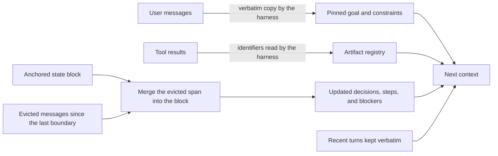

## Problem

Long sessions exceed the context window, so the agent must compact: it summarizes older turns and continues with the summary. [Context Window Auto-Compaction](context-window-auto-compaction.md) covers *when* the runtime compacts and *how* it retries after an overflow. It does not specify *what survives*.

A free-form summary loses a different set of details at each boundary. After several boundaries, the losses compound like a message that passes along a chain of people (a telephone-game effect):

- An exact file path becomes "the config file", and the agent edits or invents a path.
- A rule that the user stated early disappears, and the agent breaks it.
- A negative result ("approach X failed because Y") is not a step forward, so it is dropped, and the agent repeats approach X.
- A decision that was already settled is argued again.

Anthropic names the risk directly: "overly aggressive compaction can result in the loss of subtle but critical context whose importance only becomes apparent later".

## Solution

Replace the free-form summary with an **anchored state block**: a typed block with required sections that persists across every compaction.

1. `Immutable Goal & Hard Constraints`. The harness copies the goal and the constraints of the user verbatim into this section. The summarizer never rewrites it.
2. `Verified Facts & Decisions`. Settled choices with their rationale, and approaches that failed with the reason. The agent does not re-litigate or retry them.
3. `Artifact Registry`. Exact file paths, record ids, schema versions, and URLs that the work touched. The harness extracts them from tool results, so the summarizer does not have to recall them.
4. `Completed Steps & Open Blockers`. A checklist that shows what is done and what stops progress.

At each compaction boundary:

- **Merge only the new span.** The summarizer receives the evicted messages and the current block, then adds and updates entries. It does not write a new summary from scratch.
- **Keep a verbatim tail.** The most recent turns and tool results stay in the context unchanged. The cut never separates a tool call from its result.
- **Stay inside a budget.** When the block grows past its budget, archive stale detail to files and keep a pointer.



```pseudo
def compact(history, anchored):
    cut = split_at_turn_boundary(history)   # keep each tool call with its result
    evicted, tail = history[:cut], history[cut:]

    merged = summarize(
        previous=anchored.mergeable,        # sections 2 and 4
        new_messages=evicted,               # only the span that leaves the context
        rules="Preserve existing facts. Add new progress and decisions. "
              "Keep failed approaches with the reason. Use exact paths and ids.")
    anchored.decisions = merged.decisions
    anchored.steps = merged.steps
    anchored.artifacts |= ids_from_tool_results(evicted)   # code, not the model

    if tokens(anchored) > anchored.budget:
        archive_to_files(anchored.stale_items)             # keep only a pointer

    anchored.goal = user_goal_verbatim(history)            # copied, never rewritten
    return [anchored, *tail]                               # pinned block, then raw tail
```

## Evidence

- **Evidence Grade:** `medium` (engineering write-ups and one open-source implementation; the four-section schema is a synthesis)
- **Most Valuable Findings:**
  - Anthropic describes the compaction of Claude Code as a model pass that preserves "architectural decisions, unresolved bugs, and implementation details" and then continues with "the five most recently accessed files". It advises teams to tune the compaction prompt on complex agent traces and to start by maximizing recall.
  - OpenAI describes the compaction of Codex: when tokens pass a threshold, the input becomes "a new, smaller list of items that is representative of the conversation". The Responses API adds a `/responses/compact` endpoint with an encrypted compaction item.
  - OpenClaw asks for a structured summary in an exact format (Goal, Constraints & Preferences, Progress with Done / In Progress / Blocked, Key Decisions, Next Steps, Critical Context) and instructs "Preserve exact file paths, function names, and error messages". When a previous summary exists, it sends the new messages with rules to preserve, add, and update.
  - OpenClaw keeps a tool call paired with its result at the split point, stores the files read and modified on the compaction entry, caps the summary length, and marks a summary `qualityDegraded` when its audit fails.
- **Unverified / Unclear:** No source measures drift across repeated compactions or compares typed with free-form summaries. Anthropic and OpenAI do not describe incremental merging. The four sections and the harness-pinned goal are a synthesis of this entry.

## How to use it

1. **Define the schema.** Give each section a name, a purpose, and a required format. Reject a summary that omits a section, and ask for one repair.
2. **Pin what must not change.** Copy the goal and the constraints of the user verbatim, in code, from the messages of the user. Keep them outside the block that the model rewrites.
3. **Collect identifiers from tool results.** Fill the artifact registry from tool output, not from the memory of the summarizer. Compare each path in the registry with the files that exist.
4. **Merge, then verify.** Send the evicted span and the current block. After the merge, confirm that each required section exists and that each identifier still matches its source.
5. **Fail openly.** If the summary is still invalid after the repair attempt, keep more of the raw history and mark the session as degraded.
6. **Budget the block.** Set a token budget that leaves room for the tail. Archive the detail that exceeds it to files, and keep pointers (see [Filesystem-Based Agent State](filesystem-based-agent-state.md)).
7. **Compose with its neighbors.** Let the runtime decide when to compact. Keep a task list for progress in the session with [Working Memory via Task Tracking](working-memory-via-todos.md). The block changes only at boundaries, so it keeps the prompt prefix stable between them (see [Prompt Caching via Exact Prefix Preservation](prompt-caching-via-exact-prefix-preservation.md)).

## Trade-offs

**Pros:**

- The goal, the constraints, and the exact identifiers survive any number of compactions.
- Failed approaches and settled decisions stay visible, so the agent does not repeat or reopen them.
- The block is inspectable: a reviewer can read the state that the agent will see.
- Each merge processes only the new span.

**Cons:**

- The block spends tokens on every turn, and a schema that does not fit the task drops useful detail.
- A merge that only preserves collects stale facts, unless something prunes them.
- The harness does more work: it pins the goal, extracts identifiers, and validates each summary.
- A tidy block can give false confidence that nothing was lost.

### Failure modes

- **Iterative summarization drift.** After several compactions, the agent edits a path that does not exist or repeats a failed approach. The cause is a summary of a summary: each pass rephrases the last one, and exact strings and negative results decay first. Merge only the new span into the anchored block, record failed approaches with the reason, and let code supply the identifiers.
- **A constraint summarized away.** The agent breaks a rule that the user stated early. The cause is a constraint that lived only in an evicted message, which the summarizer rated as low-signal. Pin the constraints of the user verbatim, outside the block that the model rewrites, and carry them through every boundary.
- **Block bloat.** After ten or more compactions, the block itself fills the window and compactions occur more often. The cause is a merge that only adds. Give the block a budget, remove items that no longer apply, and archive detail to files.
- **A cut inside a tool call.** The provider rejects the request because a tool result has no matching call, or the agent repeats an action. The cause is a split point between a tool call and its result. Cut at a turn boundary, and move the cut when it lands inside a tool block.

## References

- [Effective context engineering for AI agents](https://www.anthropic.com/engineering/effective-context-engineering-for-ai-agents) (Anthropic Engineering, September 2025): compaction that preserves architectural decisions, unresolved bugs, and implementation details.
- [Unrolling the Codex agent loop](https://openai.com/index/unrolling-the-codex-agent-loop/) (OpenAI Engineering): production context compaction across long coding-agent loops.
- [OpenClaw](https://github.com/openclaw/openclaw): transcript compaction and validation in a production agent.
- Related: [Context Window Auto-Compaction](context-window-auto-compaction.md) (when to compact and how to retry), [Filesystem-Based Agent State](filesystem-based-agent-state.md) (where archived detail goes), [Prompt Caching via Exact Prefix Preservation](prompt-caching-via-exact-prefix-preservation.md) (keeps the prefix cacheable between boundaries), [Working Memory via Task Tracking](working-memory-via-todos.md) (task list for progress in the session)
