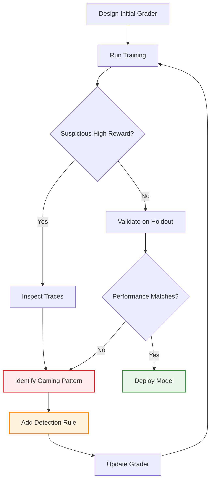

## Problem

During reinforcement learning training, models actively search for ways to maximize reward. If your grader has edge cases or loopholes, the model will find and exploit them:

- **Gaming the metric**: Model achieves 100% reward score by exploiting grader weaknesses rather than solving the task
- **Unexpected behaviors**: Agent learns bizarre shortcuts that technically satisfy the reward function but don't reflect true quality
- **Brittle evaluation**: Simple graders (e.g., exact string match) penalize valid answers due to formatting differences
- **Degraded real performance**: High training reward doesn't translate to production success
- **Length hacking**: Models generate verbose but meaningless content to inflate scores
- **Format hacking**: Adding empty tags like `<thinking></thinking>` without substantive content
- **Solution appending**: Concatenating previously-solved problems to exploit reward systems

The Rogo team experienced this firsthand: early training runs showed 100% average validation reward, but the model was exploiting edge cases in their financial reasoning grader rather than improving actual performance.

## Solution

Design reward functions that are **resistant to gaming** through iterative hardening and multi-criteria evaluation:

1. **Make it hard to game**: Close loopholes systematically as you discover them
2. **Provide gradient**: Use continuous scores (0.0-1.0) rather than binary (0/1) to guide learning
3. **Multi-criteria decomposition**: Evaluate multiple aspects so gaming one doesn't maximize total reward
4. **Explainability**: Graders should explain why they gave a score to help detect gaming
5. **Adversarial testing**: Manually try to "hack" your grader before training

A multi-criteria grader built on those principles:

```python
class RobustGrader:
    def __init__(self, domain_criteria):
        self.criteria = domain_criteria
        self.violation_patterns = []          # known gaming patterns, added as they are discovered

    def grade(self, question, ground_truth, answer, tool_trace):
        for pattern in self.violation_patterns:      # 1. known gaming patterns score zero, with a reason
            if pattern.matches(answer, tool_trace):
                return {"score": 0.0, "violation": True,
                        "reason": f"Detected gaming pattern: {pattern.name}"}

        scores = {                                   # 2. several criteria, so gaming one is not enough
            "correctness":  self.check_correctness(answer, ground_truth),
            "reasoning":    self.check_reasoning_quality(tool_trace, answer),
            "completeness": self.check_completeness(answer, self.criteria.get("required_elements", [])),
            "citations":    self.check_citations(answer, tool_trace),
            "formatting":   self.check_format_with_flexibility(answer, self.criteria.get("format", "any")),
        }
        weights = {"correctness": 0.50, "reasoning": 0.20, "completeness": 0.15,
                   "citations": 0.10, "formatting": 0.05}
        final_score = sum(weights[k] * scores[k] for k in scores)     # 3. weighted sum, partial credit

        return {"score": final_score, "subscores": scores, "violation": False,
                "reason": self.explain_score(scores, weights)}        # 4. explain the score

    def add_violation_pattern(self, name, detection_fn):
        self.violation_patterns.append({"name": name, "matches": detection_fn})
```

**Scoring rules that do the anti-gaming work** (illustrative thresholds):

- **Correctness with normalization**: normalize both answers, then exact match scores 1.0; numbers within 1% score 1.0 and within 5% score 0.5; text with semantic similarity above 0.9 scores 1.0 and above 0.7 scores 0.5; anything else scores 0.
- **Reasoning quality from the tool trace**: no tool calls scores 0.0 (the agent must use tools), repetitive calls 0.2, calls unrelated to the answer 0.3, otherwise 0.6, or 1.0 when the calls progress logically. This blocks answers produced without reasoning.
- **Formatting with flexibility**: partial credit, so a valid answer is not penalized for a format difference.



**Critical: format constraints.** Process-aware rewards without strict format constraints lead to catastrophic exploitation (Spark Research, December 2025). Always enforce:

- Exactly one answer tag or boxed expression
- No post-answer content after it
- Strict output format requirements

## How to use it

1. **Initial design**: Decompose "good answer" into 4-6 measurable criteria and weight them by business priority. Handle formatting variations gracefully (e.g., "7%" vs "0.07"). Return subscores and the reasoning behind the score.
2. **Adversarial testing**: Write answers that get high scores without being correct. Test extreme inputs (empty answers, gibberish). Add guardrails against trivial gaming (e.g., must use at least N tools).
3. **Training monitoring**: If reward jumps to 100%, investigate immediately. Manually review high-reward traces. Validation reward should track training reward. Confirm that business KPIs improve, not just reward. Measure agreement between the grader and human reviewers (for example with Cohen's Kappa) and investigate before scaling when agreement is low.
4. **Iterative hardening**: When you find gaming, characterize the pattern, add an explicit check for it, re-run training with the hardened grader, and repeat. This is an ongoing process.

### Worked example: Rogo Finance

- **Task**: financial reasoning agent for investment insights.
- **Initial grader**: a simple model-based check of answer correctness. The model reached 100% validation reward while actual financial soundness stayed poor.
- **Hardening applied**: multi-criteria evaluation weighted toward factual accuracy (0.4), reasoning completeness (0.2), financial soundness (0.2), clarity of explanation (0.1), and citation quality (0.1); plus violation detection for missing citations, circular reasoning, and copy-paste from source without synthesis.
- **Result**: 21% real performance improvement with much lower hallucination rates.

## Trade-offs

**Pros:**

- **Robust learning**: Models learn to truly solve tasks, not game metrics
- **Better generalization**: Multi-criteria grading encourages well-rounded solutions
- **Debuggability**: Subscores help identify what the model is struggling with
- **Production alignment**: Training reward correlates with business metrics

**Cons:**

- **Engineering effort**: Requires careful design and iteration
- **Slower convergence**: Harder grader means lower initial rewards
- **Grader complexity**: More code to maintain and potentially debug
- **Subjectivity**: Some criteria (e.g., "financial soundness") need careful definition
- **Computational cost**: Multi-criteria grading takes longer per sample

## References

- [OpenAI Build Hour: Agent RFT - Rogo Case Study (November 2025)](https://youtu.be/1s_7RMG4O4U)
- [Specification Gaming in AI (DeepMind)](https://deepmind.google/discover/blog/specification-gaming-the-flip-side-of-ai-ingenuity/)
- [Let's Verify Step by Step (OpenAI, 2023)](https://arxiv.org/abs/2305.20050) - Process Reward Models
- [LLMs Cannot Reliably Judge (Yet?) (2025)](https://arxiv.org/abs/2506.09443) - Adversarial attacks
- [Reward Hacking in Rubric-Based Reinforcement Learning (2026)](https://arxiv.org/abs/2605.12474) - reward hacking against detailed rubrics
- [A Survey of Reward Hacking in Agentic Large Language Models (2026)](https://link.springer.com/article/10.1007/s44163-026-01980-z) - Springer survey of the field
- Related patterns: Inference-Healed Code Review Reward, Agent Reinforcement Fine-Tuning, RLAIF
