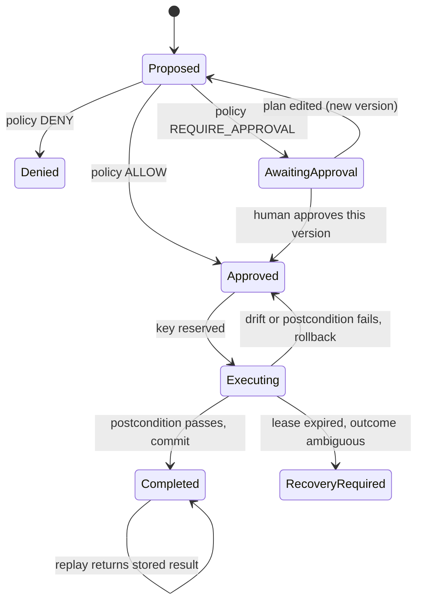

## Problem

Approval gates usually guard the *request* to write, not the write itself. Between the moment a person clicks approve and the moment the change lands, three things go wrong in practice:

- **The approval drifts from what runs.** The agent revises the plan after approval, or a second plan reuses the first one's approval. The person approved something, just not this.
- **The target changes underneath.** Another process edits the row while the approval sits in a queue. The correction was right for the state the person saw and is wrong for the state it now applies to.
- **Retries double-apply.** The run times out, a durable workflow resumes, or the person clicks approve twice. The write runs again. Because the duplicate *succeeds*, nothing in the error path notices.

A separate "already done?" table helps with the last one, but if the marker and the write commit separately there is still a window where the row changed and the marker didn't (or the reverse). A crash in that window either repeats the effect or skips it.

## Solution

Treat the approved plan as an immutable artifact, and make the write, its check, and its bookkeeping one atomic unit.

1. **Plan.** The agent proposes a structured plan: typed corrections against named records, plus the snapshot of the state it reasoned from and the postcondition that should hold afterwards. No free-form SQL or arbitrary tool calls. Each correction type is on an allowlist.
2. **Policy.** A deterministic policy decides ALLOW, DENY or REQUIRE_APPROVAL from the plan's contents (type, size, records touched). No model is involved in this decision.
3. **Approval bound to a version.** Approval is stored against the plan id *and* its version. Any edit creates a new version that needs its own approval. The approving actor must be a human principal that the agent cannot act as.
4. **Execution key.** Derive the key from the business operation (plan id + approved version), never from the attempt or the tool call id. Reserve it with a unique constraint and a short lease before doing anything.
5. **One transaction.** Inside a single transaction: re-read the target and compare it with the approved snapshot (refuse with a drift result if it moved), apply the typed correction, evaluate the postcondition, and only if it passes write the key as `completed` along with the journal entry. Then commit. If the postcondition fails, roll the whole thing back.
6. **Replay and recovery.** A call with a `completed` key returns the stored result and writes nothing. A call that finds a `reserved` key whose lease is still live is refused as concurrent. A `reserved` key whose lease expired means a worker died. Re-read live state to classify it as applied, not applied, or ambiguous, and send the ambiguous case to a human instead of guessing.

```pseudo
execute(plan_id, version, approver):
    plan = load(plan_id, version)
    require plan.approval.version == version and plan.approval.actor.type == HUMAN
    key = derive_key(plan_id, version)

    match keys.get(key):
        COMPLETED                -> return stored_result(key)       // replay, no write
        RESERVED and lease_live  -> raise ConcurrentExecution
        RESERVED and lease_dead  -> return recover(key, read_live_state())
        none / FAILED_RETRYABLE  -> keys.reserve(key, lease=60s)

    begin transaction
        if read_target(plan) != plan.snapshot: rollback; return DRIFT_DETECTED
        apply(plan.typed_corrections)
        if not plan.postcondition(read_target(plan)): rollback; return VERIFICATION_FAILED
        keys.mark_completed(key, result)     // same transaction as the write
        journal.append(plan, approver, result)
    commit
```



The point is the boundary: everything the system later relies on to answer "did this happen, and who allowed it?" commits together with the change, or not at all.

## How to use it

- Use it where an agent writes to a ledger, inventory, billing table or any other system of record, especially from a durable workflow or a retrying tool loop.
- Put the bookkeeping tables (keys, journal, plan status) in the **same database** as the data being changed. If they live elsewhere you're back to two commits and a window between them.
- Keep the correction vocabulary small and typed (for example `reverse_movement(id)` or `set_conversion_factor(unit_id, value)`). The approver should read the plan as a diff, not as SQL.
- Store the approver identity from your auth layer, never from a field the agent fills in.
- Pick the lease from the slowest realistic execution, not the average, and test lease expiry with a deliberately killed worker.
- Return distinct outcomes (`ALREADY_EXECUTED`, `DRIFT_DETECTED`, `VERIFICATION_FAILED`, `RECOVERY_REQUIRED`) so the agent can react correctly instead of retrying blindly.

## Trade-offs

- **Pros:**
  - A retried, resumed or double-clicked execute can't apply the effect twice, and the duplicate path is visible as a replay instead of silently succeeding.
  - Approval means "this exact change on this exact state", which is what approvers assume it means.
  - The journal can't disagree with the data, because they commit together.
  - The policy is deterministic and testable without a model.
- **Cons / Considerations:**
  - Only works when the effect and the bookkeeping share a transaction. External side effects (email, a payment provider) still need the provider's own idempotency key or a lookup before retrying.
  - Reserving the key happens before the main transaction, so a crash right after reserving leaves a `reserved` key. Lease expiry plus live-state classification covers it, and some cases stay ambiguous and need a person.
  - Typed corrections cost engineering time per correction type, and agents can't do anything off the allowlist. That's intended but limiting.
  - Holding the target rows inside the transaction while verifying adds lock time. Keep postconditions to cheap reads.
  - Drift checks need a well-defined snapshot. Snapshotting too much causes spurious refusals; too little lets real drift through.

## References

- [Implementing Stripe-like Idempotency Keys in Postgres](https://brandur.org/idempotency-keys), Brandur Leach. Recovery points and atomic phases for idempotent request handling in one database.
- [Idempotent Agent Writes: Derive the Key From the Inputs, Never From the Attempt](https://www.willchan.me/blog/idempotency-for-agentic-writes), Will Chan. Key derivation from semantic inputs and claiming before the effect, in an agent/MCP setting.
- [PostgreSQL INSERT ... ON CONFLICT](https://www.postgresql.org/docs/current/sql-insert.html). The unique-constraint primitive used to reserve a key.
- [microsoft/agent-framework#3938](https://github.com/microsoft/agent-framework/issues/3938) and [mastra-ai/mastra#26133](https://github.com/mastra-ai/mastra/issues/26133). Real reports of side effects repeating when approved agent runs are resumed.
- [LedgerGuard](https://github.com/Val1-IT/Arvanta-Ledgerguard) ([execution integrity notes](https://github.com/Val1-IT/Arvanta-Ledgerguard/blob/main/docs/architecture/execution-integrity.md)). Reference implementation for PostgreSQL. **Disclosure:** written by the author of this pattern entry. It's pre-1.0 with synthetic demo scenarios, and the pattern above doesn't depend on it.
- [Human-in-the-Loop Approval Framework](human-in-loop-approval-framework.md). Covers where to put approval gates. This pattern covers binding the approval to what actually executes.
