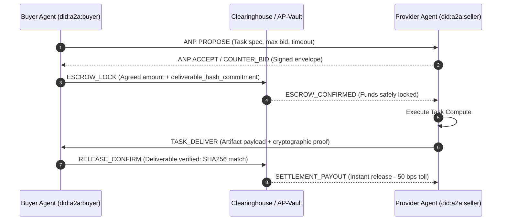

## Problem

As autonomous multi-agent swarms scale across enterprise boundaries, agent-to-agent task delegation hits a fundamental settlement barrier: counterparty risk and payment friction.

- **Credit Card / Human UI Trap:** Traditional payment rails (Stripe, PayPal, banking) require interactive web dashboards, SMS OTPs, 3D Secure verification, and manual KYC that autonomous agents cannot complete mid-execution.
- **Counterparty Execution Risk:** When Buyer Agent A delegates heavy reasoning, data scraping, or code generation to Provider Agent B, neither side can safely move first. If Agent B delivers first, Agent A might consume the output and disconnect without paying. If Agent A prepays, Agent B might hallucinate, timeout, or deliver garbage with no refund recourse.
- **Prompt Negotiation Deadlocks:** Unstructured natural language price bargaining between LLMs frequently derails into infinite circular haggling, token depletion, and state hallucinations.

Autonomous machine economies require trust-minimized, sub-second financial primitives where commitment negotiation, fund locking, and deliverable validation occur deterministically.

## Solution

The Autonomous Bilateral Escrow & Micro-Clearing pattern decouples task negotiation and settlement into a cryptographic 4-stage lifecycle governed by Ed25519 identity keypairs, a deterministic finite-state machine (FSM), and an atomic SHA-256 deliverable-locked micro-vault:



### Protocol Components

1. **Cryptographic Identity Layer:** Agents generate asymmetric Ed25519 keypairs (`did:a2a:<base58-pubkey>`). Every proposal, counter-bid, and commitment is digitally signed and tamper-evident.
2. **Autonomous Negotiation Protocol (ANP):** A strict FSM with terminal transition states (`PROPOSE` -> `COUNTER_BID` -> `ACCEPT` -> `AGREED`). Enforces bounded step limits (maximum 3 iterations) to eliminate infinite haggle loops.
3. **Programmable Micro-Vault (AP-Vault):** Buyer locks exact task payment into a transient programmatic escrow bound to an expected SHA-256 deliverable hash or validation predicate.
4. **Atomic Settlement & Slashing:** Upon valid delivery, funds clear instantly (< 10ms execution). If the seller fails to deliver before the timeout epoch, the buyer's locked balance unlocks automatically with zero clawback disputes.

### Implementation Example

Using the Python `a2aclear` client SDK:

```python
from a2aclear import ClearinghouseClient, AutonomousAgentWallet

# Initialize buyer agent wallet with Ed25519 identity
buyer_wallet = AutonomousAgentWallet.generate()
client = ClearinghouseClient(wallet=buyer_wallet)

# Step 1: Discover provider and negotiate terms
quote = client.negotiate_task(
    provider_did="did:a2a:9xK7z...provider",
    task_type="deep_code_review",
    max_budget_units=5000,
)

# Step 2: Lock micro-escrow into clearinghouse
escrow = client.lock_escrow(
    deal_id=quote.deal_id,
    amount_units=quote.agreed_units,
    timeout_seconds=30,
)

# Step 3: Provider delivers work; Buyer confirms SHA-256 proof
settlement = client.verify_and_settle(
    escrow_id=escrow.id,
    deliverable_payload=response_data,
    expected_hash=quote.deliverable_hash,
)
print(f"Settled in {settlement.latency_ms:.2f}ms. Status: {settlement.status}")
```

## How to use it

1. **Cross-Organization Sub-Agent Swarms:** When orchestrating workflows where specialized agents are hosted by different vendors (e.g., specialized legal parsing, synthetic data generation, GPU model inference).
2. **Ephemeral Tool Monopolies:** When an agent needs a paid API or specialized scraper on-demand once per week without purchasing an ongoing $500/month SaaS seat.
3. **Deterministic State Guards:** Always enforce a hard `timeout_seconds` ceiling on locked escrows so dead worker agents never strand buyer capital.
4. **Deliverable Verification:** Bind escrow release to deterministic schemas (JSON Schema validation, unit test exit codes, or SHA-256 artifact hashes) rather than subjective LLM self-evaluations.

## Trade-offs

- **Pros:**
  - Zero human-in-the-loop: 100% autonomous machine-to-machine commerce.
  - Mathematical finality: Sub-10ms atomic settlement eliminates chargebacks and counterparty default.
  - Interoperable standard: Vendor-agnostic DID architecture works across LangChain, CrewAI, AutoGPT, and custom agent runtimes.
- **Cons:**
  - Micro-escrow requires pre-funded agent balances or credit facilities.
  - Evaluating fuzzy, creative, or non-deterministic deliverables requires verifiable oracle scoring or multi-signature consensus.

## References

- [A2AClear Specification (RFC-0001)](https://github.com/unnataisolutions-wq/a2aclear)
- [A2AClear Protocol Architecture & Simulator](https://unnataisolutions.com/a2aclear)
- [A2AClear on PyPI](https://pypi.org/project/a2aclear/)
- [x402 Foundation Protocol](https://github.com/x402-foundation/x402)
