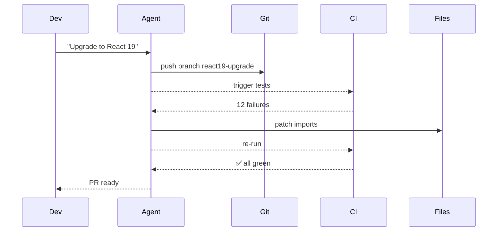

## Problem

Long-running refactors and flaky-fix cycles force developers into synchronous supervision. When the agent must wait on tests, build jobs, and deployment checks, human attention gets wasted on polling instead of decision-making. This bottleneck is worse in distributed teams where CI feedback arrives minutes later and context-switch cost is high.

## Solution

Run the agent asynchronously in the background with CI as the objective feedback channel. The agent pushes a branch, waits for CI results, patches failures, and repeats until policy-defined stopping conditions are met. Users are only pulled back in for approvals, ambiguous failures, or final review.

Production implementations include GitHub Agentic Workflows, Cursor Background Agent, and OpenHands. On the Amp side this shows up as Orbs: cloud machines per thread that keep working after you disconnect ([Amp Orbs docs](https://ampcode.com/docs/orbs)). Distinct from [Coding Agent CI Feedback Loop](coding-agent-ci-feedback-loop.md), which is about designing the agent and repo so CI output is usable feedback; this pattern is about running the whole retry loop unattended in the background.

Key mechanics:
- Branch-per-task isolation (often via cloud-based execution or git worktrees).
- CI log ingestion into structured failure signals.
- Partial feedback: start patching from early failure subsets before the full suite finishes.
- Retry budget and stop rules to avoid infinite churn.
- Notification on terminal states (`green`, `blocked`, `needs-human`).

## Example (flow)

## How to use it

- Start with deterministic tasks: dependency upgrades, lint migrations, flaky test triage.
- Define retry budgets (`max_attempts`, `max_runtime`) and escalation triggers.
- Use safe defaults: read-only permissions where possible, draft PRs for AI-generated changes.
- Keep artifact links in notifications so humans can review failures quickly.
- Gate merge on CI plus at least one human approval for high-risk repos.
- Consider durable execution mechanisms (Temporal, LangGraph) for long-running tasks.

## Trade-offs

* **Pros:** Better developer focus, lower waiting time, and tighter CI-driven iteration loops.
* **Cons:** Requires robust task lifecycle management, failure triage logic, and notification discipline.

## References

* [Raising An Agent - Episode 6 (May 2025)](https://ampcode.com/podcast/episode-6) - Background agents use existing CI as the feedback loop.
* [GitHub Agentic Workflows public preview (June 2026)](https://github.blog/changelog/2026-06-11-github-agentic-workflows-is-now-in-public-preview) - Agents run within GitHub Actions with safety controls, automating tasks such as issue triage and CI failure analysis. Technical preview announced [February 2026](https://github.blog/changelog/2026-02-13-github-agentic-workflows-are-now-in-technical-preview).
* [Amp Orbs](https://ampcode.com/docs/orbs) - Background execution model: one cloud machine per thread that keeps working after you disconnect.
* OpenHands - Open-source agent platform with background/cloud execution support.

[Source](https://ampcode.com/docs/orbs)
