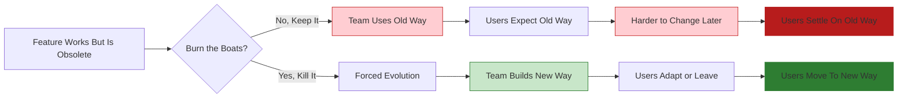

## Problem

In fast-moving AI development, holding onto features or workflows that are "working fine" prevents teams from fully embracing new paradigms. The comfort of existing functionality becomes an anchor that holds back innovation—even when you know the old approach is obsolete.

## Solution

**Burn the boats: intentionally kill features and workflows** to force evolution and prevent being stuck on old paradigms. Set hard deadlines for feature removal to create urgency and commitment to the new way.

**Historical context:** The earliest documented instance is Xiang Yu (207 BC) at the Battle of Julu, who sank boats and broke cauldrons (破釜沉舟) to force victory against superior Qin forces. The phrase is popularly associated with Hernán Cortés (1519 AD), who destroyed his ships upon arriving in Mexico, eliminating any possibility of retreat.

**Academic foundation:** Thomas Schelling's *The Strategy of Conflict* (1960) formalized this as "credible commitment"—restricting options makes threats believable and creates strategic commitment.

**In AI product development:** This means removing features that still work—features users still love—to prevent being stuck on the wrong trajectory. Note: Production AI systems typically reject "no fallback" approaches in favor of bounded autonomy with human oversight. This pattern is most relevant as a product/organizational strategy, not a technical agent safety pattern.



**Real example from AMP:**

AMP announced they are killing their editor extension — the old sidebar-based VS Code extension — roughly 60 days out, and encouraged users to switch to the Amp CLI in the meantime. The target is the obsolete sidebar-based extension, not editor users; the hosts say they do not yet know what will replace it. Cursor is never mentioned in the episode:

> "We will be killing our editor extension. We're going to be killing it because we think it's no longer the future. We think the sidebar is dead."

> "We really strongly encourage you in the meantime to switch to the Amp CLI."

**Why not just deprioritize it?**

> "It's just a focus thing for us. We can't do that without taking our eye off the thing that you all think is 100 times more important."

If you keep the old feature around:
- Users will keep using it
- You'll feel pressure to maintain it
- Your team splits attention between old and new

## How to use it

**Signs it's time to burn the boats:**

1. **The paradigm has shifted**: The fundamental approach has changed (e.g., assistant → factory)
2. **It limits your users**: The feature holds users back from better ways of working
3. **It splits your focus**: Maintaining it distracts from the truly important work
4. **Your future users won't use it**: "The 1% of developers that want to be most ahead" need the editor for a shrinking share of their work
5. **You're only keeping it for comfort**: Not because it's strategically important

**Implementation:**

**1. Set a hard deadline:**

```yaml
feature_kill_plan:
  feature: "VS Code Extension"
  deadline: "~60 days from announcement"
  message: "Will self-destruct in approximately 60 days"
  migration_path: "Use the Amp CLI in the meantime"
  rationale: "We think the sidebar is dead"
```

**2. Give users migration guidance:**

- Explain WHY you're killing it
- Provide clear alternatives
- Encourage feedback on gaps
- Accept that some users may leave

**3. Communicate the rationale:**

From AMP's announcement:

> "All of the usage of Amp today, all the revenue we're doing, we have to totally re-earn that every three months."

**4. Accept user churn:**

Some users will leave. AMP accepts this and builds for the frontier:

> "We've always wanted Amp to be on the frontier... we want to exclusively make Amp for the people willing to put in that investment."

## Trade-offs

**Pros:**

- **Forces internal innovation**: No safety net, must build the new way
- **Signals commitment**: Shows users and team you're serious
- **Avoids split focus**: No resources diverted to maintaining obsolete features
- **Selects for the right users**: The frontier users you build for stay; AMP explicitly targets "the 1% of developers that want to be most ahead"
- **Prevents stagnation**: Can't get comfortable resting on laurels

**Cons:**

- **User churn**: Some users will leave (or stay on old versions)
- **Revenue impact**: Short-term revenue may decrease
- **Risk of being wrong**: What if the new way isn't actually better?
- **Team morale**: Some team members may resist killing their work
- **Competitive vulnerability**: Competitors may support the "old way" longer

**The self-destruct timer pattern:**

AMP implemented a literal self-destruct timer in their VS Code extension:

> "It will self-destruct in about 60 days from now. We don't know exactly when, we'll put a timer."

This creates urgency and inevitability. Users can't ignore it.

**When NOT to burn the boats:**

- The feature is core to your value proposition
- You don't have a clear alternative
- The new way is unproven and risky
- Your team isn't aligned on the change
- Killing it would destroy the business
- **Agent safety**: Giving agents irreversible operations with broad permissions ("God Agent" anti-pattern) creates catastrophic risk from prompt injection, context overflow, or cascading errors

**Related principle: Re-earn revenue every quarter**

AMP treats all current usage and revenue as something they must re-earn roughly every quarter. Burning boats is one expression of that mindset; the full principle is covered in [Frontier-Focused Development](frontier-focused-development.md).

## References

* [Raising an Agent, Season 1, Episode 10](https://www.youtube.com/watch?v=4rx36wc9ugw) - AMP (Thorsten Ball, Quinn Slack). The episode is untitled; "the assistant is dead, long live the factory" is the theme the hosts attribute to the preceding episode. Transcript: [ampcode.com/podcast/episode-10](https://ampcode.com/podcast/episode-10)
* Thomas Schelling, *The Strategy of Conflict* (1960) - Foundational work on credible commitment
* Cohen & Levesque, "Intention is Choice with Commitment" (1990) - Formal framework for AI agent commitment
* [Measuring Agents in Production (UC Berkeley, 2025)](https://arxiv.org/html/2512.04123v1) - Industry rejects "no fallback" for bounded autonomy
* Related: [Disposable Scaffolding Over Durable Features](disposable-scaffolding-over-durable-features.md), [Factory over Assistant](factory-over-assistant.md)
