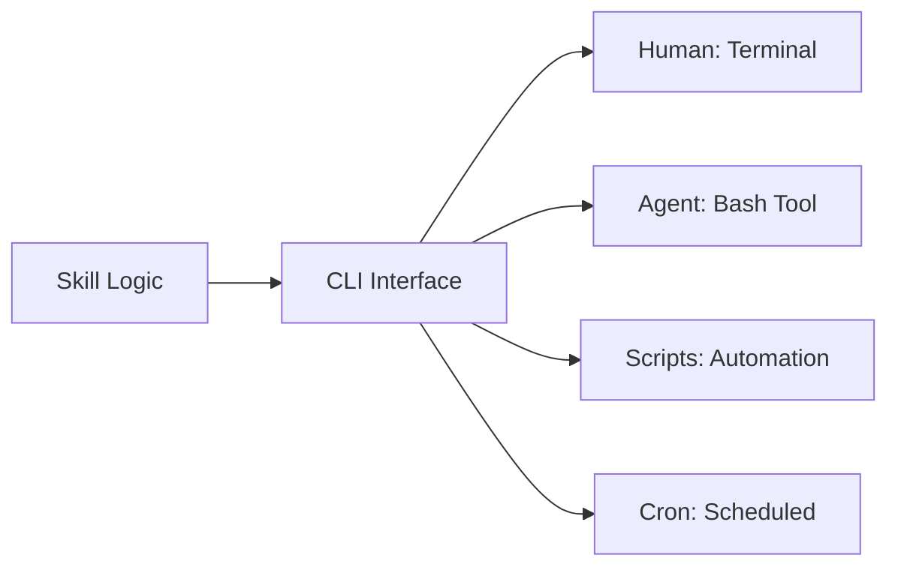

## Problem

When building agent skills (reusable capabilities), there's tension between:

- **API-first design**: Skills as functions/classes—great for programmatic use, but hard to debug and test manually
- **GUI-first design**: Skills as visual tools—easy for humans, but agents can't invoke them

Teams end up building two interfaces or choosing one audience over the other.

## Solution

Design all skills as **CLI tools first**. A well-designed CLI is naturally dual-use: humans can invoke it from the terminal, and agents can invoke it via shell commands.

The standardized **Agent Skills format** (a folder with a `SKILL.md` file plus optional `scripts/`, references, and assets) defines the container: where the skill lives and how the agent discovers and loads it. The CLI-first rule in this pattern governs what you put in that container — bundled capabilities that behave like well-behaved Unix commands. The CLI-first framing itself is the contributing author's practice; the cited sources below document the skills format and agent tool design, not a published skills-as-CLI methodology.



**Core principles:**

1. **One script, one skill**: Each capability is a standalone executable
2. **Subcommands for operations**: `skill.sh list`, `skill.sh get <id>`, `skill.sh create`
3. **Structured output**: JSON for programmatic use, human-readable for TTY (auto-detect via `isatty()`)
4. **Exit codes**: 0 for success, 1 for errors, 2 for incorrect usage, 127 if not found
5. **Environment config**: Credentials via env vars, not hardcoded
6. **Default non-interactive**: Avoid prompts; provide `--yes` or `--force` flags instead

```bash
# Illustrative example: a Trello skill as a CLI (written for this pattern, not taken from a cited source)
trello.sh boards                    # List all boards
trello.sh cards <BOARD_ID>          # List cards on board
trello.sh create <LIST_ID> "Title"  # Create card
trello.sh move <CARD_ID> <LIST_ID>  # Move card

# Human usage
$ trello.sh boards
{"id": "abc123", "name": "Personal", "url": "..."}
{"id": "def456", "name": "Work", "url": "..."}

# Agent usage (via Bash tool)
Bash: trello.sh cards abc123 | jq '.[0].name'
```

## How to use it

**Skill structure:**

```
~/.claude/skills/
├── trello/
│   └── scripts/
│       └── trello.sh          # Main CLI entry point
├── asana/
│   └── scripts/
│       └── asana.sh
├── honeybadger/
│   └── scripts/
│       └── honeybadger.sh
└── priority-report/
    └── scripts/
        └── priority-report.sh  # Composes other skills
```

**CLI design checklist:**

- [ ] Standalone executable with shebang (`#!/bin/bash`)
- [ ] Help text via `--help` or no-args
- [ ] Subcommands for CRUD operations
- [ ] JSON output (or TTY auto-detection: `sys.stdout.isatty()` / `process.stdout.isTTY`)
- [ ] Credentials from `~/.envrc` or environment
- [ ] Meaningful exit codes (0=success, 1=error, 2=usage, 127=not found)
- [ ] Stderr for errors, stdout for data
- [ ] Non-interactive mode with `--yes`/`--force` flags

**Composition example:**

```bash
# priority-report.sh composes multiple skill CLIs
#!/bin/bash
echo "-- GitHub --"
gh pr list --search "review-requested:@me"

echo "-- Trello --"
~/.claude/skills/trello/scripts/trello.sh cards abc123

echo "-- Asana --"
~/.claude/skills/asana/scripts/asana.sh tasks personal
```

## Trade-offs

**Pros:**

- **Dual-use by default**: Same interface for humans and agents
- **Debuggable**: Run manually to test, inspect output
- **Composable**: Pipe, chain, and combine with Unix tools
- **Portable**: Works in any shell, no runtime dependencies
- **Transparent**: Agent's tool calls are visible shell commands
- **Testable**: Easy to write integration tests

**Cons:**

- **Shell limitations**: Complex data structures awkward in bash
- **Error handling**: Less structured than exceptions
- **Performance**: Process spawn overhead vs function calls
- **State management**: No persistent state between invocations
- **Windows compatibility**: Requires WSL or Git Bash

**When to use something else:**

- High-frequency calls (>100/sec): Use in-process functions
- Complex object graphs: Use structured API
- Real-time streaming: Use WebSocket/SSE

## References

- Primary source: [Claude Code skills documentation](https://code.claude.com/docs/en/skills) — documents the skill layout used above: a `SKILL.md` folder per skill under `~/.claude/skills/`, with optional `scripts/` that the agent executes rather than loads into context.
- [Agent Skills open format](https://agentskills.io) and [anthropics/skills](https://github.com/anthropics/skills) — the open standard and Anthropic's repository for skills. Skills there are folders of instructions, scripts, and resources; the sources define the format, not a CLI-first design rule.
- [Writing effective tools for agents](https://www.anthropic.com/engineering/writing-tools-for-agents) (Anthropic, 2025) — guidance on agent-facing tool design: consolidated high-signal tools, namespacing, response formats, and actionable error messages. It covers tool design generally, not skills-as-CLI specifically.
- Unix Philosophy (Doug McIlroy): "Write programs that do one thing and do it well"
- POSIX exit code conventions: IEEE Std 1003.1
- 12-Factor App: Config via environment
- Boundary with related patterns: [Dual-Use Tool Design](dual-use-tool-design.md) states the general principle (one interface for humans and agents); this pattern applies it to how skills are built. [CLI-Native Agent Orchestration](cli-native-agent-orchestration.md) scripts the agent itself through its CLI rather than building skills.
