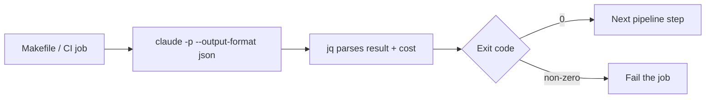

## Problem

Most agent workflows start in chat UIs that are optimized for one-off conversations, not repeatable engineering operations. Teams struggle to automate runs, compose agent steps with existing shell tools, and enforce the same behavior in local development and CI. Without a scriptable surface, orchestration logic becomes manual and hard to reproduce.

## Solution

Run the agent through its **non-interactive print mode**. In Claude Code this is `claude -p` with machine-readable output, documented in the official headless and CLI reference pages:

- `claude -p "query"` — run one task, print the result, and exit.
- `--output-format json` — structured result with session ID, cost, and metadata (`stream-json` for events).
- `--json-schema '{...}'` — validated structured output in the `structured_output` field.
- Exit code semantics — 0 on success, non-zero on failure, so shell scripts and CI can branch.
- `--allowedTools` and `--permission-mode` — pre-approve a bounded tool set; `--permission-prompts none` for unattended runs.
- `--max-turns` and `--max-budget-usd` — cap runaway loops and spend.
- `--continue` / `--resume <session>` — chain multi-step runs on one conversation.
- `--bare` — skip loading hooks, skills, plugins, and CLAUDE.md for fast, hermetic runs in CI.

Developers wrap these calls in Makefiles, Git hooks, cron jobs, and CI steps, and parse results with `jq`. The CLI becomes the stable contract between humans, scripts, and automation, with an auditable command history.



## Example

```bash
# Makefile: agent-driven review of the diff against main
review:
	git diff main | claude -p "Review this diff for typos and obvious bugs. Report file:line for each finding." \
		--output-format json | jq -r '.result'

# Git pre-commit hook: unattended check, no prompts possible
claude -p "Check staged changes for leftover debug statements." \
	--permission-mode dontAsk --permission-prompts none --max-turns 3

# CI: parse the result and the cost estimate
result=$(claude -p "Summarize the test failures" --output-format json)
echo "$result" | jq -r '.result'
echo "$result" | jq -r '.total_cost_usd'
```

## How to use it

- Wrap one high-friction workflow (for example a review or a fix loop) in a single scripted `claude -p` call before expanding scope.
- Standardize on `--output-format json` plus `jq` so scripts parse outcomes deterministically.
- Use `--permission-mode` and an explicit `--allowedTools` list instead of blanket permission skips.
- Add `--bare` in CI so a teammate's local hooks or MCP servers cannot change the result.
- Log command invocations, session IDs, and artifact paths for replay and debugging.

## Trade-offs

- **Pros:** scriptable and repeatable; documented exit codes and JSON output; works in CI with no UI; cost and turn caps built in.
- **Cons:** initial install and auth; prompt engineering replaces interactive steering; long conversations need explicit `--continue`/`--resume` handling.

**When NOT to use:** exploratory tasks that need human steering; interactive pair programming; embedding agent calls inside an application, where the Agent SDK fits better.

## References

- Primary source: [Run Claude Code programmatically](https://code.claude.com/docs/en/headless) — official headless mode documentation: `-p` usage, output formats, exit codes, unattended permission handling, and CI examples.
- [CLI reference](https://code.claude.com/docs/en/cli-reference) — full flag reference for `-p`, `--output-format`, `--json-schema`, `--max-turns`, `--max-budget-usd`, and `--bare`.
- "Why Human-Agent Systems Should Precede AI Autonomy" ([arXiv:2506.09420](https://arxiv.org/abs/2506.09420), 2025) — a general position paper on human oversight of agent systems; it argues for transparent, inspectable agent operation but does not document this CLI workflow.
- The Art of Unix Programming — Eric S. Raymond (2003) — Unix design rules that motivate CLI composition.
- An earlier revision of this pattern cited `claude spec run`, `claude spec test`, and `claude repl` subcommands and a third-party blog post. Those subcommands do not exist in the official CLI, and the post does not describe this pattern; both were removed.
- Related catalogue patterns: [CLI-First Skill Design](cli-first-skill-design.md) builds skills as CLIs; this pattern scripts the agent itself through its CLI. [Agent SDK for Programmatic Control](agent-sdk-for-programmatic-control.md) covers embedding the same agent loop in programs.
