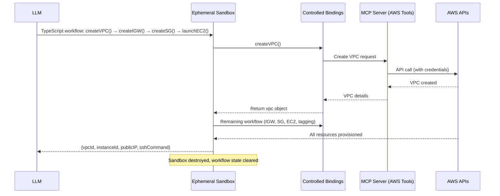

## Problem

When agents make direct API or tool calls, all intermediate data must flow through the model's context window. For data-heavy workflows (processing spreadsheets, filtering logs, transforming datasets), this creates massive token consumption and increased latency. A workflow that fetches 10,000 spreadsheet rows and filters them can easily consume 150,000+ tokens just moving data through the context.

Classic MCP forces this inefficient pattern:

```text
LLM → tool #1 → large JSON response → LLM context
LLM → tool #2 → large JSON response → LLM context
LLM → tool #3 → large JSON response → LLM context
→ final answer
```

Every intermediate result rides back through the model's context, burning tokens and adding latency at each step. Fan-out makes it worse: processing 100 emails with direct tool calls means 100 separate round-trips, each dumping its metadata into context, before any actual work begins.

## Solution

Instead of making direct tool calls, the agent writes and executes code that interacts with tools. Data processing, filtering, and transformation happens in the execution environment, with only results flowing back to the model context.

**Core insight**: LLMs are better at writing code to call APIs than at calling APIs directly, because their training data aligns with millions of open-source code repositories rather than with tool-call syntax.

```python
# Direct API approach (high token cost):
rows = api_call("spreadsheet.getRows", sheet_id="abc123")
# All 10,000 rows flow through context → 150K tokens
filtered = [row for row in rows if row.status == "active"]

# Code-Over-API approach (low token cost): the agent writes code
# that executes in the environment
def process_spreadsheet():
    rows = spreadsheet.getRows(sheet_id="abc123")
    filtered = [row for row in rows if row.status == "active"]
    print(f"Processed {len(rows)} rows, found {len(filtered)} active")
    print(f"First 5 active rows: {filtered[:5]}")
    return filtered

result = process_spreadsheet()
# Only the summary and sample flow to context → ~2K tokens
```

The agent sees the log output and return value, but the full dataset never enters its context window.

**Division of responsibilities (Cloudflare Code Mode):** Code Mode complements MCP servers rather than replacing them. The persistent layer keeps the operational complexity; the ephemeral layer does the orchestration.

**MCP servers handle (persistent layer):**

- Credential management and authentication
- Rate limiting and quota enforcement
- Webhook subscriptions and real-time events
- Connection pooling and persistent state

**Code Mode handles (ephemeral layer):**

- Multi-step tool orchestration in a single execution
- Complex data transformations and business logic
- Keeping intermediate JSON out of LLM context
- "Write once, vaporize immediately" execution with no persistent state

**Architecture:**

1. **Schema discovery**: fetch MCP server schemas dynamically at runtime
2. **API transformation**: convert tool schemas into typed API interfaces (for example TypeScript bindings with doc comments)
3. **LLM tool awareness**: the model receives the complete typed API documentation, not raw tool schemas
4. **Ephemeral code generation**: the model writes one script that orchestrates multiple tool calls
5. **Sandbox execution**: the code runs in an ephemeral sandbox (V8 isolate, container, or Wasm runtime) that dies after execution
6. **Controlled bindings**: secure bridges to the MCP servers, which keep the real credentials and logic

The model knows what code to write because it receives a strongly-typed API generated from the MCP schemas, not because it guesses.

**Fan-out:** iterating over 100 items becomes a `for` loop inside the sandbox instead of 100 LLM round-trips. Performance only gets worse with bigger N for direct tool calls, while Code Mode stays fast.



## Evidence

- **Anthropic** reports 150K → 2K tokens (98.7%) for tool definitions loaded on demand rather than upfront; its spreadsheet example returns 5 of 10,000 rows to the model.
- **Bifrost**, a third-party implementation, measures 58.2–92.8% input-token reductions for code-mode tool calling at 508 tools.
- **Cloudflare's** announcement reports qualitative benefits (fan-out efficiency, fewer round-trips) without numeric claims.

## How to use it

**Best for:**

- Data-heavy workflows (spreadsheets, databases, logs)
- Workflow-like problems with a known flow, such as infrastructure provisioning or extract-transform-load pipelines
- Bulk operations over 100+ items where direct tool calls would exceed context limits
- Cost-sensitive applications where token usage or latency matters

**When NOT to use it:**

- **Open-ended research loops**, where you decide at each step what to do next; accounting for every edge case defeats the purpose
- **Intelligence required mid-execution**, such as writing a *personalized* email for each of 100 contacts; the LLM call inside the loop puts you back to traditional agenting, just wrapped in code
- **Single one-off calls or rapid prototypes** that do not justify sandbox infrastructure

**Prerequisites:**

- Secure code execution environment with sandboxing, plus access to tools and APIs from within it
- Resource limits (CPU, memory, execution time) to prevent runaway execution
- Monitoring, logging, error handling, and recovery mechanisms for failures that happen in execution rather than in context

**Implementation steps:**

1. Design tool APIs as typed interfaces that are intuitive for code generation
2. Implement secure bindings that control access to external resources
3. Configure the sandbox with appropriate security constraints
4. Let the model generate code against the provided APIs, execute it in isolation, and return only condensed results

**Execution environment options:**

- **V8 isolates**: millisecond startup, minimal memory, strong isolation (Cloudflare Code Mode)
- **Containers**: 2–5 second startup, full language flexibility (Modal, Docker)
- **VMs**: complete isolation for destructive operations (Cognition/Devin)

## Trade-offs

**Pros:**

- Dramatic token reduction on multi-step and fan-out workflows (see Evidence)
- Lower latency through fewer large-context round-trips
- Credentials stay in the MCP servers and never reach the model
- Typed interfaces enable compile-time verification, semantic caching of successful workflows, and checkpoint/resume with a state store
- Existing MCP servers work without modification

**Cons:**

- Requires secure code execution infrastructure
- Code quality depends on the model; runtime errors in generated code need handling
- Poor fit for dynamic exploration or LLM reasoning between calls
- Typed API design is upfront engineering overhead
- Partial failure requires careful state management and recovery
- Debugging is harder because errors happen in execution, not in context

## References

- Anthropic Engineering: [Code Execution with MCP](https://www.anthropic.com/engineering/code-execution-with-mcp) (November 4, 2025) - 150K → 2K tokens (98.7%) applies to tool definitions loaded on demand; the spreadsheet example returns 5 of 10,000 rows
- Cloudflare: [Code Mode](https://blog.cloudflare.com/code-mode/) (September 26, 2025) - typed APIs generated from MCP schemas, ephemeral V8 isolates, controlled bindings; qualitative benefits, no numeric claims
- Bifrost: [Code Mode benchmarks](https://docs.getbifrost.ai/mcp/code-mode) - third-party implementation measuring 58.2–92.8% input-token reductions for code-mode tool calling
- Simon Willison: [Code execution with MCP](https://simonwillison.net/2025/Nov/4/code-execution-with-mcp/) (November 4, 2025) - independent commentary on the announcement
- Rafal Wilinski: [Code Mode analysis](https://x.com/rafalwilinski/status/1972362720579035146) - real-world insights on Code Mode strengths and limitations
- Beurer-Kellner et al.: [Design Patterns for Securing LLM Agents against Prompt Injections](https://arxiv.org/abs/2506.08837) (2025) - names the Code-Then-Execute pattern (§3.1, pattern 5)
- Debenedetti et al.: [CaMeL: Defeating Prompt Injections by Design](https://arxiv.org/abs/2503.18813) (Google DeepMind, 2025) - taint tracking and verification for code-first tool use
- [Model Context Protocol](https://modelcontextprotocol.io/) - background on traditional tool calling
- Related: [Code-Then-Execute Pattern](code-then-execute-pattern.md) - the security-focused sibling that adds static taint checking to code-first tool use; this pattern focuses on token optimization
