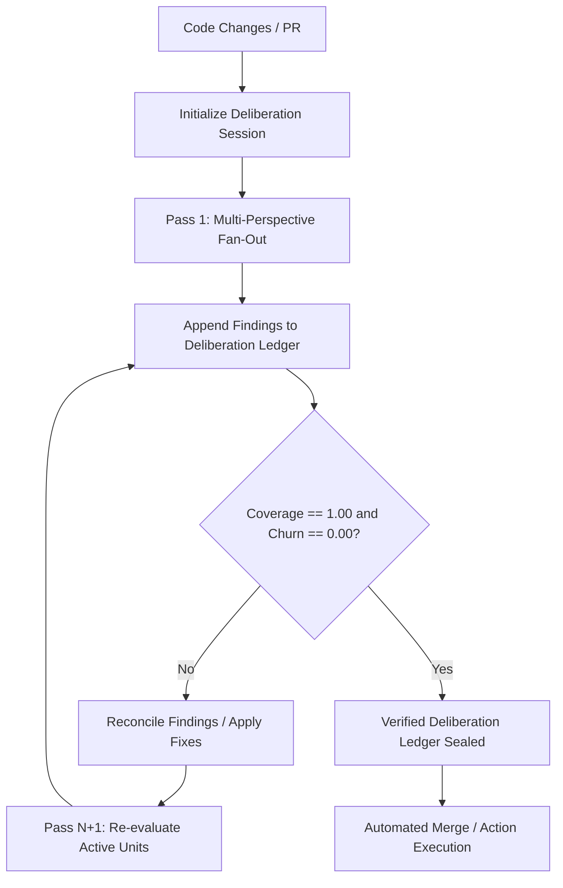

## Problem

Reviewing code with AI coding agents often relies on single-turn, single-persona prompts. Single-pass evaluations suffer from prompt-drift, hallucinations of nonexistent defects, sycophancy toward existing code, or oversight of subtle side-effects across security, architecture, and developer experience.

When agents attempt iterative refinement across multiple rounds without formal convergence rules, reviews frequently oscillate. A defect reported in pass 1 may be contradicted in pass 2, or new subjective nitpicks may arise indefinitely. Without formal coverage tracking and finding stability metrics, review pipelines cannot determine when deliberation has reached genuine consensus versus arbitrary cutoff.

## Solution

The Coverage-Gated Deliberative Review pattern structures automated evaluation into multi-perspective passes backed by an append-only deliberation ledger and mathematical stopping criteria.

Key components:

1. **Multi-Perspective Fan-Out:** Independent evaluator passes evaluate changes under orthogonal personas:
   - **Skeptic:** Adversarial analysis, vulnerability detection, and edge-case probing.
   - **Builder:** Architectural integrity, maintainability, and regression hazards.
   - **Dreamer:** Extensibility, modularity, and forward compatibility.
   - **Empath:** Usability, developer ergonomonics, and documentation clarity.

2. **Structured Delta Findings:** Each evaluator records discrete findings attached to target code units (files, diff hunks, or functions) with severity, evidence, and remediation suggestions.

3. **Mathematical Coverage Gate:** Cumulative review coverage is calculated across all modified code units:
   `Coverage = (Reviewed Code Units) / (Total Modified Code Units)`. Review gating requires `Coverage == 1.00`.

4. **Churn Delta Stabilization:** Finding churn measures the symmetric difference in open findings between successive deliberation passes:
   `Churn = (Unreconciled New Findings) / (Total Active Findings)`. Review convergence is reached when `Churn == 0.00`, proving that repeated critique surfaces no new unaddressed findings.

5. **Append-Only Deliberation Ledger:** Every pass, finding delta, and reconciliation decision is written to a deterministic, tamper-evident JSON ledger. This ledger serves as cryptographic provenance for automated CI/CD merge gating.



```pseudo
function deliberate_review(diff, perspectives, max_passes = 5):
    ledger = Ledger.create(diff)
    pass_number = 1
    
    while pass_number <= max_passes:
        for persona in perspectives:
            findings = evaluate_units(diff, persona)
            ledger.record_pass(pass_number, persona, findings)
            
        coverage = ledger.calculate_coverage()
        churn = ledger.calculate_churn(pass_number)
        
        if coverage >= 1.00 and churn == 0.00:
            return ledger.seal(status = "CONVERGED")
            
        reconcile_active_findings(ledger)
        pass_number += 1
        
    return ledger.seal(status = "UNCONVERGED")
```

## Evidence

- **Evidence Grade:** `high`
- **Most Valuable Findings:**
  - Orthogonal personas isolate specialized failure modes (e.g., security risks vs ergonomic rough edges) that single generalist prompts systematically conflate.
  - Mathematical churn gates prevent review looping and non-deterministic agent opinions by measuring finding stabilization.
  - Ponder (`Quinnod345/ponder`) implements this pattern with zero runtime dependencies, providing portable deliberation ledgers across Claude Code, Cursor, OpenCode, and GitHub Actions.
- **Unverified / Unclear:**
  - Calibrating minimum pass thresholds across very large diffs (over 10,000 LOC) requires dynamic unit partitioning to preserve prompt budget.

## How to use it

1. **Partition Code Units:** Divide changed files or functions into discrete, addressable units.
2. **Configure Evaluator Personas:** Establish at least two complementary perspectives (e.g., Skeptic and Builder).
3. **Execute Deliberation Rounds:** Run each persona across all unreviewed units and append findings to the session ledger.
4. **Reconcile and Iterate:** Fix confirmed issues or record rationale for false positives; re-run evaluation until `coverage == 1.00` and `churn == 0.00`.
5. **Integrate with CI:** Use the sealed ledger as an immutable pass artifact before allowing automated PR merges.

## Trade-offs

- **Pros:**
  - **Deterministic Termination:** Replaces arbitrary iteration caps with mathematical convergence criteria.
  - **Auditability:** Complete historical record of every raised critique and its resolution.
  - **Higher Precision:** Multi-perspective consensus eliminates false positives and hallucinatory nitpicks.
- **Cons:**
  - **Inference Cost:** Running multiple personas across repeated rounds increases token consumption.
  - **Latency:** Deliberation loops take longer than single-pass reviews, making them best suited for asynchronous CI pipelines.

## References

- [Ponder Repository](https://github.com/Quinnod345/ponder)
- [Ponder Deliberation Loop Specification](https://github.com/Quinnod345/ponder#readme)
- [AI-Assisted Code Review / Verification](ai-assisted-code-review-verification.md)
