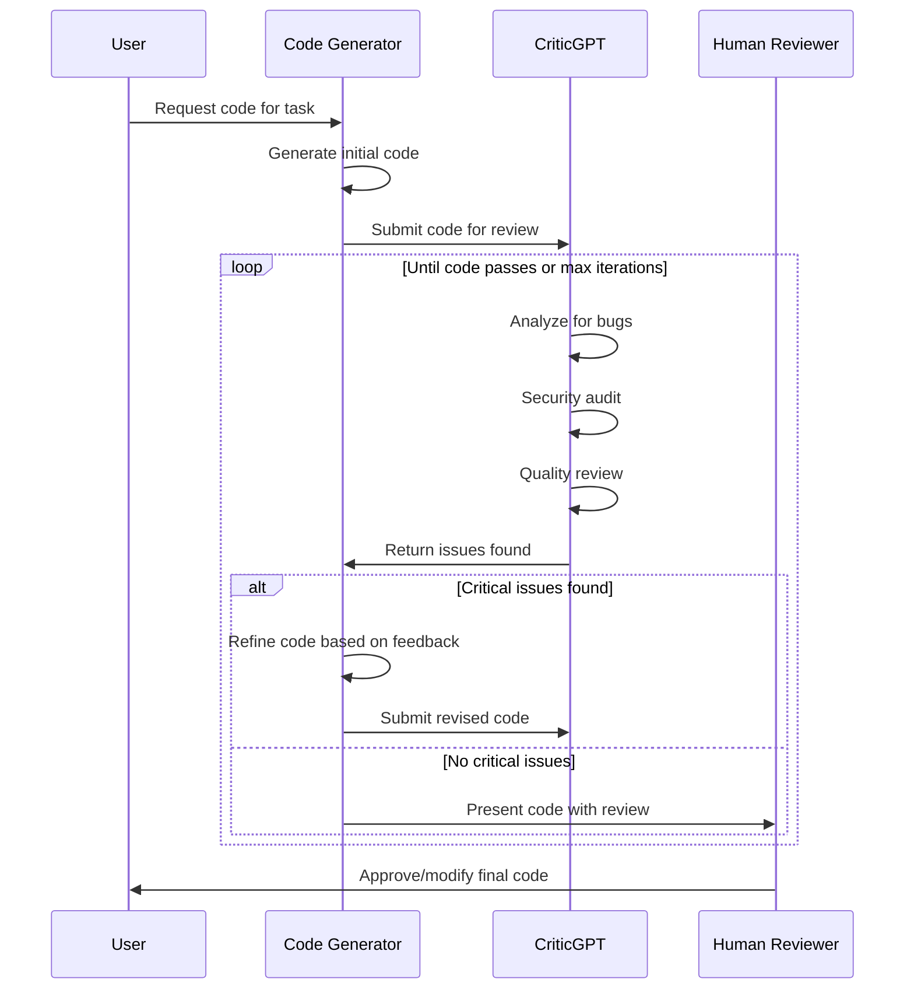

## Problem

As AI-generated code becomes more sophisticated, it becomes increasingly difficult for human reviewers to catch subtle bugs, security issues, or quality problems. Traditional code review processes may miss issues in AI-generated code because:

- The volume of generated code can overwhelm human reviewers
- Subtle bugs may appear correct at first glance
- Security vulnerabilities may be non-obvious
- Style and best practice violations may be inconsistent

## Solution

Train or deploy a specialized critic model whose only job is finding problems in code output. CriticGPT, the reference instance, is a GPT-4-based critic trained with reinforcement learning from human feedback to write natural-language critiques of ChatGPT code answers. In the paper it supports human RLHF evaluators, who preferred its critiques over purely human-written critiques 63% of the time and found more real bugs with it. Two caveats travel with the result: the critic sometimes writes convincing critiques of bugs that do not exist, and human-plus-critic teams hallucinate fewer such bugs than the critic alone — so the human stays in the loop by design.

A critic used this way can:

1. **Identify bugs** that human reviewers might miss
2. **Detect security vulnerabilities** in generated code
3. **Suggest improvements** for code quality and efficiency
4. **Verify correctness** of implemented solutions
5. **Check adherence** to coding standards and best practices

**Scope note:** the published evidence covers critics assisting human evaluators on model outputs, not a standalone reviewer. Running such a critic as an autonomous CI/CD gate, as sketched below, is an extrapolation of the paper's results; treat its findings as input to human review rather than a verdict. For the broader technique of AI flagging issues during human review, see the sibling pattern [AI-Assisted Code Review / Verification](ai-assisted-code-review-verification.md) — the difference is that this pattern uses a model trained specifically for critique, while that one uses general-purpose review agents.

Sketch of the generate-and-review loop:

```python
SEVERITY_THRESHOLD = 0.7   # reviewer default
CRITICAL_SEVERITY = 0.8    # issues above this force a regeneration
MAX_ITERATIONS = 3

def review_code(critic, code, task):
    all_issues = []
    for category, prompt in PROMPTS.items():       # bugs, security, quality, performance, best practices
        all_issues += parse(critic.analyze(prompt(code, task)), category)
    all_issues.sort(key=lambda issue: issue["severity"], reverse=True)
    return {"issues": all_issues,
            "summary": generate_summary(all_issues),
            "recommended_action": recommend_action(all_issues)}

def generate_and_review(generator, critic, task):
    code = generator.generate_code(task)
    for iteration in range(MAX_ITERATIONS):
        review = review_code(critic, code, task)
        critical = [issue for issue in review["issues"] if issue["severity"] > CRITICAL_SEVERITY]
        if not critical:
            break                                    # hand code and review to a human reviewer
        # Refinement prompt = original task + the code + the formatted critical issues
        code = generator.generate_code(refine(task, code, format_feedback(critical)))
    return {"code": code, "final_review": review, "iterations": iteration + 1}
```

Each finding carries a severity from 0 to 1, a category, and the line it refers to. The reviewer is constructed with a `severity_threshold` of 0.7; the loop shown here regenerates whenever an issue scores above `CRITICAL_SEVERITY` (0.8).

Each pass asks the critic for a fixed report shape:

- **Bugs:** line number(s), description, severity (0-1), and a suggested fix. The prompt lists logic errors, off-by-one errors, null/undefined references, type mismatches, resource leaks, race conditions, and edge case handling.
- **Security:** `[line, vulnerability type, severity, fix]`. The prompt lists SQL injection, XSS, command injection, path traversal, insecure cryptography, hardcoded secrets, authentication/authorization issues, and input validation.
- **Quality, performance, and best practices:** clarity and readability, naming, code organization, documentation completeness, DRY violations, coupling and cohesion, and error handling.
- **Fixes:** given the code and one issue, the critic generates a corrected version of the affected section.



## How to use it

- Use for automated code review workflows with high commit volumes
- Deploy in CI/CD pipelines for pre-commit quality checks, with critic findings routed to a human as review input
- Apply to security-sensitive code requiring vulnerability detection
- Integrate via git webhooks (GitHub, GitLab) for event-driven review
- Use 3-4 iterations of critique-refinement loops for complex changes
- Mitigate collapse risks: decouple evaluation/generation prompts, benchmark against human-labeled anchor sets

## Trade-offs

**Pros:**

- **Catches more bugs**: Specialized training helps identify subtle issues
- **Consistent reviews**: No fatigue or oversight like human reviewers
- **Fast feedback**: Near-instantaneous review of generated code
- **Learning tool**: Helps developers understand potential issues
- **Reduces security risks**: Proactive vulnerability detection
- **Scalable**: A consistent quality standard that can review code 24/7 and improves with more training

**Cons:**

- May have false positives requiring human verification
- Training specialized critic models is resource-intensive
- Cannot understand full business context like humans
- May miss novel vulnerability types
- Requires integration into existing workflows
- Risk of evaluator-model collusion in self-critique loops (mitigate with anchor sets and adversarial examples)

## References

- McAleese et al., [LLM Critics Help Catch LLM Bugs](https://arxiv.org/abs/2407.00215) (arXiv:2407.00215, June 2024, incl. Jan Leike) — the CriticGPT paper: RL-trained GPT-4 critic assisting human RLHF evaluators; 63% preference over human critiques, hallucinated-bug caveats. (The original `openai.com/research/criticgpt` announcement page is no longer available.)
- [Constitutional AI: Harmlessness from AI Feedback (Anthropic, 2022)](https://arxiv.org/abs/2212.08073) - RLAIF foundation: replacing human annotation with AI feedback at lower cost
- [Self-Taught Evaluators (Meta AI, 2024)](https://arxiv.org/abs/2408.02666) - Bootstrap critic models from synthetic data
- [Evaluating LLMs for Code Review (2025)](https://arxiv.org/abs/2505.20206) - GPT-4o: 68.50% classification accuracy with context
