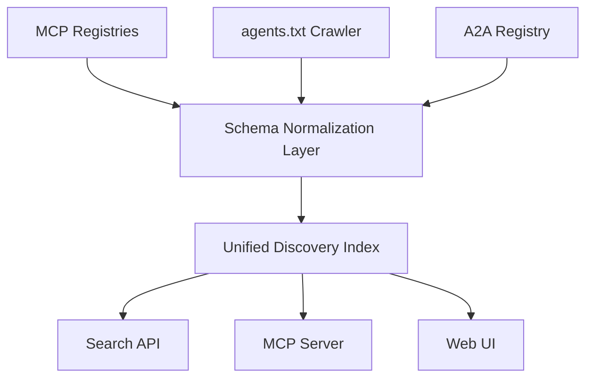

## Problem

Agent and tool discovery is spread across several mechanisms that do not reference each other:

- **MCP**: an official community registry (launched in preview in September 2025) coexists with earlier third-party directories, each with partial coverage.
- **agents.txt**: a robots.txt-style convention — a plain-text file at `<origin>/agents.txt` that advertises which agent-facing protocols and features a site supports, with a machine-readable `agents.json` companion.
- **A2A (Agent2Agent)**: an open protocol for agent discovery and collaboration, contributed by Google and now an open-source project under the Linux Foundation.
- **Platform-specific directories**: vendor marketplaces each maintain their own listings.

An agent listed in an MCP registry will not appear in an A2A agent card or an agents.txt file, and vice versa. This creates a discovery gap analogous to early web search before meta-search engines.

## Solution

Aggregate agent metadata across registries and protocols into a unified, protocol-agnostic discovery layer:

1. **Registry crawling**: periodically ingest agent listings from each protocol-specific registry via their APIs or structured feeds.
2. **Schema normalization**: map each registry's metadata schema to a common format (name, description, capabilities, transport, auth, endpoint).
3. **Protocol tagging**: label each agent with its supported protocol or protocols, enabling cross-protocol search and comparison.
4. **Unified search API**: expose a single search interface over the normalized data.
5. **Validation**: verify that agent endpoints are reachable and metadata is accurate at crawl time.

As of October 2026 we could not verify a neutral, cross-registry implementation of this architecture, so treat the design above as a proposal built from the listed protocol sources.

## How to use it

- **Agent platforms**: query the aggregated index to discover the best available agent for a task regardless of its native protocol.
- **Developer tooling**: integrate cross-protocol search into IDEs and CLI tools so developers find relevant agents without knowing which registry hosts them.
- **Orchestration systems**: route tasks to agents across protocol boundaries by maintaining a unified capability index.

**Implementation considerations:**

- Start with the highest-coverage registries for your use case and expand incrementally.
- Implement incremental sync with per-registry rate limits rather than full re-crawls.
- Cache normalized metadata with TTLs appropriate to each registry's update frequency.
- Consider exposing the aggregated index as an MCP server itself, enabling agents to discover other agents programmatically.

## Trade-offs

- **Pros:** single search surface for all agent protocols; protocol-agnostic so it adapts as protocols emerge or fade; reduces lock-in to any single registry; enables cross-protocol capability comparison.
- **Cons:** aggregation adds latency versus direct registry queries; schema normalization loses protocol-specific metadata; operational burden of maintaining crawlers for each registry; stale data risk if registries update faster than sync cycles; discovery does not equal trust — aggregation verifies listing accuracy, not agent quality.

## References

- Primary source: [agents.txt](https://agents-txt.com) — the agents.txt convention: a well-known file that advertises supported agent protocols (MCP, A2A, payments, and others) with an `agents.json` machine-readable companion. It documents one discovery layer this pattern aggregates, not the aggregation itself.
- [A2A Protocol](https://github.com/a2aproject/A2A) — open agent-to-agent protocol repository, an open-source project under the Linux Foundation (contributed by Google).
- [MCP Registry](https://github.com/modelcontextprotocol/registry) — the official community-driven registry for MCP servers, in preview since September 2025, with its API in a v0.1 freeze since October 2025.
- [Model Context Protocol](https://modelcontextprotocol.io) — the MCP specification homepage; background on the protocol, not on cross-registry aggregation.
- An earlier revision linked agentsprotocol.ai for an "ACDP" specification; that domain no longer resolves, and the claim could not be re-verified, so it was removed.
- Related catalogue patterns: [Tool Search Lazy Loading](tool-search-lazy-loading.md), [Progressive Tool Discovery](progressive-tool-discovery.md), [Static Service Manifest for Agents](static-service-manifest-for-agents.md)
