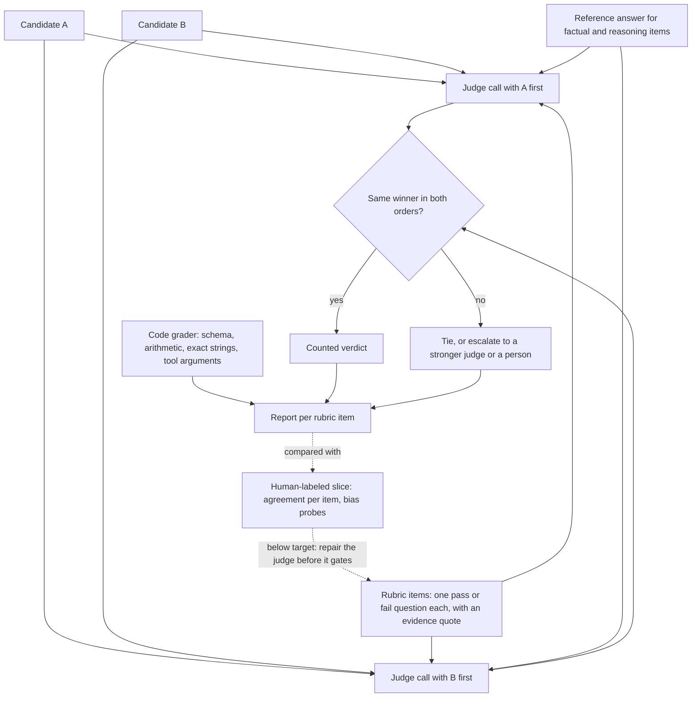

## Problem

A model judge (LLM-as-a-judge) is the usual grader for output that has no exact answer: the quality of a reply, a summary, a code review. The usual prompt asks for a holistic score, or for the better one of two candidates. That prompt makes systematic errors, and a release gate inherits each error.

[Zheng et al.](https://arxiv.org/abs/2306.05685) measured the errors on MT-bench:

- **Position bias.** "Most LLM judges favor the first position". With the default prompt, GPT-4 gave the same verdict after the two answers changed places in 65.0% of the cases, GPT-3.5 in 46.2%, and Claude-v1 in 23.8%.
- **Verbosity bias.** The authors made 23 answers longer with no new information (a "repetitive list" attack). GPT-3.5 and Claude-v1 preferred the longer answer in 91.3% of the cases, and GPT-4 in 8.7%.
- **Self-enhancement bias.** Compared to the humans, GPT-4 gave itself a win rate that was 10% higher. The authors add that their "study cannot determine whether the models exhibit a self-enhancement bias".

A fourth limit is not a bias: the judge can be wrong on facts and on arithmetic. In the same study, GPT-4 called an incorrect answer correct in 14 of 20 math judgments. It can solve such a problem when you ask it separately, but it "was misled by the provided answers".

Each error has a cost in an evaluation pipeline:

- A judge that favors the first position makes the result depend on the order of the candidates.
- A judge that favors length pays for padding. An agent that optimizes against that judge learns to write more, and not to write better.
- A judge that scores its own model family higher hides the regressions of the other models.
- A holistic score does not show which requirement failed, so the team does not know what to repair.

## Solution

Keep the model judge for the judgments that need semantics. Remove its distortions with four controls. Calibrate it before it gates anything.

**1. Swap the positions.** For each pair, grade `(A, B)` and `(B, A)`. Count a win only if the same candidate wins in both orders. If the two verdicts disagree, call it a tie, or send the pair to a stronger judge or to a person. Zheng et al. name this the conservative approach: "only declare a win when an answer is preferred in both orders". At a large scale, assign the positions at random.

**2. Decompose into pass/fail rubric items.** Replace "rate 1–10" with narrow items. Each item asks one question about one observable requirement, and the answer is pass or fail:

- Bad item: "Is the answer good?"
- Good item: "Does the answer state the cancellation deadline in days? Quote the sentence."

Ask for the evidence before the verdict. Reject a verdict with no quote. Anthropic gives the same direction: "Have detailed, clear rubrics", and "instruct the LLM to output only 'correct' or 'incorrect'". Keep the deterministic requirements out of the judge. Schema validity, arithmetic, exact strings, and tool-call arguments are graded in code.

**3. Supply a reference, and change the family.** For factual items and reasoning items, put a reference in the prompt: a golden answer from the test set, or ground-truth facts. Do not use the model under test as its only judge. Select a judge from another model family, or two judges from two families. Count a pass only when the judges agree.

**4. Calibrate against human labels.** Before the judge gates a release, people label a slice of the cases, item by item. Then measure four things:

- The agreement for each rubric item: precision and recall, or Cohen's kappa.
- The position bias: the same pair in both orders.
- The verbosity bias: a padded copy of a passing answer next to the original. The correct verdict is a tie.
- The family preference: a strong answer from the family of the judge next to a strong answer from another family.

Calibrate again when the judge model, the judge prompt, or the rubric changes.



The calibration shows where the judge is reliable. In the same study, GPT-4 agreed with the humans on 85% of the MT-bench votes without a tie, where the humans agreed with each other on 81%. With ties included, the agreement was 70%. The agreement rose "from 70% to nearly 100%" as the performance gap between the two compared models increased. A judge is reliable on a clear case and weak on a close one. A gate must know on which kind of case it decides.

```pseudo
def score(candidate):                            # one output: one pass/fail verdict per rubric item
    verdict = {}
    for item in RUBRIC:
        if item.kind == "code":                  # schema, arithmetic, tool arguments
            verdict[item] = item.check(candidate)   # deterministic: no judge call
        else:
            verdict[item] = judge(item.ask, candidate, reference=item.reference)
            require verdict[item].quote in candidate.text  # no evidence quote, no verdict
    return verdict

def compare(a, b, reference=None):               # pairwise: the judge sees both orders
    ab, ba = judge_pair(a, b, reference), judge_pair(b, a, reference)  # A, B, or TIE
    if ab == ba and ab != TIE: return ab         # the same winner in both orders: count it
    return TIE                                   # else a tie, or escalate to a person

def calibrate(judge_version, labeled):           # people gave a verdict for each item
    for item in judge_items(RUBRIC):
        tp, fp, fn = confusion(judge_version, labeled, item)
        require precision(tp, fp) >= item.min_precision
        require recall(tp, fn) >= item.min_recall
    for probe in bias_probes(labeled):           # swapped order, padded copy, same-family pair
        require judge_version(probe.input) == probe.expected
```

## Evidence

- **Evidence Grade:** `high` (a study with 58 expert labelers and about 3,000 expert votes on MT-bench, plus crowd votes from Chatbot Arena, published in the NeurIPS 2023 Datasets and Benchmarks Track, and vendor documentation that agrees on the rubric design and the order of the graders)
- **Most Valuable Findings:**
  - Zheng et al. built the position test from two similar answers for each first-turn question of MT-bench. "Most LLM judges favor the first position". The authors note that the answers were so similar that humans could also not always tell them apart.
  - Verbosity bias: in the "repetitive list" attack on 23 answers, GPT-3.5 and Claude-v1 preferred the longer answer in 91.3% of the cases, and GPT-4 in 8.7%. The judges in the study always returned a tie for two identical answers, so a test with identical copies does not find this bias.
  - Grading ability: on 10 math questions (20 judgments with swapped positions), GPT-4 called an incorrect answer correct 14 times with the default prompt, 6 times with chain-of-thought, and 3 times with a reference answer.
  - Agreement: GPT-4 agreed with humans on 85% of the MT-bench votes without ties, where humans agreed with each other on 81%, and on 70% with ties included.
  - Anthropic ranks the graders: "Code-based grading: Fastest and most reliable". Of the model judge: "Test to ensure reliability first, then scale."
- **Unverified / Unclear:** Zheng et al. tested swaps, few-shot examples, chain-of-thought, and a reference answer. They did not test a judge from another family as a control for self-enhancement, and no source tests a calibration gate for a judge in CI. Few-shot examples increased the consistency of GPT-4 from 65.0% to 77.5%, but "high consistency may not imply high accuracy", and the longer prompt made the calls 4 times more expensive. The sources measure the biases on models of 2023 and do not give the size of each bias in current models.

## How to use it

1. **Grade in code what code can grade.** Schema validity, arithmetic, exact strings, and tool-call arguments go to a code grader. Anthropic ranks it first: "Fastest and most reliable". Send to the judge only the items that need semantics.
2. **Write one question per item.** Tie each item to one observable requirement and to a pass condition. Add a length budget as an item when a longer answer can improve the score.
3. **Ask for the evidence before the verdict.** The judge quotes the candidate. Reject a verdict with no quote, or with a quote that is not in the candidate (see [Evidence Questions, Not Verdict Questions](evidence-questions-not-verdict-questions.md)).
4. **Swap in each comparison.** Count only the wins that agree in both orders. Track the tie rate: a high rate means that the pairs are too close for this judge.
5. **Put a reference in the prompt.** Store a golden answer or ground-truth facts with each factual test case. Let the judge write its own answer first when a test case has no golden answer.
6. **Change the family of the judge.** Do not let a model grade its own output as the only judge. Use a judge from another family, or two judges from two families. Count a pass only when the judges agree.
7. **Pin the judge, and record it.** Fix the judge model, its version, and its prompt. Store them with each result, so that a team can tell a change of the judge from a change of the system.
8. **Calibrate, then gate.** People label a slice. Compute the agreement for each item. Add the bias probes to the set. Calibrate again at each change of the judge model, the prompt, or the rubric.
9. **Show the complete conversation.** In a multi-turn evaluation, give the judge all the turns in one prompt. Zheng et al. found that a split prompt can make the judge fail to locate the earlier reply of the assistant. In one example, GPT-4 then gave an inaccurate judgment.
10. **Compose with the neighbors.** [Deterministic Grader in the Loop](deterministic-grader-in-the-loop.md) replaces the judge in a self-review loop. [Anti-Reward-Hacking Grader Design](anti-reward-hacking-grader-design.md) hardens a grader against gaming. [Workflow Evals with Mocked Tools](workflow-evals-with-mocked-tools.md) runs the agent-as-judge half of a workflow eval in CI. [RLAIF (Reinforcement Learning from AI Feedback)](rlaif-reinforcement-learning-from-ai-feedback.md) trains on judge labels, so a biased judge becomes a biased reward.

## Trade-offs

**Pros:**

- A verdict does not depend on the order, the length, or the family of the candidates.
- Each verdict carries evidence, so a failed item shows the team what to repair.
- The calibration numbers show on which kind of case the judge is reliable.
- Code grades each invariant faster, and with no error.

**Cons:**

- Each comparison needs two judge calls, and each verdict needs evidence tokens.
- A labeled slice costs human time, and each change of the judge needs a new pass.
- The tie rate increases, because only a consistent win counts.
- Narrow items can miss a quality that the rubric does not name.

### Failure modes

- **Verbosity gaming.** The output of the agent becomes longer and the score increases, while accuracy does not change. The cause is a holistic judge that rewards length, and an agent loop that optimizes against that judge. Grade with pass/fail items. Add a length budget as an item. Add a padded copy of a passing answer to the probes: the judge must return a tie.
- **Rubric drift and judge upgrades.** The score moves after an upgrade of the judge model, with no change in the system under test. The cause is that "absolute scores are likely to fluctuate more than relative pairwise results if the judge model changes". Pin the judge model and its prompt. Run the calibration set again before you compare two releases. Prefer per-item rates and pairwise results to one absolute score.
- **A judge on deterministic invariants.** The judge passes an invalid JSON payload or a wrong sum, and the evaluation is slow and expensive. The cause is a judgment that code can make with no error, given to a judge that can be "misled by the provided answers". Move schema validity, arithmetic, and tool-call arguments to a code grader. Keep the judge for the items that need semantics.
- **Uncalibrated thresholds.** The CI gate blocks a build and clears the same build later, and the engineers learn to ignore the gate. The cause is a threshold inside the run-to-run variance of a judge that no person measured. Measure the variance of the judge on a fixed sample. Set the threshold outside that variance. Gate on the pass rate of many cases and not on one sample.

## References

- [Judging LLM-as-a-Judge with MT-Bench and Chatbot Arena](https://arxiv.org/abs/2306.05685) (Zheng et al., NeurIPS 2023): position, verbosity, and self-enhancement biases, position swaps, reference-guided judging, and the agreement with humans.
- [Define success criteria and build evaluations](https://platform.claude.com/docs/en/test-and-evaluate/develop-tests) (Anthropic documentation): the order of the graders, rubric design, and reliability tests before scale.
- Related: [Deterministic Grader in the Loop](deterministic-grader-in-the-loop.md) (a scorer in code in place of the judge), [Anti-Reward-Hacking Grader Design](anti-reward-hacking-grader-design.md) (stops the gaming of a grader), [Workflow Evals with Mocked Tools](workflow-evals-with-mocked-tools.md) (runs agent-as-judge criteria in CI), [RLAIF (Reinforcement Learning from AI Feedback)](rlaif-reinforcement-learning-from-ai-feedback.md) (uses judge labels as a training signal)
