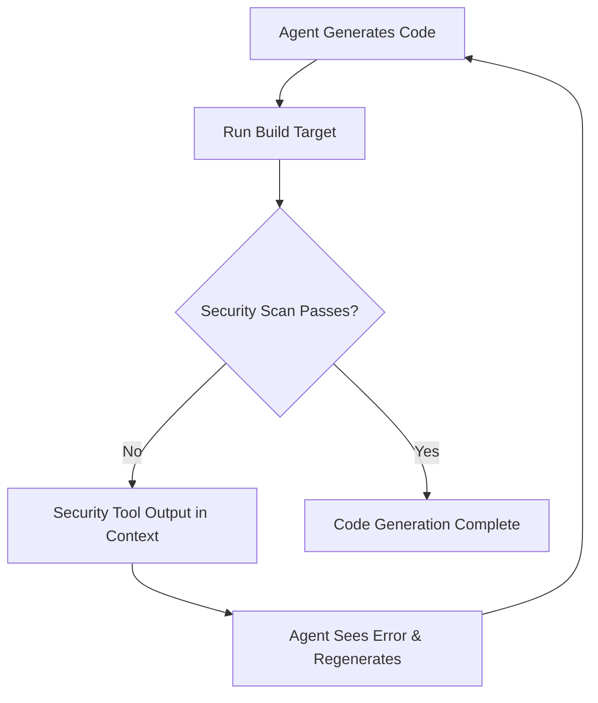

## Problem

Non-deterministic approaches to security in AI code generation (Cursor rules, MCP security tools) are fundamentally flawed because security requires absolute determinism - code is either secure or not secure, with no grey area. These approaches are merely suggestions to the LLM that may or may not be followed consistently.

## Solution

Implement **deterministic security validation** through the build loop using a two-phase approach:

1. **Generation Phase** (non-deterministic): Agent generates code based on suggestions and context
2. **Backpressure Phase** (deterministic): Security scanning tools validate the generated code

The key is integrating existing security scanning tools (SAST, DAST, SCA) directly into the build target that agents must execute after every code change. This approach is grounded in supply chain security frameworks like SLSA and reproducible builds research.

```makefile
.PHONY: all build test security-scan

all: build test security-scan

build:
    @echo "Build completed successfully"
    @exit 0

test:
    @echo "Tests completed successfully" 
    @exit 0

security-scan:
    # Use your existing security scanning tools
    semgrep --config=auto src/
    bandit -r src/
    trivy fs .
    gitleaks detect --source .
    @exit $?
```

Configure agent instructions to mandate build execution. Note that harnesses treat such instructions as advisory: a model can skip them, so they are a request rather than a guarantee.

```markdown
# Agent Instructions

## Code Quality 

After every code change, you MUST:

1. Run `make all` to verify that the code builds successfully and tests pass.
2. IMPORTANT: You MUST resolve any security issues identified during compilation.
```

For deterministic enforcement, gate the stop of the turn instead of the prompt. Claude Code Stop hooks run a check as a script and block the turn from ending until it passes; the official guidance states that unlike CLAUDE.md instructions, which are advisory, hooks are deterministic. Wiring `make security-scan` into a Stop hook makes the scanner impossible to skip:

```json
{
  "hooks": {
    "Stop": [
      {
        "hooks": [
          { "type": "command", "command": "make security-scan" }
        ]
      }
    ]
  }
}
```



## How to use it

1. **Inner Loop (Development)**:
   
- Integrate existing security scanning tools into your build target
   - Configure agent instructions to run build after every change
   - Let the agent see security tool output and iterate

2. **Outer Loop (CI/CD)**:
   
- Use the same security tools in your pull request checks
   - Maintain one unified rules database across both loops

3. **Implementation Steps**:
   
- Add security scanning tools to Makefile/package.json/build script
   - Update agent configuration (AGENTS.md/Cursor rules) to mandate build execution
   - Ensure security tools exit with non-zero codes on violations

## Trade-offs

**Pros:** 
- Leverages deterministic, battle-tested security tools
- Reuses existing security infrastructure and rules
- Works with any coding agent/harness
- Provides consistent security validation

**Cons:** 
- Increases build time and CI resource usage
- May produce false positives requiring human review
- Requires fast security tools for good developer experience

## References

* [Geoffrey Huntley's blog post on secure code generation](https://ghuntley.com/secure-codegen/) (2025-09-03) - primary source; full content is behind a subscription paywall, so the specific build-loop advice cannot be verified publicly
* [Claude Code best practices](https://code.claude.com/docs/en/best-practices) - public corroboration of the gating mechanism: "Give Claude a check it can run: tests, a build" and "a Stop hook runs your check as a script and blocks the turn from ending until it passes"; "Unlike CLAUDE.md instructions which are advisory, hooks are deterministic"
* [SLSA (Supply-chain Levels for Software Artifacts)](https://slsa.dev) - Framework for supply chain security
* [Build Systems a la Carte (Mokhov, Mitchell, Peyton Jones, POPL 2020)](https://dl.acm.org/doi/10.1145/3371091) - Formal build system theory including backpressure
* [Reproducible Builds Project](https://reproducible-builds.org) - Community initiative for verifiable builds
* Related pattern: [Background Agent with CI Feedback](background-agent-ci.md) - the outer loop; this pattern is the per-change inner loop that runs in the agent's own workspace, while CI feedback covers the slower pipeline after the branch is pushed
* Related pattern: [Deterministic Threat Rule Scanning](deterministic-threat-rule-scanning.md) - the same deterministic-control idea applied to scanning agent tool traffic for injected threats, rather than scanning generated code
* This generalizes beyond security to any code quality or pattern enforcement
