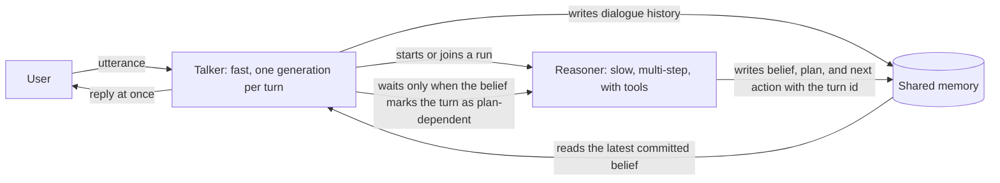

## Problem

An agent that talks with a person has two jobs. It must reply in the time of a conversational pause. It must also do the slow work that makes the reply useful: multi-step reasoning, retrieval, and tool calls. One model that does both in one pass makes each reply wait for the complete loop and for each tool result.

The existing multi-model patterns do not remove this wait:

- [Oracle and Worker Multi-Model Approach](oracle-and-worker-multi-model.md) keeps the fast model at work and consults a slow oracle, but the worker stops until the oracle answers.
- [Multi-Model Orchestration for Complex Edits](multi-model-orchestration-for-complex-edits.md) is a sequence of phases. Each phase ends before the next phase starts.

In both patterns, the conversation and the deep work run one after the other. A live user needs them to run at the same time.

## Solution

Split the agent into two subsystems that run at the same time at different speeds. A shared belief state couples them, and nothing else does.

- **Talker (System 1, the fast path).** It owns the live user stream, voice or chat. It makes one generation per turn: it reads the latest user utterance, the dialogue history, and the latest committed belief, and it replies at once. It asks clarifying questions, and it keeps the conversation alive while the slow work runs. It calls no tools on the reply path. Implementers usually select a model with a low time to first token for this role.
- **Reasoner (System 2, the slow path).** It runs asynchronously. It does the multi-step planning, the retrieval, and the tool calls, and it turns the results into a structured update of the belief state: verified facts, the plan, and a proposed next action. Implementers usually select the stronger reasoning model for this role.
- **Shared belief state.** A typed record, in JSON or XML, that holds the goal, the facts, the plan, and the phase of the task. The Reasoner is the only writer of the belief. The Talker is the only writer of the dialogue history.
- **Wait switch.** The Talker can wait for the Reasoner before it replies. The Talker-Reasoner paper calls this "equivalent to System 2 taking over and overruling System 1's impulses". The belief decides when: in the coaching example of the paper, the Talker waits in the planning phase and not in the other phases.

Two rules keep the split safe. The paper does not state either rule:

1. **One run at a time, tagged with its turn.** A new user utterance joins the run in flight, or it cancels that run and starts a new one. A run commits its result only if its turn is still the current turn.
2. **The Talker promises only what the belief states.** Facts, plans, and commitments come from the belief. The Talker does not invent them while the Reasoner works.



```pseudo
async def on_user_turn(utterance):
    turn = next_turn_id()
    memory.current_turn = turn                    # each new utterance moves the turn
    memory.dialogue.append(utterance)
    memory.run = start_or_join_run(utterance, turn)    # one run in flight

    belief = memory.belief                             # can lag this utterance
    if belief.phase_needs_plan and not memory.run.done:
        belief = await memory.run                      # the wait switch
    reply = talker(utterance, memory.dialogue, belief)  # one generation
    memory.dialogue.append(reply)                      # the only history writer
    return reply

async def reasoner(utterance, turn, cancel):
    facts, plan = await multi_step_reasoning_and_tools(utterance, cancel)
    if cancel.is_set or turn is not memory.current_turn:
        return                                         # the user moved on: discard
    memory.belief = update(memory.belief, facts, plan)  # the only belief writer
```

## Evidence

- **Evidence Grade:** `medium` (one architecture paper with a qualitative case study, and one framework that ships a similar frontend and backend split as an alpha feature; no comparative benchmark)
- **Most Valuable Findings:**
  - The Talker-Reasoner paper defines the Talker as the agent that is "fast and intuitive" and "tasked with synthesizing the conversational response". It defines the Reasoner as the agent that is "slower, more deliberative" and does the "multi-step reasoning and planning, calling tools". The two interact "through memory", so the Talker "might operate with a delayed view of the world".
  - The paper reports a failure of its own design. The user asked for a plan, and the Talker did not wait. The Talker made "snap judgements": the belief did not yet hold the correct coaching phase, and no resources were fetched. The fix is the wait switch: "Whether the Talker waits for the Reasoner to finish is determined by the belief".
  - Pipecat includes a similar split as `LLMWithBackend`: "A conversational frontend holds the conversation with a fast model and no tools of its own". Its `delegate` tool "returns at once, so the frontend can acknowledge while the backend works". In that design, "A second request joins the work in progress, and a correction changes or stops it".
- **Unverified / Unclear:** The paper reports a qualitative evaluation on one use case, sleep coaching, with no latency numbers and no baseline comparison. It builds both roles on the same model family, so the split into a small Talker and a strong Reasoner is an implementation choice. Turn tags, the cancellation of superseded runs, and the single-writer rule are a synthesis of this entry. Pipecat marks `LLMWithBackend` as alpha, with an API that is likely to change.

## How to use it

1. **Write the belief schema first.** Give each field a name and a type: goal, facts, plan, phase, open questions. If the schema is not clear, the split is not ready.
2. **Assign one writer to each record.** The Reasoner writes the belief. The Talker writes the dialogue history. A late write must never overwrite a field that the other role owns.
3. **Keep the Talker off the tool path.** Make one generation per turn. If the reply needs a tool, the Talker says that it will check, and the Reasoner runs the tool.
4. **Derive the wait switch from the belief.** Do not wait on each turn "to be safe". Count the share of turns that wait, and watch the latency of the reply.
5. **Tag each Reasoner run with its turn.** Commit a result only when its turn is the current turn. Cancel the tools of a superseded run, or let a new request join the run in flight.
6. **Bound the Talker.** Instruct it to state facts and to make commitments only from the belief. When the user asks for a plan and the belief holds no plan, the Talker waits or asks a question.
7. **Select a model for each role.** [Budget-Aware Model Routing with Hard Cost Caps](budget-aware-model-routing-with-hard-cost-caps.md) sets the spend limit of each role.
8. **Test the races.** Cover an interruption during a run, a request that supersedes the run, and a result that arrives after the user changed the topic. The example of Pipecat includes behavioral evals for these cases, such as cancel and replace, partial cancel, and a result during an interruption.
9. **Compose with the voice and handoff patterns.** [Voice Agent Turn-Taking & Barge-In Handling](voice-agent-turn-taking-barge-in.md) supplies the filler for a slow tool call and the barge-in that a Reasoner run must respect. When the background work needs a person, [Seamless Background-to-Foreground Handoff](seamless-background-to-foreground-handoff.md) carries the context to the foreground.

## Trade-offs

**Pros:**

- The user gets a reply at conversational speed while the deep work runs.
- Each role uses the model that it needs, which can cost less than one strong model on each turn.
- The belief state is a record that a reviewer can read.
- The roles can change independently: a different model, a different prompt.

**Cons:**

- Two prompts, two models, and one schema to maintain.
- The Talker replies from a belief that can be out of date.
- The shared state adds races that a single loop does not have.
- A Reasoner run on each turn costs more than one loop, unless the runs join or cancel.

### Failure modes

- **Stale-result race.** The user changes the request to "forget London, check Paris", and the agent then reports London hotels. The cause is a Reasoner run that started from the old request and wrote its result after the change. Tag each run with its turn, commit the result only when that turn is current, and cancel the tools of a superseded run.
- **Promise drift.** The Talker gives a plan or a fact that the tool results of the Reasoner later contradict. The cause is a reply to a plan-dependent request from an old belief, the "snap judgement" failure of the paper. Derive the wait switch from the belief, and let the Talker state only what the belief holds.
- **Unbounded fan-out.** The cost grows with each user utterance, and late runs overwrite the results of the other runs. The cause is a new Reasoner run for each utterance. Keep one run in flight for each session: a new utterance joins the run, or it cancels the run and replaces it.
- **The Talker always waits.** The latency of the reply is the latency of the Reasoner, and the split gives no gain. The cause is a wait switch that is on by default. Decide the wait from the belief, keep the default at not wait, and measure the share of turns that wait.

## References

- [Agents Thinking Fast and Slow: A Talker-Reasoner Architecture](https://arxiv.org/abs/2410.08328) (Christakopoulou, Mourad & Matarić, Google DeepMind, 2024): the Talker and the Reasoner, coupled through memory.
- [Pipecat](https://github.com/pipecat-ai/pipecat): `LLMWithBackend`, a fast conversational frontend and a slower backend that runs the tools.
- [LiveKit Agents](https://github.com/livekit/agents): a framework for realtime voice AI agents, for the Talker side.
- Related: [Oracle and Worker Multi-Model Approach](oracle-and-worker-multi-model.md) (the worker waits for the oracle), [Multi-Model Orchestration for Complex Edits](multi-model-orchestration-for-complex-edits.md) (phases that run one after the other), [Budget-Aware Model Routing with Hard Cost Caps](budget-aware-model-routing-with-hard-cost-caps.md) (the model and the spend limit of each role), [Seamless Background-to-Foreground Handoff](seamless-background-to-foreground-handoff.md) (a person takes over the background work), [Voice Agent Turn-Taking & Barge-In Handling](voice-agent-turn-taking-barge-in.md) (the interruption on the voice side that a Reasoner run must respect)
