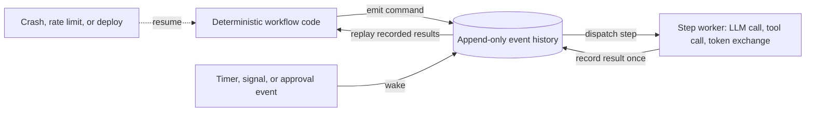

## Problem

Agent workflows are chains of side effects: LLM calls, tool calls, token exchanges, and writes. Many events can stop a run in the middle. A worker crashes or redeploys. A provider rate-limits a call. A person takes two days to approve a refund.

Each naive recovery has a defect:

- **Restart from the beginning.** You pay again for each completed LLM call, and you send the email or charge the card a second time.
- **Keep the process alive during the wait.** The wait holds memory and connections, and a deploy still stops it.
- **Hand-write checkpoint files.** Each workflow gets its own recovery code, and a crash between a side effect and its checkpoint still repeats the effect.

[Filesystem-Based Agent State](filesystem-based-agent-state.md) covers checkpoints that the agent writes on purpose. It does not decide which steps run again after a failure, and it cannot make a repeated step safe.

## Solution

Split the run into two kinds of code, and let an engine record what happened.

- **Deterministic workflow code** decides which step runs next. It does no I/O. It reads no clock and no random value.
- **Steps** (also called activities) do everything that touches the world: LLM inference, tool and API calls, OAuth token exchanges, database writes. The engine runs a step, then records its output in an append-only **event history**.

After a crash, the engine runs the workflow code again from the start and supplies the recorded result of each step. This is **replay**. Completed steps do not run again. Sleeps and external events are records also, so a workflow can hibernate for hours or days and hold no process.



Two rules make replay safe:

1. **An idempotency key for each logical operation.** A step can run more than once, because a worker can crash after the step commits but before the engine records the result. Derive the key from the business operation (order id plus operation), never from the attempt number.
2. **A compensation for each mutating step.** When a later step fails after an earlier external write succeeded, run the registered compensation for each completed write in reverse order. Cloudflare Workflows provides this as rollback handlers on a step; this is the saga approach.

```pseudo
workflow refund_order(order_id):
    # Coordinator: no clocks, randomness, or I/O in this function.
    draft = step("draft-reply", () => call_llm(order_id))
    wait_for_event("refund-approved", timeout="3 days")

    step("charge-refund",
         () => charge(order_id, draft.amount, key=f"refund:{order_id}"),
         compensate=[cancel_refund])
    step("notify", () => send_email(order_id, draft.body))

step(name, action, compensate=[]):
    if history.has(name): return history.result(name)   # replay
    result = run_with_retries(action)                    # may run more than once
    history.append(name, result, compensate)

on_workflow_failure():
    for s in reverse(history.completed_steps):
        if s.compensate: run_with_retries(s.compensate)
```

## Evidence

- **Evidence Grade:** `high` (three independent production engines document the same mechanism and failure modes)
- **Most Valuable Findings:**
  - Temporal replays the workflow from the event history. Its docs name direct `Date.now()` calls, random values, and network calls outside an Activity as causes of non-determinism errors, and list LLM invocations as Activity work whose recorded result is reused on replay.
  - Cloudflare describes each LLM and tool call as "a self-contained, individually retryable unit of work", states that a step "might be retried multiple times", and offers rollback handlers that run in reverse step-start order as saga-style compensation.
  - DBOS checkpoints annotated workflows and steps in Postgres and resumes "from the last completed step". It lists operating an agent that relies on "unreliable or non-deterministic APIs" as a primary use case.
  - Brandur Leach's idempotency-key write-up supplies the recovery-point model: store the result against the key, then return the stored result when the same key arrives again.
- **Unverified / Unclear:** No source measures agent-specific savings from skipped LLM calls. None of the three engines promises exactly-once external effects; all rely on idempotent steps. The Saga paper (1987) describes compensation for multi-service transactions, not agent workflows.

## How to use it

1. **Separate coordination from effects.** Move each LLM call, tool call, clock read, and random value into a step. The workflow code only sequences steps and branches on their recorded results.
2. **Name steps deterministically.** The engine matches recorded results by step identity. A name that contains a timestamp forces a re-run.
3. **Build state from step results only.** A workflow can hibernate and lose all in-memory state between steps. Do not rely on a variable that a step mutated.
4. **Key every mutation.** Pass an idempotency key to providers that accept one. For providers that do not, read the remote state first and return early if the operation already happened.
5. **Bound each wait.** Give sleeps and event waits a timeout. Use [Human-in-the-Loop Approval Framework](human-in-loop-approval-framework.md) for the approval gate, and bind the approval to the exact action with [Exact-Action Authorization Binding](exact-action-authorization-binding.md).
6. **Bound the history.** After many steps, start a fresh execution and pass only the state that it needs (Temporal calls this Continue-As-New). Store large step outputs outside the history and keep a reference.
7. **Watch for stuck runs.** A workflow that waits on an event that never arrives needs a timeout and an external check such as [Dead-Man's Switch for Scheduled Agent Jobs](dead-mans-switch-for-scheduled-agent-jobs.md).

## Trade-offs

**Pros:**

- A crash, deploy, or rate limit costs at most the step that was in flight.
- Long waits hold no process, connection, or thread.
- Completed LLM calls and committed writes are not repeated.
- The history is an audit trail of what ran, when, and with which result.

**Cons:**

- Workflow code must stay deterministic, and in-flight runs need a versioning strategy for code changes.
- The engine is more infrastructure: a hosted or self-run server, or a transactional database.
- Recorded history has size limits, so large payloads must live elsewhere.
- Replay makes debugging harder: the same code runs many times, and only the last run does real work.

### Failure modes

- **Non-determinism error on resume.** The workflow fails with a non-deterministic error after a deploy. The cause is a clock read, a random id, or a direct LLM or network call in workflow code, or a code change while runs are in flight. Move the call into a step, use the replay-safe time and random APIs of the engine, and version the workflow code.
- **Expired credentials after a long sleep.** A step fails with an authentication error hours after the workflow started. The cause is a bearer token cached in a step output or in workflow state while the workflow slept. Acquire tokens inside each step at call time, keep secrets out of the history, and see [Delegated User Authorization](delegated-user-auth-token-exchange.md).
- **Duplicate side effect after a crash.** A customer is charged or emailed twice. The cause is a step that committed externally and then crashed before the engine recorded the result; on replay the step ran again with no idempotency key. Derive a business-level key for each operation, or read the remote state before you write.
- **Unbounded history in an agent loop.** Replays get slower, then the run fails on a history limit. The cause is a long or infinite agent loop that appends events and large tool outputs without end. Start a fresh execution at a clean boundary with only the summary state, and store big outputs by reference.

## References

- [Temporal Workflows](https://docs.temporal.io/workflows): deterministic workflow orchestration over event-history replay.
- [Cloudflare Workflows](https://developers.cloudflare.com/workflows/): durable multi-step execution with retries and `waitForEvent`.
- [DBOS Transact (Python)](https://github.com/dbos-inc/dbos-transact-py): database-backed durable execution for Python workflows and agents.
- [Brandur Leach: Idempotency Keys](https://brandur.org/idempotency-keys): idempotency keys and recovery points for atomic side effects.
- Garcia-Molina, H. & Salem, K. (1987). *Sagas*. The origin of compensation-based rollback for multi-service transactions.
- Related: [Filesystem-Based Agent State](filesystem-based-agent-state.md) (agent-written checkpoints), [Exact-Action Authorization Binding](exact-action-authorization-binding.md) (approval bound to the action that runs), [Human-in-the-Loop Approval Framework](human-in-loop-approval-framework.md) (the gate that a durable wait sleeps on), [Dead-Man's Switch for Scheduled Agent Jobs](dead-mans-switch-for-scheduled-agent-jobs.md) (detects a run that stopped)
