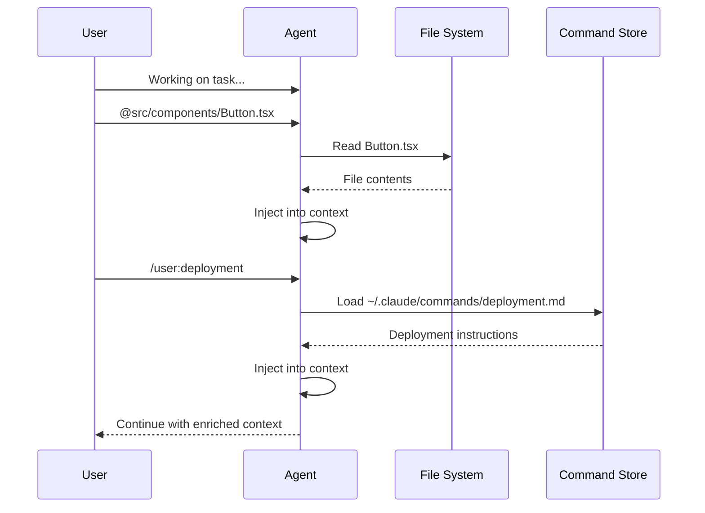

## Problem

While layered configuration files provide good baseline context, agents often need specific pieces of information (e.g., contents of a particular file, output of a script, predefined complex prompt) on-demand during an interactive session. Constantly editing static context files or pasting large chunks of text into prompts is inefficient.

## Solution

Implement mechanisms for users to dynamically inject context into the agent's working memory during a session. Common approaches include:

- **File/Folder At-Mentions:** Allowing users to type a special character (e.g., `@`) followed by a file or folder path (e.g., `@src/components/Button.tsx` or `@app/tests/`). The agent then ingests the content of the specified file or a summary of the folder into its current context for the ongoing task.
- **Custom Slash Commands:** Enabling users to define reusable, named prompts or instructions in separate files (e.g., in `~/.claude/commands/foo.md`). These can be invoked with a slash command (e.g., `/user:foo`), causing their content to be loaded into the agent's context. This is useful for frequently used complex instructions or context snippets.

These methods allow for a more fluid and efficient way to provide targeted context exactly when needed. Current agent harnesses carry the same idea further: Claude Code supports `@` file references and `@server:resource` mentions for MCP resources, slash-command skills invoked with `/skill-name`, and Agent Skills whose `SKILL.md` metadata loads on demand with full instructions fetched only when used.

**File at-mention mechanics** (folded in from the retired On-Demand File Fetch entry):

- Support ranges (`@file.ts:10-50`); when a file exceeds the read limit, narrow the range or summarize instead of loading it whole. Claude Code documents a 25,000-token default per file reference and a 256KB text-file cap.
- For oversized files, extract the relevant portions with a parser (for example tree-sitter AST extraction of function and class definitions) rather than loading entire files.
- Validate every path before reading: reject traversal (`../../etc/passwd`), absolute paths outside the project root, and symlinks that escape it; block sensitive files such as `.env` and `*.key`.

## Example (context injection flow)

## Evidence

- **Evidence Grade:** `established`
- **Documented implementations:** `@` file references, `@server:resource` MCP resource mentions, and slash commands are documented product features of Claude Code (see References); equivalent at-mention mechanisms ship in other coding agents
- **Security-critical:** injected files and command output are an injection surface, so allowlist validation and secret scanning matter

## How to use it

- Use `@` mentions for specific files or folders the task needs now; reserve baseline configuration files for instructions that apply to every session.
- Encapsulate repeated multi-step instructions as named slash commands or skills instead of pasting them each time.
- Keep commands and skills version-controlled so the team shares one definition.
- Enforce path allowlists, file size limits, and credential scanning on whatever the injection mechanism can pull in.

## Trade-offs

* **Pros:** Delivers exactly the context the current step needs; keeps large files out of the baseline context; turns recurring instructions into reusable, reviewable commands.
* **Cons:** Prompt tokens grow with each injection, so over-mentioning bloats the session; commands and skills need maintenance as workflows change; injected content is an injection and exfiltration surface.

## References

- Claude Code docs: common workflows covering `@` file references, `@server:resource` MCP resource mentions, and slash-command usage: https://code.claude.com/docs/en/common-workflows
- Claude Code docs: Agent Skills (progressive-disclosure `SKILL.md` invoked with `/skill-name`): https://code.claude.com/docs/en/skills
- Boris Cherny on at-mentions and custom commands: [How to Use Claude Code Like the People Who Built It](https://every.to/podcast/transcript-how-to-use-claude-code-like-the-people-who-built-it) (secondary summary: [Mastering Claude Code](https://www.nibzard.com/claude-code))
- Aider: `/add`, `/drop` CLI commands with tree-sitter AST parsing — an independent implementation of file at-mention mechanics.
- Beurer-Kellner, M., et al. (2025). "Design Patterns for Securing LLM Agents against Prompt Injections." arXiv:2506.08837.
