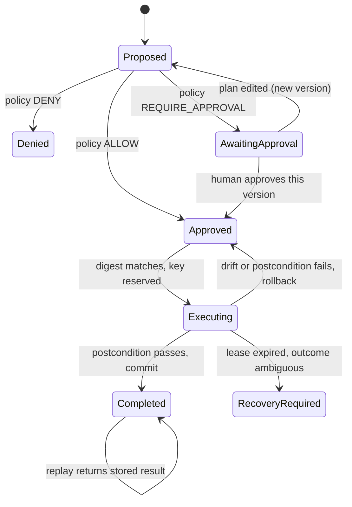

## Problem

Approval systems ask a person or policy service to approve a proposed tool call, then execute it later. Between those steps, the request can be reconstructed, transformed, retried, delegated, or resumed from stored state. Three things go wrong in practice:

- **The approval drifts from what runs.** The agent revises the plan after approval, a second plan reuses the first one's approval, or the action is rebuilt with another recipient, target, operation, payload, actor, acting surface, or policy version. The person approved something, just not this.
- **The target changes underneath.** Another process edits the row while the approval sits in a queue. The correction was right for the state the person saw and is wrong for the state it now applies to.
- **Retries double-apply.** The run times out, a durable workflow resumes, or the person clicks approve twice. The write runs again. Because the duplicate *succeeds*, nothing in the error path notices.

Ordinary audit logs show what was approved and what was executed, but comparison after the fact does not prevent the mismatch. Tool-level allowlists and human approval gates decide whether an action *may* proceed; unless the acting boundary verifies the exact approved action, they do not close this time-of-check/time-of-use (TOCTOU) gap. A separate "already done?" marker helps with replay, but if the marker and the write commit separately there is still a window where one lands and the other does not.

## Solution

Bind authorization to a deterministic identity of the **complete authorization-relevant representation presented for approval**, require the acting adapter to rederive that identity immediately before execution, and when the effect is a database write, make the write, its postcondition check, and its bookkeeping one atomic unit.

**Approval binding (the security mechanism):**

1. Define the authorization-relevant fields: task, approver, actor, acting surface, operation, resolved target identity, arguments, governing policy, expiry, and a nonce or single-use identifier.
2. Canonicalize that representation with a documented profile. Compute a versioned, collision-resistant, domain-separated digest and bind the profile identifier into the authorization.
3. Issue an authenticated, short-lived authorization envelope. A signature or MAC, protected opaque capability, or trusted transactional lookup must bind the issuer, digest, profile, expiry, nonce, policy, and intended enforcement surface.
4. At the execution boundary, authenticate the envelope and reconstruct the action from the immutable values the adapter will actually consume. Canonicalize independently and compare the digest.
5. Atomically compare-and-consume the single-use authorization before execution. Deny mismatches, expiry, replay, or integrity failure. Any material transformation after comparison requires a new authorization.
6. Record authorization match, execution attempt, and independently observed external effect as separate claims. Digest equality correlates records; it does not prove that execution occurred or succeeded.

**Transactional execution (the reliability step, when the effect is a write):**

1. **Plan.** The agent proposes a structured plan: typed corrections against named records, plus a snapshot of the state it reasoned from and the postcondition that should hold afterwards. No free-form SQL or arbitrary tool calls; each correction type is on an allowlist.
2. **Policy.** A deterministic policy decides ALLOW, DENY, or REQUIRE_APPROVAL from the plan's contents (type, size, records touched). No model is involved in this decision.
3. **Approval bound to a version.** Approval is stored against the plan id *and* its version. Any edit creates a new version that needs its own approval. The approving actor must be a human principal the agent cannot act as.
4. **Execution key.** Derive the idempotency key from the business operation (plan id + approved version), never from the attempt or the tool call id. Reserve it with a unique constraint and a short lease before doing anything.
5. **One transaction.** Inside a single transaction: re-read the target and compare it with the approved snapshot (refuse with a drift result if it moved), apply the typed correction, evaluate the postcondition, and only if it passes write the key as `completed` along with the journal entry. Then commit. If the postcondition fails, roll the whole thing back.
6. **Replay and recovery.** A call with a `completed` key returns the stored result and writes nothing. A call that finds a `reserved` key whose lease is still live is refused as concurrent. A `reserved` key whose lease expired means a worker died; re-read live state to classify it as applied, not applied, or ambiguous, and send the ambiguous case to a human instead of guessing.

```pseudo
profile = "example.action-binding/v1+sha256"
approved = canonicalize(profile, {
  task_id, actor, acting_surface, operation,
  target, arguments, policy_id, expires_at, nonce
})
authorization = authenticated_approve(
  domain_digest(profile, approved), profile, expires_at, nonce
)

# Later, inside the adapter that will perform the action:
verify_envelope_integrity_and_issuer(authorization)
presented = canonicalize(profile, immutable_values_used_by_adapter())

if domain_digest(profile, presented) != authorization.action_digest:
    deny("approved action changed")

atomic_compare_and_consume(authorization)  # fails on expiry, replay, or race

# For a write to a system of record, continue inside one transaction:
begin transaction
    if read_target(plan) != plan.snapshot: rollback; return DRIFT_DETECTED
    apply(plan.typed_corrections)
    if not plan.postcondition(read_target(plan)): rollback; return VERIFICATION_FAILED
    keys.mark_completed(key, result)     # same transaction as the write
    journal.append(plan, approver, result)
commit
```



The adapter is the enforcement point. A prompt instruction to "execute only what was approved" is not this pattern, because the same model can reinterpret both the approval and the action. The boundary matters: everything the system later relies on to answer "did this happen, and who allowed it?" commits together with the change, or not at all.

## Evidence

- **Evidence Grade:** `mixed`
- **Most Valuable Findings:**
  - The NOA Action Digest defines an attempt-scoped correlation construction derived from an authorization record, parameter commitment, execution grant, and single-use nonce, while explicitly stating that it does not define execution binding and that equality proves neither execution nor effect.
  - The SCITT AI-agent action-receipt profile separates an issuer-authenticated action record from prior authorization, controller-reported outcome, and external-world effect claims.
  - Brandur Leach's idempotency-keys write-up establishes recovery points and atomic phases for idempotent request handling in one database.
  - Real reports in microsoft/agent-framework and mastra describe side effects repeating when approved agent runs were resumed.
- **Unverified / Unclear:** The fail-closed adapter comparison is this pattern's synthesis, not a guarantee established by the cited specifications. Comparative production evidence is not yet established. Security depends on authenticated authorization, collision-resistant domain-separated canonicalization, atomic consumption, immutable post-check values, and complete mediation.

## How to use it

- Apply it to actions where post-approval drift or replay would matter: payments, messages, deployments, permission changes, ledgers, inventory, billing tables, destructive operations, or externally visible commitments, especially from a durable workflow or a retrying tool loop.
- Include every field that could change the meaning or blast radius. Hashing only the tool name while leaving recipient or arguments outside the identity creates approval theater. Resolve aliases before approval when later resolution could change the resource.
- Use a documented canonicalization profile. Reject duplicate keys, unsupported numeric forms, ambiguous paths, and unknown fields rather than normalizing them differently across services.
- Keep authorization short-lived and preferably single-use. Authenticate it and bind it to the acting surface and policy version so it cannot be replayed through a broader adapter.
- Make alternative execution paths pass through the same verification point. An unmediated CLI, browser, or fallback API can bypass an otherwise correct contract.
- Put the bookkeeping tables (keys, journal, plan status) in the **same database** as the data being changed. If they live elsewhere you are back to two commits and a window between them. External side effects still need the provider's own idempotency key or a lookup before retrying.
- Keep the correction vocabulary small and typed (for example `reverse_movement(id)` or `set_conversion_factor(unit_id, value)`). The approver should read the plan as a diff, not as SQL. Store the approver identity from your auth layer, never from a field the agent fills in.
- Pick the lease from the slowest realistic execution, not the average, and test lease expiry with a deliberately killed worker. Return distinct outcomes (`ALREADY_EXECUTED`, `DRIFT_DETECTED`, `VERIFICATION_FAILED`, `RECOVERY_REQUIRED`) so the agent can react correctly instead of retrying blindly.
- Test mutations and races deliberately: change one target, argument, actor, operation, policy, expiry, or nonce; then make two workers consume the same authorization. Prove rejection before duplicate execution.
- After a matching attempt, verify the stated success criterion through an appropriately trusted status lookup, stable handle, or independent read-back. Report `unknown` when observation cannot resolve the outcome; do not reuse the authorization digest as success evidence.

## Trade-offs

- **Pros:** Detects and rejects committed-field drift on correctly mediated paths; makes approval scope machine-checkable; localizes enforcement at the acting boundary; a retried, resumed, or double-clicked execute cannot apply the effect twice, and the duplicate is visible as a replay instead of silently succeeding; the journal cannot disagree with the data because they commit together; the policy is deterministic and testable without a model.
- **Cons:** Requires authenticated envelopes, strict canonicalization, atomic consumption, crash reconciliation, and mediation of every acting path; changed requests incur another approval; typed corrections cost engineering time per correction type; holding target rows during verification adds lock time (keep postconditions to cheap reads); aliases and unchecked post-comparison transformations can still defeat naive implementations.
- **Limits:** A digest is an integrity identity, not authentication, authorization, or execution proof. A compromised approver, adapter, canonicalizer, or signing key remains dangerous. Drift checks need a well-defined snapshot: too much causes spurious refusals, too little lets real drift through. Reserving the key happens before the main transaction, so a crash right after reserving leaves some cases ambiguous and in need of a person.

## References

- Toraman et al., [*The NOA Action Digest: a Domain-Separated Correlation Value for Human-Approved Agent Actions*](https://datatracker.ietf.org/doc/html/draft-toraman-noa-action-digest-01)
- Toraman, [*A SCITT Profile for AI-Agent Action Receipts*](https://datatracker.ietf.org/doc/html/draft-noa-scitt-ai-agent-receipt-01)
- [Implementing Stripe-like Idempotency Keys in Postgres](https://brandur.org/idempotency-keys), Brandur Leach. Recovery points and atomic phases for idempotent request handling in one database.
- [Idempotent Agent Writes: Derive the Key From the Inputs, Never From the Attempt](https://www.willchan.me/blog/idempotency-for-agentic-writes), Will Chan. Key derivation from semantic inputs and claiming before the effect, in an agent/MCP setting.
- [PostgreSQL INSERT ... ON CONFLICT](https://www.postgresql.org/docs/current/sql-insert.html). The unique-constraint primitive used to reserve a key.
- [microsoft/agent-framework#3938](https://github.com/microsoft/agent-framework/issues/3938) and [mastra-ai/mastra#26133](https://github.com/microsoft/mastra/issues/26133). Real reports of side effects repeating when approved agent runs are resumed.
- [Google AIP-151: Long-running operations](https://google.aip.dev/151) and [Kubernetes API conventions: spec and status](https://github.com/kubernetes/community/blob/master/contributors/devel/sig-architecture/api-conventions.md#spec-and-status). Stable operation handles for status retrieval; desired specification separated from observed status.
- [LedgerGuard](https://github.com/Val1-IT/Arvanta-Ledgerguard) ([execution integrity notes](https://github.com/Val1-IT/Arvanta-Ledgerguard/blob/main/docs/architecture/execution-integrity.md)). Reference implementation for PostgreSQL. **Disclosure:** written by one of the authors of this pattern entry. It's pre-1.0 with synthetic demo scenarios, and the pattern above doesn't depend on it.
- [Human-in-the-Loop Approval Framework](human-in-loop-approval-framework.md) covers where to put approval gates. This pattern covers binding the approval to what actually executes.
