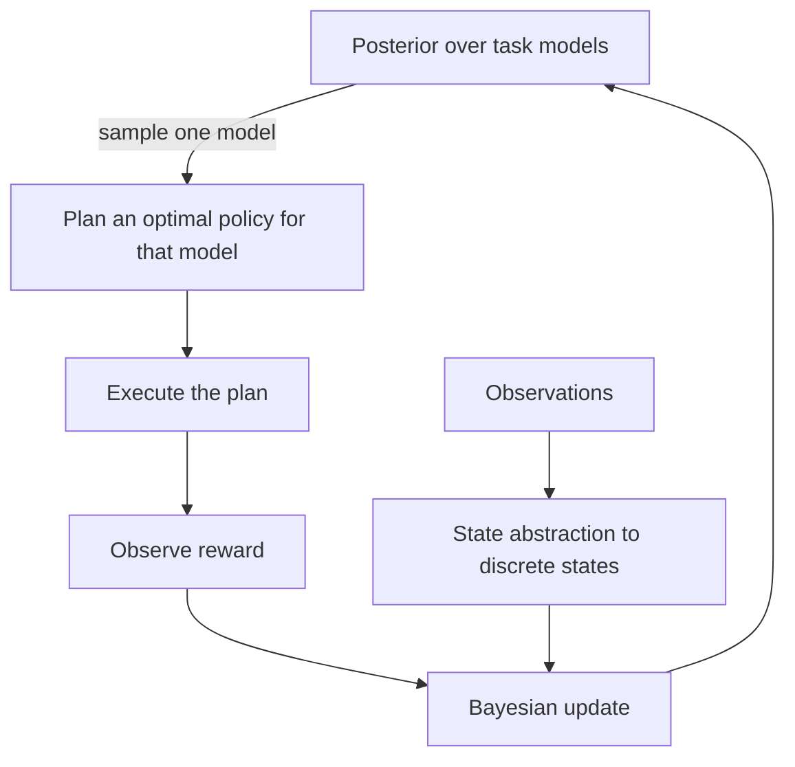

## Problem

Heuristic planning loops often over-exploit the first plausible strategy and under-explore alternatives. In uncertain environments, this drives repeated dead ends, unstable learning, and high token/API spend with little information gain.

## Solution

Embed a *fully specified* RL algorithm—Posterior Sampling for Reinforcement Learning (PSRL)—inside the LLM's reasoning:

- Maintain a Bayesian posterior over task models.
- Sample a model, compute an optimal plan/policy, execute, observe reward, update posterior.
- Express each step in natural language so the core LLM can carry it out with tool calls.

The planner becomes an explicit exploration policy instead of an improvised chain of thoughts. By repeatedly sampling from the posterior, the agent balances exploration and exploitation with a principled uncertainty model rather than ad-hoc retries. This is Thompson sampling generalized to multi-state MDPs, with near-optimal regret bounds of O(√T).

**State the controller keeps outside the prompt:**

- `H`: a small set of competing task models, each written as text that predicts which action leads to which reward.
- `posterior`: one weight per model in `H`, renormalized after every update.
- `history`: `(state, action, reward)` triples, the evidence for the update.
- `horizon`: how many episodes remain, which sets how far ahead each plan looks.

**Controller skeleton** (illustrative; the paper supplies the algorithm, not this code):

```pseudo
H = candidate_task_models(task)             # competing hypotheses, in plain text
posterior = uniform(H)
for episode in range(horizon):
    h = sample(H, posterior)                # one draw, then commit to it for the episode
    plan = LLM.plan(task, model=h, steps=remaining)
    for action in plan:
        state = abstract_state(observation)     # text -> discrete state id
        observation, reward = env.step(action)
        history.append((state, action, reward))
    posterior = bayes_update(posterior, history[episode], H)   # deterministic, in code
```



## How to use it

Wrap PSRL in a reusable prompt template or controller skeleton with explicit state variables (`posterior`, `reward`, `horizon`). Start in bounded environments with measurable reward signals and instrument posterior updates for debugging. For text-based environments, design a state abstraction (e.g., semantic hashing or embedding-based clustering) to map unstructured context to discrete MDP states.

A workable order to build it in:

1. Fix the state abstraction first and check that repeated visits to the same situation map to the same state id.
2. Write the candidate task models by hand before asking the model to propose any.
3. Hold the posterior weights and history in structured state outside the context window.
4. Draw the sampled model with a real random number generator and pass it into the prompt.
5. Log posterior entropy and per-model selection counts; the loop is working when uncertain models get tried and wrong ones fade.

Related patterns: [Tree-of-Thought Reasoning](tree-of-thought-reasoning.md) and [Language Agent Tree Search](language-agent-tree-search-lats.md) search over reasoning steps inside one task; this pattern explores across episodes by maintaining uncertainty about the task itself.

### Failure modes

- **Sampling that is not sampling.** Asked to "sample from the posterior," an LLM tends to pick its most plausible hypothesis nearly every time, which is greedy planning with extra steps. The opposite error is redrawing before every action, which abandons each strategy at the first bad step; PSRL explores deeply precisely because it commits to one model for a whole episode. Draw the model in code from weights held outside the prompt, once per episode, and check the selection counts.
- **The posterior drifts with the context window.** If the weights live only in the prompt, summarization and paraphrase silently change them or drop hypotheses, and after a long run the "posterior" is whatever the last summary said. Keep the weights as structured state, update them with a deterministic function, and inject them fresh each episode.
- **Self-scored reward.** If the same LLM that planned also decides the reward ("the test would probably pass"), the update runs on hallucinated evidence and confidence sharpens on nothing. The reward must come from the environment, which is why the absence of one is an anti-signal.
- **Unstable state abstraction.** Embedding clusters or semantic hashes shift as context grows: the same situation maps to different state ids and counts never accumulate, or different situations merge and contaminate the estimate. Version the abstraction, freeze its parameters for a run, and fail loudly when an observation cannot be placed.

## Trade-offs

* **Pros:** More sample-efficient exploration and better decision consistency under uncertainty.
* **Cons:** Higher implementation complexity, sensitive reward design, additional compute overhead, and requires careful state abstraction for text environments.

**Best for:** Small-to-medium state spaces (<10k states) where sample efficiency matters and reward signals are informative.

**Production status:** While Thompson sampling is widely deployed for bandit problems (Netflix, Amazon, Spotify), PSRL embedded in LLM reasoning remains emerging with no verified production implementations.

## References

- Arumugam & Griffiths, *Toward Efficient Exploration by LLM Agents* (2025)

- Strens, *A Bayesian Framework for Reinforcement Learning* (ICML 2000)

- Osband et al., *More Efficient Reinforcement Learning via Posterior Sampling* (NeurIPS 2013)

- Primary source: https://arxiv.org/abs/2504.20997
