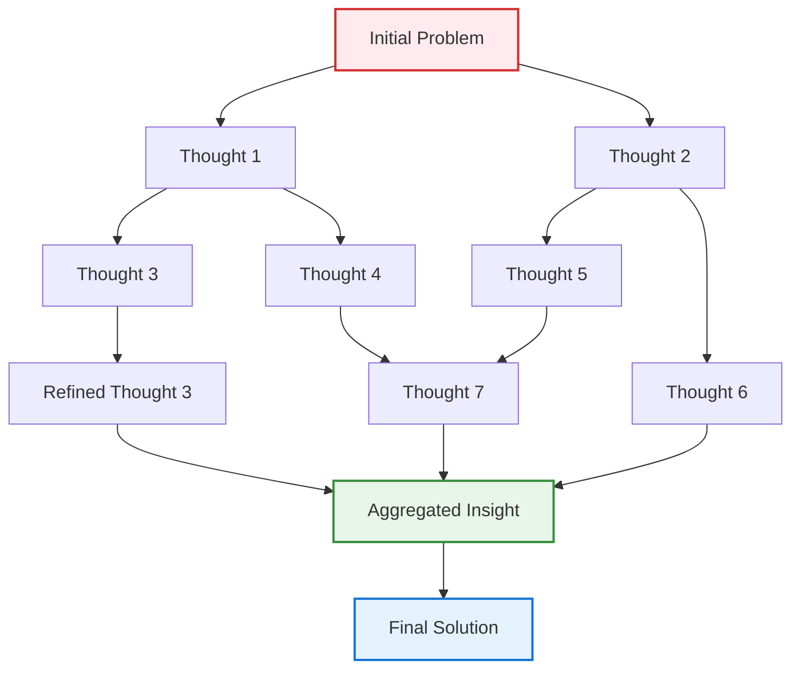

## Problem

Linear reasoning approaches like Chain-of-Thought (CoT) and even tree-based methods like Tree-of-Thoughts (ToT) have limitations when dealing with problems that require complex interdependencies between reasoning steps. Many real-world problems involve reasoning paths that merge, split, and recombine in ways that don't fit neatly into linear or tree structures. These problems need a more flexible approach that can represent arbitrary relationships between thoughts.

## Solution

Graph of Thoughts (GoT) extends reasoning frameworks by representing the thought process as a directed graph. GoT provides a general framework that subsumes Chain-of-Thought (linear) and Tree-of-Thoughts (branching) as special cases, with aggregation as the key enabling operation.

In GoT:

- **Nodes** represent individual thoughts or reasoning states
- **Edges** represent transformations or reasoning steps between thoughts
- **Multiple paths** can lead to and from each node
- **Aggregation operations** can combine multiple thoughts
- **Backtracking** allows revisiting and refining previous thoughts

This enables operations like:

1. **Branching**: Generate multiple thoughts from one
2. **Aggregation**: Combine insights from multiple reasoning paths
3. **Refinement**: Improve thoughts based on later insights
4. **Looping**: Revisit and refine thoughts iteratively

Sketch of a controller for those operations:

```python
class GraphOfThoughts:
    def __init__(self, llm, max_thoughts=50):
        self.llm = llm
        self.max_thoughts = max_thoughts
        self.thought_graph = nx.DiGraph()      # nodes: thoughts; edges: the operation that produced one
        self.thought_scores = {}

    def solve(self, problem):
        root = self.generate_initial_thought(problem)
        self.add_thought(root, score=1.0)

        while len(self.thought_graph) < self.max_thoughts:
            thoughts_to_expand = self.select_thoughts_for_expansion()

            # Score each candidate before expansion so selection is driven
            # by evaluate_thought rather than insertion order
            for thought in thoughts_to_expand:
                self.thought_scores[thought] = self.evaluate_thought(thought, problem)

            for thought in thoughts_to_expand:
                self.branch_thought(thought, problem)
                self.aggregate_related_thoughts(thought)
                self.refine_thought(thought, problem)

        return self.extract_best_solution()

    def branch_thought(self, thought, problem):
        # Ask for 2-3 different ways to continue or branch this reasoning
        for text in self.llm.generate(branch_prompt(problem, thought)).split('\n'):
            self.add_edge(thought, self.add_thought(Thought(text)), operation='branch')

    def aggregate_related_thoughts(self, thought):
        related = self.find_related_thoughts(thought)
        if len(related) >= 2:                   # merge into one thought; edges from every source
            merged = self.add_thought(Thought(self.llm.generate(merge_prompt(related))))
            for source in related:
                self.add_edge(source, merged, operation='aggregate')

    def refine_thought(self, thought, problem):
        context = self.get_thought_context(thought)    # neighboring thoughts
        refined = self.llm.generate(refine_prompt(problem, thought, context))
        if self.is_improvement(refined, thought.content):
            self.add_edge(thought, self.add_thought(Thought(refined)), operation='refine')

    def evaluate_thought(self, thought, problem):
        # Asks for 0-1 ratings on relevance, logical correctness, novelty/insight, and progress
        return self.parse_score(self.llm.generate(evaluate_prompt(problem, thought)))

    def extract_best_solution(self):
        terminals = [n for n in self.thought_graph.nodes() if self.thought_graph.out_degree(n) == 0]
        best_path, best_score = None, -1
        for terminal in terminals:
            for path in nx.all_simple_paths(self.thought_graph, source=self.get_root(), target=terminal):
                if (score := self.score_path(path)) > best_score:
                    best_path, best_score = path, score
        return self.format_solution(best_path)
```



## How to use it

Use for complex problems where multiple solution approaches need to be merged or where early decisions may need revision based on later insights.

Currency note (2026): native reasoning models now internalize much of the single-model test-time structuring that GoT was designed to prompt for by hand, so hand-rolled GoT prompting pays off mainly on open or smaller models. The pattern's live relevance is at the agent level: graph-based orchestration with cycles and backtracking, as in [LangGraph](https://docs.langchain.com/oss/python/langgraph/overview).

Use simpler approaches (CoT, ToT) for:

- Straightforward problems with single viable solution paths
- Cases where computational resources are limited
- Problems where reasoning branches don't need to recombine

## Trade-offs

**Pros:**

- Handles complex problems with interdependent reasoning steps
- Can discover non-obvious connections between ideas
- Supports iterative refinement and backtracking
- More expressive than linear or tree-based approaches
- **Flexibility**: Can represent complex, non-linear reasoning patterns
- **Reusability**: Thoughts can be referenced and built upon multiple times
- **Robustness**: Multiple paths to solution increase success probability
- **Insight Aggregation**: Combines best aspects of different reasoning paths

**Cons:**

- Higher computational cost than a single reasoning path; how much higher depends on graph size and branching, not a fixed multiplier
- Complex to implement and debug
- May generate many redundant thoughts
- Requires sophisticated scoring and path-finding algorithms
- Can be overkill for simple problems

## References

- [Graph of Thoughts: Solving Elaborate Problems with Large Language Models (AAAI 2024)](https://arxiv.org/abs/2308.09687) - Besta et al., ETH Zurich. On the paper's sorting task, GoT improved quality over Tree-of-Thoughts by 62% while lowering cost by over 31%; the paper does not claim a fixed compute multiplier over linear reasoning.
- [Tree of Thoughts: Deliberate Problem Solving with Large Language Models](https://arxiv.org/abs/2305.10601) - Yao et al., NeurIPS 2023 - the tree-search special case GoT extends with merge operations
- [Code Implementation](https://github.com/spcl/graph-of-thoughts)
- [LangGraph - Graph-based Agent Workflows](https://www.langchain.com/langgraph)
