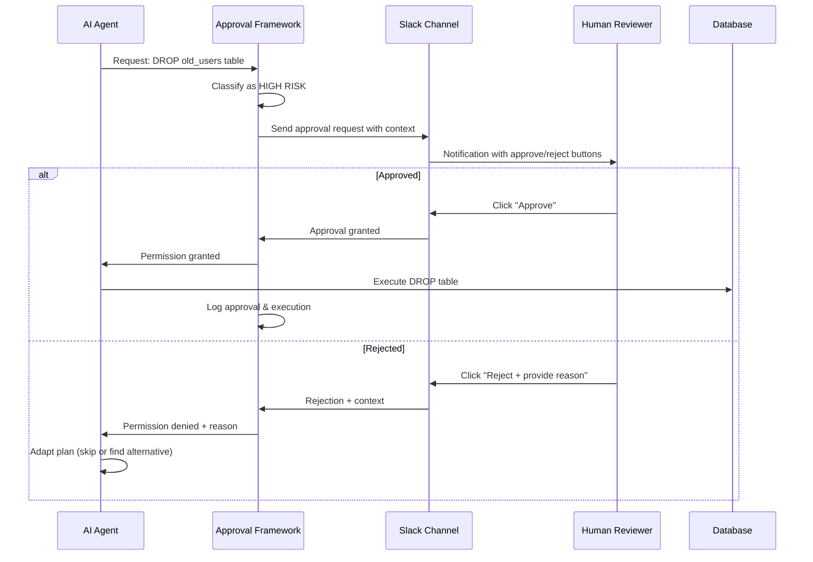

## Problem

Autonomous AI agents need to execute high-risk or irreversible operations (database modifications, production deployments, system configurations, API calls) but allowing unsupervised execution creates unacceptable safety and compliance risks. Blocking all such operations defeats the purpose of agent automation.

## Solution

Systematically insert human approval gates for designated high-risk functions while maintaining agent autonomy for safe operations. Create lightweight feedback loops that enable time-sensitive human decisions without blocking the entire agent workflow.

**Core components:**

**Risk classification:**

- Identify functions that require human approval
- Define approval criteria (cost thresholds, data sensitivity, reversibility)
- Categorize operations by risk level

**Multi-channel approval interface:**

- Slack integration for real-time notifications
- Email for asynchronous approvals
- SMS for urgent/critical operations
- Web dashboard for batch reviews

**Approval workflow:**

- Agent requests permission before executing risky function
- Human receives context-rich approval request
- Quick approve/reject/modify decision
- Agent proceeds or adapts based on response
- Timeout handling with configurable escalation (default deny recommended)

**Audit trail:**

- Log all approval requests and responses
- Track who approved what and when
- Enable compliance and debugging



## How to use it

**When to apply:**

- Production database operations (DELETE, DROP, ALTER)
- External API calls with side effects (payments, emails, webhooks)
- System configuration changes (firewall rules, permissions)
- Destructive file operations (bulk deletes, overwrites)
- Compliance-sensitive operations (GDPR, HIPAA, SOC2)

**Implementation examples:**

**Permission rules (Claude Code settings):**

```json
// .claude/settings.json — rules are evaluated deny, then ask, then allow
{
  "permissions": {
    "allow": ["Bash(git add:*)", "Bash(npm test:*)"],
    "ask": ["Bash(git push:*)"],
    "deny": ["Read(.env)", "Read(secrets/**)"]
  }
}
```

Commands on the `ask` list pause the agent until a human answers the permission prompt, which is the same gate-then-resume flow the Slack-based implementations use.

**Interrupt pattern (LangGraph):**

```python
from langgraph.types import interrupt

def risky_operation(state):
    approval = interrupt({
        "question": "Should I proceed with this operation?",
        "operation": state["message"]
    })
    return {"user_approval": approval}

# Compile with checkpointer for state preservation
app = workflow.compile(checkpointer=MemorySaver())
```

**Protocol-level elicitation (MCP):**

An MCP server can pause mid-flow and send an `elicitation/create` request to the client, which renders the question and schema to the user and returns the answer to the agent. This gives any MCP-connected client the same interrupt semantics without a bespoke approval service.

**2. Configure approval channels:**

```yaml
approval_channels:
  high_risk:
    
- slack: "#agent-approvals"
    - sms: "+1234567890"  # For urgent
  medium_risk:
    
- slack: "#agent-review"
  low_risk:
    
- email: "team@company.com"
```

**3. Set context requirements:**

- Why is the operation needed?
- What data will be affected?
- Is it reversible?
- What are the alternatives?

**Prerequisites:**

- Integration with communication platforms (Slack, email, SMS)
- Clear risk classification criteria
- Fast human response time for time-sensitive operations
- Fallback strategies when approval is denied

## Trade-offs

**Pros:**

- Enables safe autonomous execution of risky operations
- Maintains human oversight where it matters most
- Lightweight integration (Slack buttons, not complex UIs)
- Audit trail for compliance and debugging
- Reduces agent anxiety about mistakes
- Allows gradual trust expansion over time

**Cons:**

- Requires human availability and responsiveness
- Can bottleneck agent workflows if approvals are slow
- Infrastructure complexity (notification systems, state management)
- Risk of approval fatigue leading to rubber-stamping
- Requires clear classification of what needs approval
- May interrupt human focus with frequent requests

## References

- [Building Companies with Claude Code](https://claude.com/blog/building-companies-with-claude-code) - HumanLayer's core product coordinates agent actions with "human approval steps" via Slack
- [HumanLayer on GitHub](https://github.com/humanlayer/humanlayer) - the open-source SDK is now largely deprecated ("the code here is pretty much all deprecated"); the company pivoted to a coding-agent IDE ([humanlayer.dev](https://www.humanlayer.dev))
- [12-Factor Agents](https://github.com/humanlayer/12-factor-agents) - Factor 7 covers contacting humans via tool calls
- [Claude Code permissions](https://code.claude.com/docs/en/permissions) - permission modes plus allow/ask/deny rules as a maintained standard implementation
- [MCP elicitation specification](https://modelcontextprotocol.io/specification/2025-06-18/client/elicitation) - protocol-level mid-flow approval requests
- [Design Patterns for Securing LLM Agents](https://arxiv.org/abs/2506.08837) (Beurer-Kellner et al., ETH Zurich, 2025) - Academic treatment of approval systems as security pattern, including separation of proposal and execution
- [Impri](https://github.com/sekera-radim/impri) - Self-hostable, framework-agnostic implementation of this pattern (disclosure: made by this PR's author): agents propose actions via MCP or REST, a human approves/edits/rejects from a web inbox, Slack, Telegram, or phone, then the agent executes. MIT-licensed open-core, included as a concrete alternative to the vendor-SDK references above.
- Related patterns: [Spectrum of Control / Blended Initiative](spectrum-of-control-blended-initiative.md), [Chain-of-Thought Monitoring & Interruption](chain-of-thought-monitoring-interruption.md)
