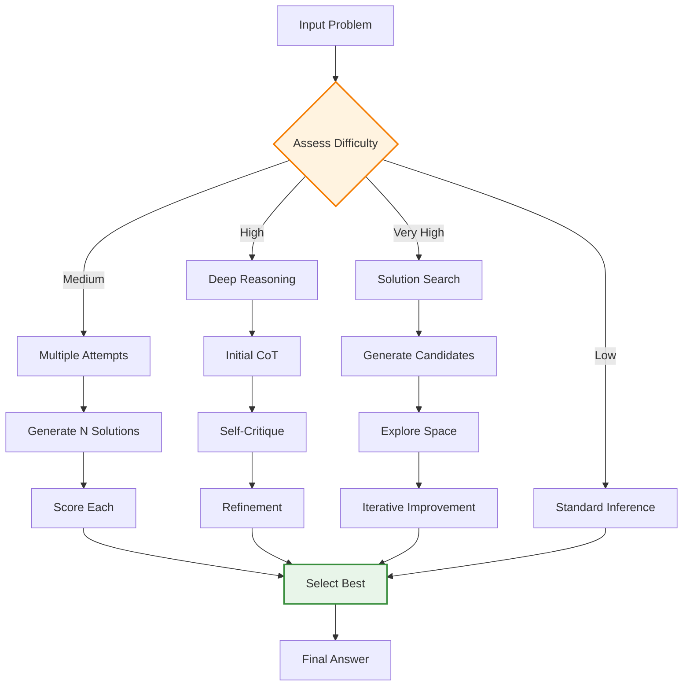

## Problem

Traditional language models are limited by their training-time capabilities. Once trained, their performance is essentially fixed, regardless of how much compute is available at inference time. This means that for particularly challenging problems, we cannot simply "think harder" by allocating more computational resources to find better solutions. This limitation becomes especially apparent in complex reasoning tasks where more deliberation could lead to better outcomes.

## Solution

Inference-Time Scaling allocates additional computational resources during inference to improve output quality. Instead of generating a single response, the system can:

1. **Generate multiple candidates** and select the best one (Best-of-N)
2. **Perform extended reasoning** chains before responding (Chain-of-Thought)
3. **Iterate and refine** outputs through multiple passes (Self-Refinement)
4. **Search through solution spaces** more thoroughly (Tree-of-Thought, MCTS)
5. **Verify and validate** answers before returning them (Self-Consistency)

This approach trades compute time for solution quality, allowing smaller models with inference-time scaling to outperform larger models using standard inference.

Sketch of an agent that picks strategies by compute budget:

```python
class InferenceTimeScalingAgent:
    def solve_with_scaling(self, problem, max_compute_budget=100):
        if self.scaling_strategy == 'adaptive':
            difficulty = self.estimate_difficulty(problem)             # spend by difficulty, not a fixed N
            compute_budget = min(difficulty * 10, max_compute_budget)
        else:
            compute_budget = max_compute_budget

        solutions = []
        if compute_budget >= 10:                                       # 1. multiple attempts, varied prompting
            solutions.extend(self.multiple_attempts(problem, n=5))
        if compute_budget >= 30:                                       # 2. extended reasoning with self-critique
            solutions.append(self.deep_reasoning(problem))
        if compute_budget >= 50:                                       # 3. search over the solution space
            solutions.append(self.solution_search(problem))
        return self.select_best_solution(solutions, problem)

    def multiple_attempts(self, problem, n=5):
        strategies = ["Think step by step", "Consider edge cases", "Work backwards from the goal",
                      "Break into subproblems", "Use analogical reasoning"]
        solutions = []
        for i in range(n):
            strategy = strategies[i % len(strategies)]
            solution = self.base_model.generate(f"{strategy}: {problem}")
            solutions.append({'solution': solution, 'strategy': strategy,
                              'confidence': self.evaluate_confidence(solution)})
        return solutions

    def deep_reasoning(self, problem):
        # Reason first (understand, pick an approach, solve, verify), then critique
        # (errors? assumptions? could the approach be improved?), then refine
        initial = self.base_model.generate(cot_prompt(problem))
        critique = self.base_model.generate(critique_prompt(problem, initial))
        refined = self.base_model.generate(refine_prompt(problem, initial, critique))
        return {'solution': refined, 'strategy': 'deep_reasoning', 'iterations': 3,
                'confidence': self.evaluate_confidence(refined)}

    def solution_search(self, problem, max_iterations=10):
        candidates = PriorityQueue()                 # highest-scoring partial solution first
        for sol in self.generate_initial_solutions(problem, n=3):
            candidates.put((-self.score_solution(sol), sol))
        best, iterations = None, 0
        while not candidates.empty() and iterations < max_iterations:
            score, current = candidates.get()
            if self.is_complete_solution(current, problem) and (best is None or score < best[0]):
                best = (score, current)
            variations = self.generate_variations(current, problem)    # explore, score, re-queue
            for var in variations:
                candidates.put((-self.score_solution(var), var))
            iterations += 1
        return {'solution': best[1] if best else current, 'strategy': 'solution_search',
                'iterations': iterations, 'candidates_explored': iterations * len(variations)}
```



## Evidence

- **Academic Foundation**: Wei et al. (2022) established chain-of-thought prompting; Wang et al. (2022) demonstrated self-consistency gains via multiple sampling
- **Compute-Optimal Scaling**: Snell et al. (2024) show that adapting test-time compute per prompt makes scaling markedly more efficient than uniform best-of-N, and can let a smaller model outperform a much larger one in FLOPs-matched settings
- **Search-Based Methods**: Yao et al. (2023) showed Tree-of-Thought improves complex problem-solving through search over reasoning paths
- **Production Models**: OpenAI o1 (September 2024) and Anthropic Claude Extended Thinking implement inference-time scaling natively, with improved reasoning on math and coding tasks
- **Self-Refinement**: Shinn et al. (2023) Reflexion shows models can improve outputs through iterative self-critique

## How to use it

- Set a compute or latency ceiling per request before you scale, then measure quality per dollar at each budget step. Stop where returns flatten.
- Match the strategy to verifiability. Best-of-N and self-consistency need a scorer or verifier to select among candidates. Sequential refinement needs the model to critique its own output credibly.
- Adapt compute to difficulty instead of spending a fixed N on every prompt. Snell et al. (2024) show compute-optimal allocation beats uniform best-of-N at the same budget.
- Check native reasoning models first. Frontier models now spend test-time compute internally (o1, Claude Extended Thinking). Hand-rolled best-of-N or search scaffolding may duplicate what the base model already provides. See [recursive-best-of-n-delegation.md](recursive-best-of-n-delegation.md) and [tree-of-thought-reasoning.md](tree-of-thought-reasoning.md) for when building it yourself still pays off.

## Trade-offs

**Pros:**

- Can dramatically improve performance on complex tasks
- More cost-effective than training larger models
- Allows dynamic resource allocation based on task difficulty
- Enables "System 2" thinking in AI systems

**Cons:**

- Increased latency for responses
- Higher inference costs for complex problems
- Diminishing returns beyond certain compute thresholds
- Not beneficial for simple tasks
- Requires careful tuning of scaling strategies

## References

- [Scaling LLM Test-Time Compute Optimally can be More Effective than Scaling Model Parameters (Snell et al., 2024)](https://arxiv.org/abs/2408.03314) — the compute-optimal reference: adaptive per-prompt allocation of test-time compute versus best-of-N and parameter scaling
- [Chain-of-Thought Prompting Elicits Reasoning (Wei et al., 2022)](https://arxiv.org/abs/2201.11903)
- [Self-Consistency Improves CoT Reasoning (Wang et al., 2022)](https://arxiv.org/abs/2203.11171)
- [Tree of Thoughts (Yao et al., 2023)](https://arxiv.org/abs/2305.10601)
- [Reflexion: Language Agents with Verbal Reinforcement Learning (Shinn et al., 2023)](https://arxiv.org/abs/2303.11366)
- [OpenAI Learning to Reason with LLMs](https://openai.com/index/learning-to-reason-with-llms/)
