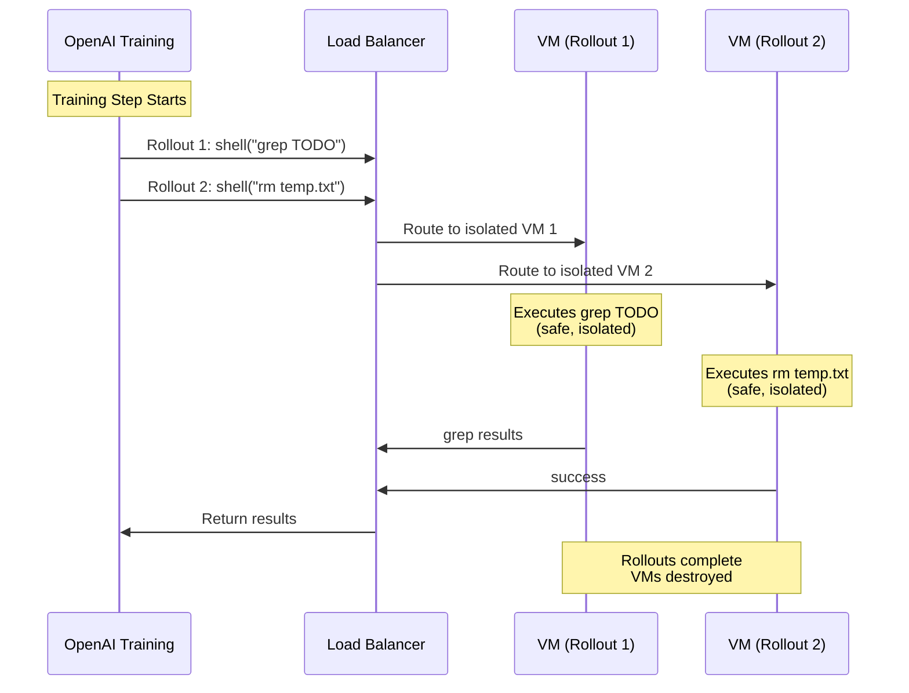

## Problem

During reinforcement learning training with tool-using agents, multiple rollouts execute simultaneously and may call destructive or stateful tools. This challenge is well-established in distributed RL research—A3C (Mnih et al., 2016) and PPO (Schulman et al., 2017) both rely on parallel isolated environment instances for stable gradient estimation.

- **Cross-contamination**: One rollout's actions affect another rollout's environment
- **Destructive commands**: Agent might run `rm -rf`, corrupting shared state
- **State leakage**: File system changes persist across rollouts, creating inconsistent training data
- **Reward corruption**: If rollout B sees rollout A's side effects, reward signals become meaningless
- **Debugging nightmares**: Non-deterministic failures due to race conditions

Cognition faced this when training Devon's file planning agent: the agent had access to a `shell` tool that could run arbitrary commands like `grep`, `find`, or even `rm`. Running 32 parallel rollouts on shared infrastructure would cause chaos.

## Solution

**Spin up an isolated virtual machine (or container) for each RL rollout, ensuring complete environment isolation.**

**Architecture:**

1. **Rollout ID Tracking**: OpenAI's Agent RFT platform assigns unique IDs to each rollout
2. **VM/Container Mapping**: Your infrastructure maps rollout ID → dedicated VM
3. **Clean State**: Each VM starts fresh with identical filesystem, packages, and configuration
4. **Cleanup**: VMs are destroyed after rollout completes (success or failure)

**Key Components:**

- **VM Provisioning**: Fast VM creation (typically cloud instances or containers)
- **Bursty Scaling**: Handle 100s-500s of simultaneous VM requests at training step boundaries
- **State Isolation**: No shared filesystems or databases between VMs
- **Timeout Handling**: VMs auto-destroy after timeout to prevent resource leaks

**Tool server shape** (Cognition used Modal; one instance per rollout VM):

```python
base_image = (Image.debian_slim().apt_install("git", "build-essential").pip_install("pandas", "numpy", "openai")
              .copy_local_dir("./corpus", "/workspace/corpus"))                 # training data, replicated per VM
@app.cls(image=base_image, cpu=2, memory=4096, timeout=600,                    # 10 min per rollout max
         concurrency_limit=500, container_idle_timeout=60)                      # burst capacity; 1 min idle cleanup
class IsolatedToolExecutor:
    def initialize_rollout(self, rollout_id: str):                              # called first
        self.rollout_id, self.history = rollout_id, []
        self.work_dir = f"/workspace/rollout_{rollout_id}"                       # isolated working directory
    def execute_shell(self, rollout_id: str, command: str):
        if rollout_id != self.rollout_id:                                         # every endpoint validates the id
            raise ValueError(f"Rollout ID mismatch: {rollout_id} != {self.rollout_id}")
        result = subprocess.run(command, shell=True, cwd=self.work_dir, capture_output=True, text=True, timeout=60)
        self.history.append({"command": command, "returncode": result.returncode,
                             "stdout": result.stdout[:1000], "stderr": result.stderr[:1000]})
        return {"stdout": result.stdout, "stderr": result.stderr, "returncode": result.returncode}
tools_config = [  # registered with OpenAI Agent RFT: one HTTPS endpoint per tool; AUTH = {"Authorization": "Bearer YOUR_TOKEN"}
    {"name": "shell",     "url": "https://your-app.modal.run/execute_shell", "headers": AUTH},
    {"name": "read_file", "url": "https://your-app.modal.run/read_file",    "headers": AUTH},
    {"name": "search",    "url": "https://your-app.modal.run/search_corpus", "headers": AUTH},
]
```

The `read_file` and `search_corpus` endpoints follow the same pattern: validate the `rollout_id`, read only inside that VM (the corpus is a read-only copy), and return the result. Modal destroys the VM when the rollout ends.



## How to use it

**Phase 1: Infrastructure setup.** Choose your isolation technology:

- **Modal/E2B**: MicroVMs with ~1s startup, Firecracker isolation (recommended for agent training)
- **Modal/Lambda**: Serverless functions with container isolation (easiest)
- **Docker**: Containers per rollout (good balance)
- **Kubernetes Jobs**: K8s pods per rollout (production-grade)
- **Cloud VMs**: EC2/GCP instances per rollout (maximum isolation, 30-120s startup)

**Phase 2: Rollout ID tracking.** All tool endpoints accept and validate `rollout_id`, and the router maps it to a dedicated VM:

```python
@app.post("/tool/{tool_name}")
async def execute_tool(tool_name: str, rollout_id: str, params: dict):
    vm = get_or_create_vm(rollout_id)                 # isolated environment for this rollout
    try:
        return await vm.execute(tool_name, params)
    except Exception as e:
        # Log the failure; an infrastructure error must not be scored as a zero reward
        logger.error(f"rollout={rollout_id} tool={tool_name} status=error error={str(e)}")
        return {"error": "Infrastructure error, please retry", "retryable": True}
```

**Phase 3: Bursty traffic.** Agent RFT sends traffic in bursts, so size concurrency limits and idle timeouts for the peak, not the average (see `concurrency_limit` and `container_idle_timeout` above):

- **Training step boundary**: 100-500 simultaneous rollout requests
- **Tool call latency**: Brief pauses while agent thinks
- **Cleanup phase**: Mass VM destruction

**Phase 4: Monitor infrastructure.** Critical metrics:

- **VM provisioning time**: Should be <5 seconds (alert if >10s)
- **Infrastructure error rate**: Target <1%, alert if >5% (higher rates cause training collapse)
- **Rollout timeout rate**: Target <0.1%, alert if >1%
- **Resource leaks**: Active rollout count should match expected; alert if +50 over baseline

Sam's advice from Cognition:

> "Sometimes like let's say there's infrastructure error and the VMs fail... that does lead to the training kind of collapsing because even the model might have done something good, it got a zero reward."

Log `rollout`, `tool`, and `status` for every call, and return a retryable error to the trainer instead of letting an infrastructure failure become a zero-reward rollout.

### Worked example: Cognition (Devon)

- **Challenge**: train Devon's file planning agent, which uses `shell` to run `grep`, `find`, `ls`, and so on, without one rollout affecting another and while tolerating destructive commands.
- **Solution**: Modal for fast VM provisioning; a dedicated VM with a fresh filesystem per rollout; the whole repository corpus copied into each VM; capacity for 500+ simultaneous VMs during training bursts.
- **Results**: safe training despite shell access, no cross-contamination between rollouts, deterministic behavior for reward calculation, and a planning agent trained to go from 8-10 tool calls down to 4.
- **Bursty traffic is real**: "At the beginning of every rollout they would send us like 500 new rollout requests"
- **Monitor failures**: infrastructure errors causing zero rewards can collapse training
- **Reuse production code**: "We use VMs because we could reuse the production Devon VM info"

**Corroboration beyond the webinar (2026):**

The Cognition case study remains the primary narrative source (the video's host introduces the speaker as "research engineer Sam Pretty at Cognition"), but the same isolation requirement now appears in open-source agent-RL trainers. Microsoft's [agent-lightning](https://github.com/microsoft/agent-lightning) runs each rollout agent as its own Kubernetes Job — "Run agents directly as Kubernetes Jobs without relying on external sandbox services" — giving pod-level per-rollout isolation as a built-in property of its rollout controller rather than a custom Modal setup.

## Trade-offs

**Pros:**

- **Complete isolation**: No cross-contamination between rollouts
- **Safety**: Destructive commands can't affect other rollouts or host system
- **Determinism**: Consistent environment for reliable reward signals
- **Production parity**: Can use exact same environment as production

**Cons:**

- **Cost**: 100s of VMs running simultaneously can be expensive
- **Provisioning time**: VM startup adds latency (containers are faster)
- **Complexity**: Requires robust infrastructure and monitoring
- **Scaling limits**: Cloud provider quotas may limit concurrent VMs
- **Failure modes**: Infrastructure issues can cause training collapse

### Alternatives

- **Shared infrastructure with namespacing** (chroot, Docker volumes): cheaper but less isolation, with a risk of leakage through shared resources.
- **Database-backed state** keyed by rollout ID: simpler infrastructure, but it does not work for filesystem-based tools.
- **Optimistic isolation**: let rollouts share infrastructure, detect contaminated rollouts, and discard them; this wastes compute on the discarded rollouts.

## References

- [OpenAI Build Hour: Agent RFT - Cognition Case Study (November 2025)](https://youtu.be/1s_7RMG4O4U)
- [Microsoft agent-lightning](https://github.com/microsoft/agent-lightning) — open-source agent-RL trainer whose rollout controller runs each rollout as a Kubernetes Job, providing per-rollout pod isolation natively
- Mnih et al. (2016). "Asynchronous Methods for Deep Reinforcement Learning". [arXiv:1602.01783](https://arxiv.org/abs/1602.01783) — A3C foundation for parallel isolated environments
- Schulman et al. (2017). "Proximal Policy Optimization Algorithms". [arXiv:1707.06347](https://arxiv.org/abs/1707.06347) — PPO parallel rollout collection
- Liang et al. (2018). "RLlib: Abstractions for Distributed Reinforcement Learning". [arXiv:1712.09381](https://arxiv.org/abs/1712.09381) — Actor-model isolation for distributed RL
- [Modal Documentation](https://modal.com/docs)
- [E2B Documentation](https://e2b.dev/docs) — Firecracker microVMs for agent sandboxes
- Related patterns: Agent Reinforcement Fine-Tuning, Adaptive Sandbox Fanout Controller, Sandboxed Tool Authorization, Egress Lockdown, Virtual Machine Operator Agent
