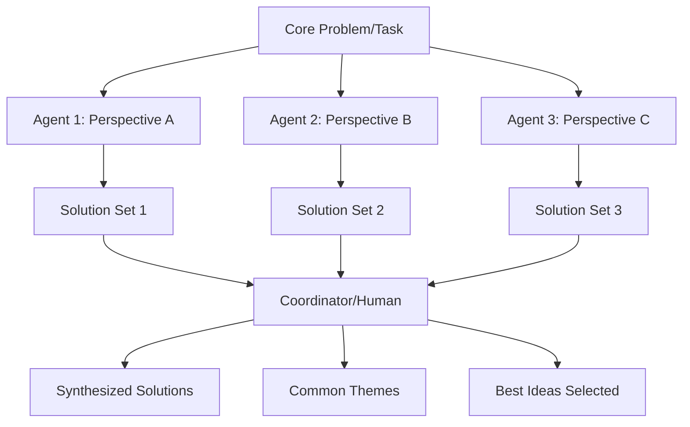

## Problem

For complex problems or creative ideation, a single AI agent instance might get stuck in a local optimum or fail to explore a diverse range of solutions. Generating a breadth of ideas can be challenging for a sequential, monolithic process.

## Solution

Employ a multi-agent approach for brainstorming and idea generation. This involves:
1.  Defining a core problem or task.
2.  Spawning multiple independent (or semi-independent) AI agent instances.
3.  Assigning each agent the same initial task or slightly varied perspectives on the task.
4.  Allowing each agent to work in parallel to generate ideas, solutions, or approaches.
5.  Collecting the outputs from all agents.
6.  Optionally, a coordinating agent or a human user can then synthesize these diverse outputs, identify common themes, or select the most promising ideas for further development.

This pattern leverages parallelism to explore a wider solution space and can lead to more creative or robust outcomes than a single agent might produce alone.

## Example (parallel brainstorming)

## Example

-   "Use 3 parallel agents to brainstorm ideas for how to clean up `@services/aggregator/feed_service.cpp`." (from Claude Code examples)

## How to use it

- Use this when you need diverse perspectives or want to avoid local optimum trapping.
- Assign distinct roles or perspectives to each agent (e.g., critic, optimist, technical realist).
- Limit to 2-4 agents for manageable coordination (practitioner guidance, not a measured threshold); note that research on sampling-and-voting finds accuracy generally improves with more agents, so add agents when the task rewards coverage and you can afford the runs.
- Use a coordinating agent or human to synthesize and deduplicate outputs.

## Trade-offs

* **Pros:** Explores wider solution space, reduces local optimum trapping, enables diverse perspective exploration.
* **Cons:** Adds orchestration complexity, coordination overhead increases with agent count, requires synthesis mechanisms.

## References

-   Inspired by the example of using parallel agents for brainstorming in "Mastering Claude Code: Boris Cherny's Guide & Cheatsheet," section III.
-   [Self-Consistency Improves Chain of Thought Reasoning in Language Models](https://arxiv.org/abs/2203.11171) - Wang et al., 2022: sampling multiple reasoning paths and taking the most consistent answer
-   [More Agents Is All You Need](https://arxiv.org/abs/2402.05120) - Li et al., 2024: sampling-and-voting performance scales with the number of agents
-   Microsoft AutoGen: https://github.com/microsoft/autogen
-   MetaGPT: https://github.com/geekan/MetaGPT
-   Related: [Recursive Best-of-N Delegation](recursive-best-of-n-delegation.md) — runs N attempts and picks the best one. Distinct from that pattern: brainstorming merges diverse ideas into options rather than selecting a single best output.
-   Related: [Opponent-Processor Multi-Agent Debate](opponent-processor-multi-agent-debate.md) — agents argue opposing positions. Distinct from that pattern: brainstorming agents work independent perspectives in parallel instead of critiquing each other.

[Source](https://www.nibzard.com/claude-code)
