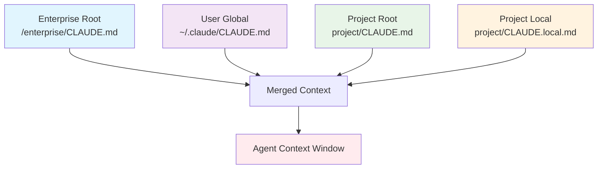

## Problem

AI agents require relevant context to perform effectively. Providing this context manually in every prompt is cumbersome, and a one-size-fits-all global context is often too broad or too narrow. Different projects, users, and organizational policies may require different baseline information for the agent.

## Solution

Implement a system of layered configuration files (e.g., named `CLAUDE.md` or a similar convention) that the agent automatically discovers and loads based on their location in the file system hierarchy. This allows for:

-   **Enterprise/Organizational Context:** A root-level file (`/<enterprise_root>/CLAUDE.md`) for policies or information shared across all projects in an organization.
-   **User-Specific Global Context:** A file in the user's home directory (`~/.claude/CLAUDE.md`) for personal preferences, common tools, or notes shared across all their projects.
-   **Project-Specific Context:** A file within the project's root directory (`<project_root>/CLAUDE.md`), typically version-controlled, for project-specific instructions, architectural overviews, or key file descriptions.
-   **Project-Local Context:** A local, non-version-controlled file (`<project_root>/CLAUDE.local.md`) for individual overrides, temporary notes, or secrets relevant to the project for that user.

The agent intelligently merges or prioritizes these context layers, providing a rich, tailored baseline of information without manual intervention in each query.

Current Claude Code documentation extends the same layering with four mechanisms worth knowing:

- **AGENTS.md interop**: Claude Code reads a repository's `AGENTS.md` in place of or alongside `CLAUDE.md`, so a repo set up for other coding agents works unchanged.
- **Path-scoped rules**: `.claude/rules/*.md` files can carry a `paths` field so instructions load only when the agent works on matching files, keeping the baseline smaller.
- **Imports**: `@path/to/import` in any memory file expands and loads the referenced file at launch (recursively, up to four hops).
- **Auto memory**: alongside the layers you write, Claude writes its own learning notes per repository and loads them at the start of every session.

## Example (configuration hierarchy)

## Evidence

- **Documented implementations:** layered memory files, AGENTS.md interop, `.claude/rules/` scoping, and `@` imports are documented features (Claude Code memory docs, linked below)
- **Cross-tool convention:** AGENTS.md is an open format stewarded by the Agentic AI Foundation under the Linux Foundation, adopted by OpenAI Codex, Google Jules and Gemini CLI, GitHub Copilot's coding agent, Cursor, Devin, and others, with the project reporting over 60k open-source projects using it: https://agents.md
- **Practitioner origin:** popularized by Boris Cherny's account of Claude Code's design (interview linked below); limited formal academic literature

## How to use it

- Use this when model quality depends on selecting or retaining the right context.
- Start with strict context budgets and explicit memory retention rules.
- Measure relevance and retrieval hit-rate before increasing memory breadth.
- Version-control project context (`CLAUDE.md`); exclude local overrides (`CLAUDE.local.md`) from VCS.

## Trade-offs

* **Pros:** Raises answer quality by keeping context relevant and reducing retrieval noise; enables enterprise-wide policy enforcement; supports automatic context loading without manual intervention.
* **Cons:** Requires ongoing tuning of memory policies and indexing quality; context window limits may truncate layers; potential for configuration conflicts.

## References

- Claude Code memory documentation (CLAUDE.md hierarchy, AGENTS.md interop, `.claude/rules/`, imports, auto memory): https://code.claude.com/docs/en/memory
- Boris Cherny on the CLAUDE.md system: [How to Use Claude Code Like the People Who Built It](https://every.to/podcast/transcript-how-to-use-claude-code-like-the-people-who-built-it) (secondary summary: [Mastering Claude Code](https://www.nibzard.com/claude-code))
- AGENTS.md open format (adoption list and stewardship): https://agents.md
- Claude Code: https://github.com/anthropics/claude-code
- Continue.dev: https://github.com/continuedev/continue
- Cursor rules: https://cursor.com/docs
