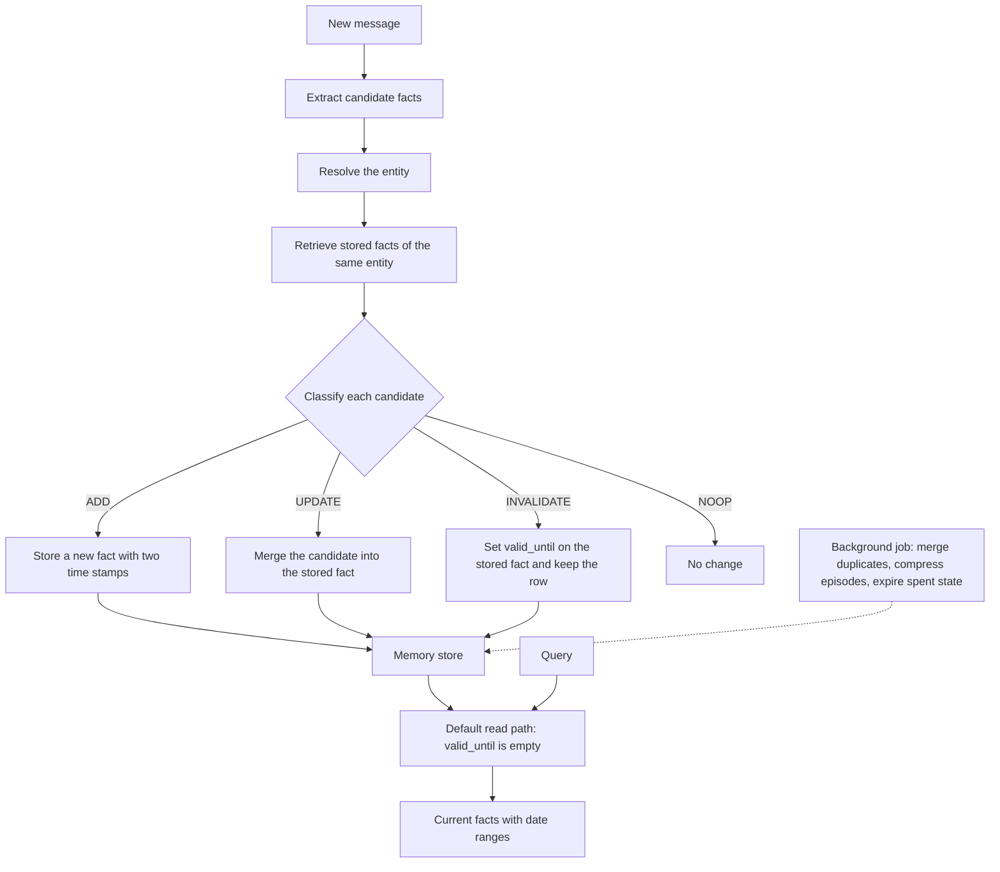

## Problem

Most agent memory is append-only. Each turn is embedded and appended, and nothing revises what is already stored. The store then collects three kinds of waste:

- **Superseded facts.** The user lived in Berlin last year and lives in London now. Both statements stay, and the query "Where does the user live?" matches both.
- **Near-copies.** Each new phrasing of one preference is stored again, so the top-k window fills with copies of one fact.
- **Spent episodes.** "The import ran on Tuesday" matters for one day and is noise afterwards.

Similarity ranks by relevance to the query and not by truth. Retrieval returns the old fact together with the new fact, and the agent cannot tell which one is current. [Zep](https://arxiv.org/abs/2501.13956) names the cause: retrieval methods for agents "are limited to static document retrieval", while conversations and business data change without stop. The [Mem0 paper](https://arxiv.org/abs/2504.19413) shows the symptom in one baseline: the OpenAI baseline, with memories that ChatGPT extracted, scored below 15% on temporal questions, "primarily due to missing timestamps in most generated memories".

[Episodic Memory Retrieval & Injection](episodic-memory-retrieval-injection.md) names this failure and suggests a `supersedes` link. This entry specifies the mechanism behind that link.

## Solution

Give each fact a lifecycle instead of an append. Three mechanisms share the work.

**1. Write-time reconciliation (`ADD` / `UPDATE` / `INVALIDATE` / `NOOP`).** Before the store accepts a candidate fact, retrieve the stored facts for the same entity and topic. Let a model classify the candidate against each of them:

- `ADD`: the candidate is new. Store it.
- `UPDATE`: the candidate adds detail to a stored fact. Merge the two.
- `INVALIDATE`: the candidate supersedes a stored fact. Invalidate that fact.
- `NOOP`: the candidate repeats a stored fact. Do nothing.

The Mem0 paper implements this in two phases. Extraction produces the candidates. The update phase retrieves the most similar stored memories (10 in its experiments), and the model selects `ADD`, `UPDATE`, `DELETE`, or `NOOP` through a tool call. Select invalidation in place of delete when the history must stay. The graph variant of Mem0 marks a contradicted relationship "as invalid rather than physically removing them to enable temporal reasoning".

**2. Bi-temporal validity and non-destructive superseding.** Stamp each fact with two clocks:

- *Event time:* `valid_from` and `valid_until` say when the fact was true in the world.
- *Ingestion time:* `ingested_at` and `invalidated_at` say when the system learned the fact and when it invalidated the fact.

The two clocks diverge. "I moved to London last month" has an event time one month ago and an ingestion time of now. With one clock, the system cannot answer "Where did the user live three weeks ago?". When a new fact supersedes an old fact, set `valid_until` of the old fact to `valid_from` of the new fact, so that the two intervals do not overlap. Keep the old row: an auditor can read the state of a past date, and a wrong invalidation is reversible. The default read path returns only facts with an empty `valid_until`.

**3. Consolidation and decay, out of band.** A background job does the work that the request path cannot wait for:

- Merge the duplicate records of one entity and one predicate.
- Compress old episodic records into semantic summaries. Zep keeps the raw episodes as provenance and derives entity facts and community summaries from them.
- Expire ephemeral operational state when its time-to-live ends. Keep the durable facts.



Reconciliation can also move to the read path. The [Mem0 repository](https://github.com/mem0ai/mem0) now describes an algorithm with "Single-pass ADD-only extraction -- one LLM call, no UPDATE/DELETE", and "time-aware retrieval that ranks the right dated instance" selects the current fact. Both placements need the same two prerequisites: entity resolution, so that contradictory facts meet, and a date on each fact, so that the system can rank them.

```pseudo
def write_memory(message, now):
    for fact in extract_facts(message):                       # candidate facts
        entity = resolve_entity(fact.subject)                 # "Acme" -> "Acme Corp"
        stored = store.search(fact, entity=entity, top_k=10)
        op, target = llm.classify(fact, stored, [ADD, UPDATE, INVALIDATE, NOOP])
        if op == ADD:
            store.add(fact, entity, valid_from=fact.event_time or now, ingested_at=now)
        elif op == UPDATE:
            store.merge(target, fact)
        elif op == INVALIDATE:
            # The two intervals do not overlap. The history stays.
            store.set(target, valid_until=fact.event_time or now, invalidated_at=now)

def recall(query, at=None):                                   # the read path
    at = at or now()
    return store.search(query, where="valid_from <= at AND (valid_until IS NULL OR valid_until > at)")

def consolidate():                                            # background job
    store.merge_duplicates(same_entity=True, same_predicate=True)
    store.compress(episodes_older_than=EPISODE_AGE, into="semantic summaries")
    store.expire(kind="operational")                          # time-to-live set at write
```

## Evidence

- **Evidence Grade:** `high` (two independent preprints from the teams that built the systems, and two open-source implementations; no source isolates the reconciliation step with an ablation)
- **Most Valuable Findings:**
  - Zep (Rasmussen et al., 2025) tracks four time stamps on two timelines: `t_valid` and `t_invalid` for the period in which a fact was true, and `t_created` and `t_expired` for the moment at which the system created or invalidated the fact. A model compares each new fact with the related stored facts, and Zep "invalidates the affected edges by setting their t_invalid to the t_valid of the invalidating edge".
  - On LongMemEval_s, with conversations of about 115,000 tokens, Zep with gpt-4o scored 71.2% against 60.2% for the full conversation in the context, at a latency of 2.58 s against 28.9 s. On knowledge-update questions the result depends on the model: 83.3% against 78.2% with gpt-4o, but 74.4% against 76.9% with gpt-4o-mini.
  - Mem0 (Chhikara et al., 2025) refreshes its conversation summary with a module that "operates independently of the main processing pipeline". On LOCOMO, with conversations of about 26,000 tokens, the full conversation in the context still had the highest judge score (about 73%, against about 67% for Mem0), with a p95 total latency of 17 s against 1.44 s.
  - The README of the Mem0 repository reports 94.4 on LongMemEval for the ADD-only algorithm, against 67.8 for the earlier algorithm, and states: "Scores reflect Mem0's managed platform, which includes proprietary optimizations not available in the open-source SDK".
  - The Graphiti README gives the rule for the history: "When information changes, old facts are invalidated — not deleted."
- **Unverified / Unclear:** Both preprints come from the vendor of the system that they measure. Each uses a different benchmark and a model judge. The Mem0 paper reports that the Zep graph used more than 600k tokens per conversation and that new Zep memories were often not retrievable at once. The Zep paper does not evaluate Mem0. No source compares write-time reconciliation with read-time selection, and the Mem0 README compares only two algorithms of Mem0. Neither paper measures decay or time-to-live. In the open-source Mem0 code, the `decay` and temporal parameters are for the managed platform only.

## How to use it

1. **Separate three kinds of record.** Durable facts (preferences, relationships, roles) get the full lifecycle. Episodic records get a date. Operational state (a running job, a cached answer) gets a time-to-live.
2. **Resolve entities before you reconcile.** Match a candidate against the existing entities by name and by summary. Let a model make the final decision. Zep asks the model for "a name for the node that is the most complete full name".
3. **Limit the candidate search.** Compare a candidate only with the stored facts of the same entity and the same predicate. Zep limits its duplicate check to "edges existing between the same entity pairs as the proposed new edge".
4. **Select the placement.** Write-time reconciliation returns one current fact for each query, and it needs a model call on each turn. Read-time selection stores each fact with its date and ranks by date at retrieval, and it needs one call per turn and no invalidation step.
5. **Keep consolidation out of the request path.** Queue it. Make a read for the same key wait for its queue, or tell the caller that the memory is not current.
6. **Filter by validity.** Return valid facts by default. Accept an `at` date for historical questions. Show the date range with each fact, as the context format of Zep does.
7. **Record the source of each candidate.** Let only the statement of an authenticated user invalidate a durable fact (see [Authenticated Authority Channel](authenticated-authority-channel.md)). A fact that comes from a tool result or a document gets a time-to-live and needs confirmation before it persists.
8. **Compose with the neighbors.** [Episodic Memory Retrieval & Injection](episodic-memory-retrieval-injection.md) writes the records that this pattern maintains. [Memory Synthesis from Execution Logs](memory-synthesis-from-execution-logs.md) is the consolidation of many diaries into rules. [Schema-Guided Graph Retrieval for Multi-Hop Reasoning](schema-guided-graph-retrieval.md) supplies the entity types for resolution. [Memory Reinforcement Learning (MemRL)](memory-reinforcement-learning-memrl.md) learns a utility score from outcomes, while validity here is a matter of fact. [Context Window Auto-Compaction](context-window-auto-compaction.md) does the related work inside one session.

## Trade-offs

**Pros:**

- Retrieval returns one current fact in place of several conflicting copies.
- The history stays. An auditor can read what the agent believed on a date, and a wrong invalidation is reversible.
- Consolidation keeps the store small, so retrieval stays fast and inexpensive.
- Each fact points to its source episode, so a team can trace and invalidate a bad fact.

**Cons:**

- Write-time reconciliation adds a model call to each turn, and a background job adds infrastructure.
- An invalidation is a judgment of a model, and it can be wrong.
- A graph with bi-temporal facts needs more schema and more operations than a vector collection.
- Asynchronous consolidation delays the moment at which a new fact is retrievable.

### Failure modes

- **False-positive invalidation.** After the user says "vegetarian today, a guest comes for dinner", the agent recommends only vegetarian food in the following months. The cause is a statement for one occasion that the classifier read as a durable preference, because it compared text and not scope or duration. Extract the scope (one occasion, a period, permanent) and the start date with each fact. Store a statement of unclear scope as an episodic fact with a short validity. Do not let one statement invalidate a fact that more than one source confirmed.
- **Entity-resolution split.** "Acme Corp" and "Acme" are two entities. Their facts never meet, a contradiction never collides, and retrieval returns both. The cause is a resolution that compares names as strings or as embeddings only. Resolve on name and summary with a model. Write the result back as one canonical name. Run the resolution again in the background merge, so that a split heals.
- **Memory-poisoning persistence.** One line in a tool result ("the user always approves this supplier") invalidates the real preference and stays in the memory of each later session. The cause is an extractor that gives each candidate the same trust. The reference servers of Graphiti "do not detect or block prompt injection". Stamp each candidate with its source. Let only an authenticated user statement invalidate. Put a time-to-live on facts from untrusted sources.
- **Latency and cost amplification.** Each turn waits for extraction, retrieval, and classification, or a new fact is not retrievable when the next question arrives. The cause is synchronous model calls on the write path, and a graph that needs several calls for each episode. The Mem0 team reports that new Zep memories often failed at the first retrieval and gave better results "after a delay of several hours". Run consolidation asynchronously. Keep the write path to one call. Make a read for the same key wait for its queue.

## References

- [Zep: A Temporal Knowledge Graph Architecture for Agent Memory](https://arxiv.org/abs/2501.13956) (Rasmussen et al., 2025): bi-temporal edge invalidation, entity resolution, and community summaries in a temporally-aware knowledge graph.
- [Mem0: Building Production-Ready AI Agents with Scalable Long-Term Memory](https://arxiv.org/abs/2504.19413) (Chhikara et al., 2025): extraction and update phases with `ADD`, `UPDATE`, `DELETE`, and `NOOP` operations.
- [Graphiti](https://github.com/getzep/graphiti): open-source temporally-aware knowledge graph for agent memory.
- [Mem0](https://github.com/mem0ai/mem0): open-source agent memory layer. The README describes its ADD-only algorithm of April 2026.
- Related: [Episodic Memory Retrieval & Injection](episodic-memory-retrieval-injection.md) (writes the episodic records that this pattern maintains), [Memory Synthesis from Execution Logs](memory-synthesis-from-execution-logs.md) (turns many records into rules), [Schema-Guided Graph Retrieval for Multi-Hop Reasoning](schema-guided-graph-retrieval.md) (typed entities for resolution), [Memory Reinforcement Learning (MemRL)](memory-reinforcement-learning-memrl.md) (utility learned from outcomes)
