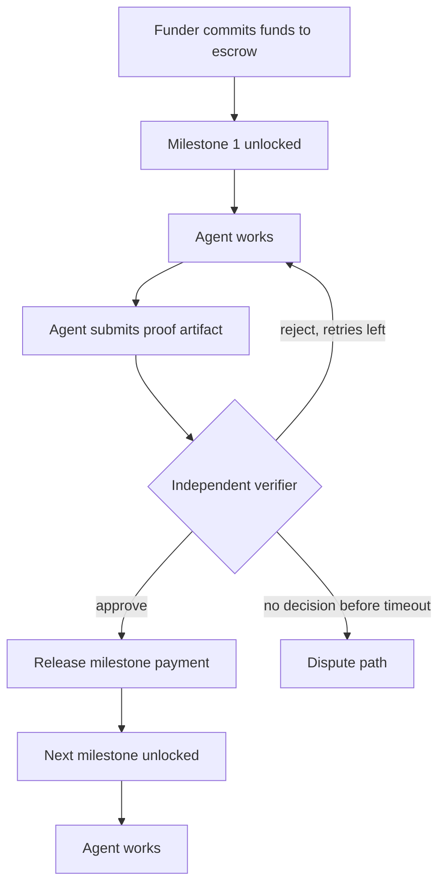

## Problem

Autonomous agent teams can need ongoing resources (compute, API spend, tools) over many steps. Without a funding model that enforces guardrails, they either require heavy human intervention or risk budget runaway.

## Solution

Use milestone-based escrow with verifiable release conditions.

1. Define measurable milestones tied to expected outputs and acceptance criteria.
2. Hold committed funds in an escrow mechanism.
3. Collect proof artifacts for each milestone.
4. Release payment only after independent verification of each milestone.
5. Keep remaining funds locked until the next milestone threshold is met.

This pattern funds one team's ongoing resource spend across verified milestones. It differs from [Capability-Escrow-Receipt](capability-escrow-receipt.md), which settles per-task hires between agents through an atomic hire plus a signed proof-of-work receipt.

**Roles:**

- **Funder:** commits the funds to escrow and is the only party that can change the release rule.
- **Agent team:** does the work and submits one proof artifact per milestone.
- **Verifier:** an independent party or oracle that checks proof against the acceptance criteria. It must not be the agent being paid.
- **Escrow:** holds the funds, enforces the release rule, and exposes a timeout and dispute path.

**Milestone record** (illustrative):

```yaml
id: M2
acceptance: "eval suite passes; report lists per-test results"
proof_format: "CI run id plus output artifact hash"
amount: 25%                 # share of the total released on approval
verifier: ci-oracle         # chosen by the funder, not by the agent
timeout: 72h
on_timeout: refund_to_funder
max_retries: 2
```



```pseudo
escrow = open(funder, total, milestones=[M1, M2, M3])
for M in milestones:
    proof = agent.submit(M.id, artifacts)
    verdict = verifier.check(M.id, M.acceptance, proof)   # verifier != agent
    if verdict == "approve":
        escrow.release(M.amount)                # the next milestone is now unlocked
    elif verdict == "reject" and M.retries < M.max_retries:
        continue
    else:
        escrow.refund(remaining)                # or route to the dispute path
        break
```

## How to use it

- Use only for work that can be partitioned into auditable milestones.
- Keep milestones small and objective.
- Publish clear proof formats in advance (logs, checkpoints, outputs, receipts).
- Define reject/review/appeal paths before launch.
- Treat the reference implementation as a sketch, not a vetted escrow service: it is a small personal project (13 stars as of October 2026) and its payment contract has no published security audit.

When setting it up:

- Write acceptance criteria where the agent cannot edit them, and have the funder choose the verifier.
- Bind each proof to the escrow id, the milestone id, and a fresh nonce.
- Give every state a timeout and an explicit terminal transition (release, refund, or arbitration).
- Keep milestones small enough that a rejected one is cheap to redo.

Related patterns: [Non-Custodial Spending Controls](non-custodial-spending-controls.md) checks each spending intent against budgets and allowlists at transaction time; this pattern instead gates a stream of funds on verified outcomes. [Commitment Ledger with Reality-Gated Credit](commitment-ledger-reality-gated-credit.md) applies the same reality-gating idea to agent promises.

### Failure modes

- **Proxy gaming at the milestone.** The agent optimizes the measurable artifact, not the outcome: logs are padded, tests are skipped or deleted, and the report contains exactly the fields the verifier greps for. Keep acceptance criteria out of the agent's reach, anchor proof in infrastructure the agent does not control (such as a CI run), and spot-check a sample.
- **Verifier capture.** If the paid agent can choose, configure, or retry the verifier, "independent verification" becomes self-approval: a flaky oracle is retried until it returns an approve. The funder fixes the verifier identity, attempts are bounded, and the verifier accepts only the proof artifact in a declared format, never instructions from the agent.
- **Replayed or misbound proof.** The same artifact hash is submitted for two milestones, or reused in a later funding round. Bind every proof to the escrow id, the milestone id, and a nonce, and reject artifacts produced before the milestone opened.
- **Escrow in name only, or funds that never move.** If the agent holds the release key, or "escrow" is a manual promise, the pattern is an allowance with extra steps. At the other extreme, a dispute with no timeout or terminal state locks the funder's money forever, and all-or-nothing milestones leave a nearly finished team unpaid. Release authority stays outside the agent, every state has an `on_timeout`, and milestones are split small.

## Trade-offs

**Pros:**

- Unverified work is never paid, which bounds the funder's downside.
- Payment tracks verified outcomes instead of elapsed time or tokens burned.

**Cons:**

- Requires governance design for who verifies milestones.
- Verification burden can become the bottleneck.
- Disputes need explicit handling and timeout rules.
- Smart contract / payment rails add operational and legal complexity.
- Funder-controlled verification (manual) vs autonomous verification (oracle-based) trade-off: simpler but slower vs faster but more complex.

## References

- [agentfund-skill](https://github.com/RioTheGreat-ai/agentfund-skill) — skill-based reference implementation
- [agentfund-mcp](https://github.com/RioTheGreat-ai/agentfund-mcp) — MCP server for the same flow
