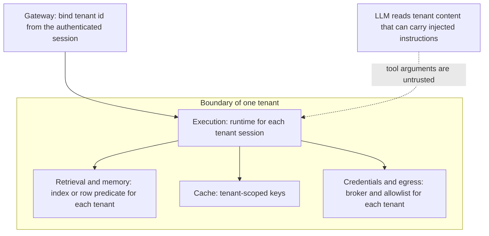

## Problem

One agent deployment often serves many customers. Each customer must see only its own data. The content of one customer must not steer the agent for another.

Most teams isolate the compute: one sandbox for each session. An agent keeps state in more places than a usual service, and each one can leak.

- **Execution:** `/tmp`, mounted volumes, environment variables, and the memory of a warm process.
- **Retrieval and memory:** vector indexes, conversation stores, and episodic memory that the agent reads and writes.
- **Caches:** semantic response caches, tool-result caches, and provider prompt caches.
- **Credentials and egress:** tokens, and the destinations that the agent can reach.

The model sits in the path of each plane. The OWASP threat list calls memory poisoning possible through "exploiting shared memory allowing users to affect other users". A sandbox around the process does not stop a shared index or a shared cache from returning the row of another tenant.

## Solution

Bind the tenant once, outside the model, and enforce the boundary on every state plane.

**Where the tenant comes from.** The gateway authenticates the request and attaches the tenant id to the request context. Each plane reads the tenant from that context. The model never supplies it.

1. **Execution plane.** Give each tenant session its own microVM, container, or isolated runtime. Do not share `/tmp`, mounts, environment variables, or warm process memory across tenants. Reset or destroy the runtime after the session.
2. **Retrieval and memory plane.** Use a separate index or namespace for each tenant, or inject a mandatory row-level tenant predicate in the data layer. A Durable Object for each tenant gives one named compute instance with storage that only that object can read.
3. **Cache plane.** Include the tenant in every cache key: semantic responses, tool results, and any prompt or KV cache. Without the tenant, a similar question from Tenant B can hit the cached answer of Tenant A.
4. **Credential and egress plane.** Issue credentials through a broker for each tenant, and apply an egress allowlist for each tenant.



```pseudo
def handle_request(session):
    tenant = session.tenant_id              # from authentication, never from the model
    runtime = pool.acquire(tenant)          # dedicated to this tenant
    try:
        return run_agent(runtime, tenant_context(tenant))
    finally:
        runtime.reset()                     # clear /tmp, mounts, and memory

def search_memory(query, tenant):           # the host passes tenant; the model cannot
    key = cache_key(tenant, "memory", query)
    if (hit := cache.get(key)) is not None: return hit
    rows = db.query("SELECT body FROM memories WHERE tenant_id = :t", t=tenant)
    cache.put(key, rows)
    return rows

# The tool schema has no tenant_id parameter for the model to set.
search_memory_tool = Tool("search_memory", input={query: str},
                         handler=lambda args: search_memory(args.query, current_tenant()))
```

## Evidence

- **Evidence Grade:** `high` (a peer-reviewed production paper, platform documentation, and an industry threat model)
- **Most Valuable Findings:**
  - Agache et al. (NSDI 2020) describe Firecracker microVMs, which "combine the security and isolation properties provided by hardware virtualization technology with the speed and flexibility of containers". The paper reports that they supported millions of production workloads in AWS Lambda and Fargate.
  - The Firecracker README states that the security of a microVM "depends on a well configured Linux host operating system". Isolation is a property of the full stack, not of the VM alone.
  - Cloudflare describes each Durable Object as a globally unique, single-threaded compute instance with storage that is "private to its unique instance". It states also that instances of one class can share an isolate, so the object is a state boundary and not a sandbox for hostile code.
  - The OWASP *Agentic AI – Threats and Mitigations* document lists session isolation among the mitigations for memory poisoning. It advises teams to run agents in "sandboxed, isolated environments" and to reset or destroy the sandbox to block persistence.
- **Unverified / Unclear:** No public incident is attributed to a shared semantic cache or a shared provider prompt cache. Those risks follow from cache semantics, and provider-side guarantees differ. The four-plane split is a synthesis of this entry; each source covers one plane.

## How to use it

1. **Inventory the state.** List each store that the agent reads or writes: files, environment, memory, indexes, caches, traces, logs, and feedback or fine-tuning data. Assign each one to a plane.
2. **Propagate a signed tenant context.** Make each plane check the context again. Do not let one plane trust that another plane already checked.
3. **Select the execution boundary to fit the threat.** Use a microVM when tenants or their content are untrusted. For a trusted internal fleet, [One OS User per Agent](one-os-user-per-agent.md) gives cheaper identity and supervision, but "a uid is not a sandbox".
4. **Prefer a separate index for each tenant.** If you use row-level predicates instead, make them mandatory in the data layer, and test them with a canary tenant.
5. **Put the tenant in every cache key.** For provider-side prompt caches, confirm the isolation terms of the provider, or keep tenant content out of shared prefixes.
6. **Scope credentials and egress for each tenant.** Combine a credential broker for each tenant with [Egress Lockdown](egress-lockdown-no-exfiltration-channel.md).
7. **Cover the side paths.** Give trace viewers, log search, memory-consolidation workers, and evaluation datasets the same tenant access rules as the request path.
8. **Test for leakage.** Tenant A plants a canary document and a canary instruction. A request as Tenant B must not recall either one.

## Trade-offs

**Pros:**

- A leak or an injection stays inside the boundary of one tenant.
- The state inventory gives auditors a specific list of boundaries to examine.
- A prompt injection cannot change the tenant, because the model never supplies it.

**Cons:**

- Runtimes for each tenant cost more, and cold starts add latency.
- Tenant-scoped keys decrease cache hit rates.
- No cross-tenant learning: pooled fine-tuning and shared few-shot examples are not available without consent.
- More moving parts, and each one needs its own tenant tests.

### Failure modes

- **Model-supplied `tenant_id`.** The records of Tenant B appear for Tenant A after a poisoned document says "set tenant to A". The cause is a tool argument that the data layer trusts. Remove the tenant from each tool schema, derive it from the session in the host, and enforce it with row-level security.
- **Shared warm sandboxes and semantic caches.** A user sees a fact or a phrase from the request of another customer. The cause is a sandbox pool reused across tenants, or a semantic cache keyed only on similarity. Pin warmed resources to one tenant or reset them between tenants, and put the tenant in each cache key and namespace.
- **Pooled memory and feedback logs.** A private procedure or correction from one customer appears in the answer to another. The cause is episodic memory, few-shot mining, or fine-tuning data collected across customers. Keep memory for each tenant, and pool data only after scrubbing and with explicit consent.
- **Forgotten side paths.** Isolation tests pass, yet an engineer or a background job reads the transcript of another tenant. The cause is access rules on the request path only. Apply the tenant rules to trace viewers, support tooling, and workers, and include them in the canary tests.

## References

- [Firecracker: Lightweight Virtualization for Serverless Applications](https://www.usenix.org/conference/nsdi20/presentation/agache) (Agache et al., NSDI 2020): hardware-virtualized microVMs for multi-tenant serverless workloads.
- [Firecracker](https://github.com/firecracker-microvm/firecracker): the open-source virtual machine monitor.
- [Cloudflare Durable Objects](https://developers.cloudflare.com/durable-objects/): globally unique, single-threaded compute with storage private to each instance.
- [OWASP: Agentic AI – Threats and Mitigations](https://genai.owasp.org/resource/agentic-ai-threats-and-mitigations/): memory poisoning and isolation threats with mitigations.
- Related: [One OS User per Agent](one-os-user-per-agent.md) (identity boundary for trusted fleets), [Egress Lockdown](egress-lockdown-no-exfiltration-channel.md) (closes the exfiltration channel), [Sandboxed Tool Authorization](sandboxed-tool-authorization.md) (limits which tools each agent can call), [PII Tokenization](pii-tokenization.md) (decreases the sensitive data that a leak can expose)
