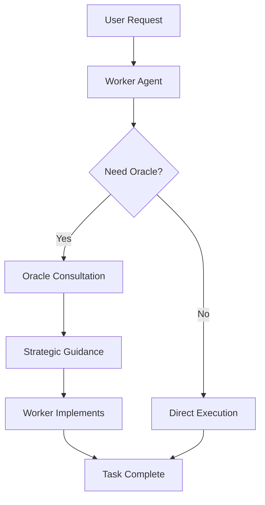

## Problem

Relying on a single AI model creates a trade-off between capability and cost. High-performance models are expensive for routine tasks, while cost-effective models may lack the reasoning power for complex problems.

## Solution

Implement a two-tier system with specialized roles:

- **The Worker:** A fast, capable, and cost-effective model that handles bulk tool use and code generation
- **The Oracle:** A powerful, expensive model reserved for high-level reasoning, architectural planning, and debugging complex issues (Amp's implementation, as described in 2025 coverage, consulted OpenAI o3)

The Worker can explicitly request Oracle consultation when stuck or needing better strategy. The Oracle reviews the Worker's approach and suggests course corrections without polluting the main agent's context.

## Evidence

- **Evidence Grade:** `emerging`
- **Most Valuable Findings:** Used in production by Amp, whose oracle subagent combines multiple LLMs (S1E7 of the "Raising an Agent" podcast); academic foundation from model cascading research (FrugalGPT: up to 98% cost reduction with quality parity)
- **Unverified:** Amp has not published a cost-reduction figure for the oracle/worker split; optimal Oracle invocation thresholds remain application-specific

## How to use it

Reach for this split when most requests are routine but some need frontier reasoning:

1. Route all work to the worker model first.
2. Give the worker an explicit escape hatch, such as a consult tool that forwards the stuck state to the oracle.
3. Let the oracle review the approach and return course corrections, without joining the main context.
4. Log oracle hit rates and tune the escalation trigger.

Typical settings: development environments, complex coding tasks, architectural decisions, and debugging sessions where initial approaches fail. In the literature this idea appears as model cascading, weak-strong model routing, or hierarchical model systems.

* Related patterns: [Budget-Aware Model Routing with Hard Cost Caps](budget-aware-model-routing-with-hard-cost-caps.md) routes every request by cost and quality gates rather than escalating on being stuck; [Multi-Model Orchestration for Complex Edits](multi-model-orchestration-for-complex-edits.md) assigns different models to fixed phases of one edit pipeline; [Failover-Aware Model Fallback](failover-aware-model-fallback.md) switches models only after a failure, not on demand.

## Trade-offs

* **Pros:** Cost-efficient use of frontier models; sophisticated problem-solving; specialized AI team approach
* **Cons:** Additional orchestration complexity; potential latency from model switching; requires careful Oracle invocation logic

## References

* Amp, "Raising an Agent," episode 7 (oracle subagent that combines multiple LLMs): https://ampcode.com/podcast
* Isaac Flath, "Inside Amp Code" (documents the oracle using OpenAI o3): https://isaacflath.com/writing/inside-amp-code-how-sourcegraph-is-building-ai-powered-development
* Sourcegraph on Amp becoming an independent company: https://sourcegraph.com/blog/why-sourcegraph-and-amp-are-becoming-independent-companies
* FrugalGPT (Stanford, 2023): https://arxiv.org/abs/2305.05176
* RouteLLM (ICLR 2024): https://arxiv.org/abs/2406.18665
* LiteLLM Router: https://github.com/BerriAI/litellm

- Primary source: https://youtu.be/hAEmt-FMyHA?si=6iKcGnTavdQlQKUZ
