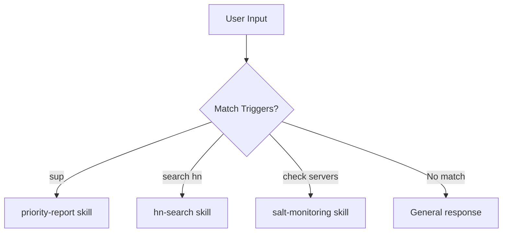

## Problem

Agents with many skills face a routing problem: given a user's natural language input, which skill should handle it? The recognized mechanism in current skill systems is model judgment over descriptions: each skill declares a name and description, and the agent decides from those whether to load the full skill (the Agent Skills standard calls this progressive disclosure). That mechanism is flexible but probabilistic—users cannot predict exactly which phrasing activates which capability.

Additionally, agents may have skills that should activate *proactively* (without explicit request) when certain topics arise, but without explicit trigger lists, the agent may miss opportunities or activate inappropriately.

## Solution

Define an explicit **trigger vocabulary** for each skill: a list of phrases, keywords, and patterns that should activate that skill. Document these triggers visibly so both humans and agents know the activation criteria.

Treat trigger lists as a **complement to description-based routing**, not a replacement. Use them for deterministic, high-frequency commands where predictability matters ("sup", "check mail"), and let model judgment over skill descriptions handle paraphrase and long-tail input. Exact-match triggers short-circuit the probabilistic layer; they do not replace it.

```yaml
# Skill definition with explicit triggers
skill: priority-report
description: Generate prioritized task report

triggers:
  exact: ["sup", "priority report", "standup prep"]
  contains: ["what should I work on", "what's pending", "my tasks"]
  patterns: ["what.*on my plate", "action items"]

proactive: true  # Activate without explicit request when triggers match
```



**Key components:**

1. **Trigger lists**: Explicit phrases per skill, documented in skill definitions
2. **Proactive flag**: Whether skill should auto-activate on trigger match
3. **Priority ordering**: When multiple skills match, which takes precedence
4. **User visibility**: Triggers documented so users learn the vocabulary

**Proactive activation categories:**

- **Information offering**: Providing relevant information unprompted
- **Suggestion**: Recommending actions or content
- **Clarification**: Asking for missing information
- **Correction**: Fixing user errors or misunderstandings

User acceptance of proactive activation depends on relevance (contextually appropriate), timing (not interrupting flow), and transparency (explaining why the action was taken).

## How to use it

**Skill documentation format:**

```markdown
## Priority Report

Use the `priority-report` skill when user asks about:

- What they need to work on next
- Priority tasks or action items
- Outstanding reviews, PRs, or issues

**Proactive triggers:** "sup", "priority report", "what should I work on",
"task overview", "standup prep", "my tasks", "what's pending"

**Script:** `~/.claude/skills/priority-report/scripts/priority-report.sh`
```

**Implementation approaches:**

1. **Documentation-based** (simplest): List triggers in CLAUDE.md or skill docs; agent reads and matches
2. **Config-based**: YAML/JSON trigger definitions loaded at startup
3. **Hybrid**: LLM matches against documented triggers, falls back to semantic similarity

**Trigger design guidelines:**

- **Short phrases**: "sup", "check mail", "my tasks" (1-3 words)
- **Question patterns**: "what should I...", "where did..."
- **Domain keywords**: Platform names, technical terms
- **Casual variants**: "sup" alongside "priority report"
- **Avoid overlap**: Don't reuse triggers across skills

**Example trigger vocabulary:**

| Skill | Triggers |
|-------|----------|
| priority-report | "sup", "my tasks", "standup prep", "what's pending" |
| hn-search | "search hn", "hacker news", "find on hn" |
| magic-cafe | "magic trick", "what's hot in magic", "magic forum" |
| email-triage | "triage inbox", "urgent emails", "prioritize mail" |

## Trade-offs

**Pros:**

- **Transparent**: Users can learn trigger phrases, feel in control
- **Predictable**: Same input always routes to same skill
- **Debuggable**: Easy to see why a skill activated (or didn't)
- **Fast**: String matching faster than embedding lookup
- **Documentable**: Triggers become part of user-facing docs
- **Proactive**: Agent can jump in when relevant topics arise

**Cons:**

- **Rigid**: Misses paraphrases not in trigger list
- **Maintenance**: Must update triggers as vocabulary evolves
- **Conflicts**: Multiple skills may want same triggers
- **Cultural/language bias**: Triggers may not translate
- **Discovery**: Users must learn the vocabulary (or read docs)

**Hybrid approach:**

Combine explicit triggers with semantic fallback:
1. Check explicit trigger matches first (fast, predictable)
2. If no match, use embedding similarity or model judgment over skill descriptions (flexible, slower)
3. Log unmatched inputs to discover new trigger candidates

This hybrid keeps routing predictable for known phrases while the description-matching layer covers paraphrases.

## References

- [Agent Skills](https://agentskills.io) — the open standard for skill definitions. Documents the description-based activation model this pattern complements: agents load only skill names and descriptions at startup and read full instructions when a task matches a description.
- [Extend Claude with skills (Claude Code docs)](https://code.claude.com/docs/en/skills) — shipping implementation of description-driven activation with progressive disclosure; also shows the control flags (`disable-model-invocation`, `user-invocable`) that govern proactive behavior.
- [Skill Activation as Precision and Recall (this catalogue)](skill-activation-as-precision-recall.md) — measure routing quality with labeled prompts and CI thresholds, whether routing uses triggers, descriptions, or both.
- Background: intent classification in conversational AI; chatbot trigger/response pattern matching; Slack workflow triggers.
