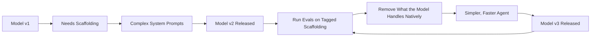

## Problem

Agent scaffolding built for older models becomes unnecessary overhead as models improve:

- **Prompt bloat**: System prompts accumulate instructions that newer models don't need
- **Over-engineered flows**: Complex orchestration for tasks models can now handle directly
- **Wasted tokens**: Paying for instructions the model already knows
- **Slower execution**: Unnecessary steps add latency
- **Maintenance burden**: More code to maintain for diminishing benefit

The risk runs in both directions. Models improve faster than scaffolding is removed, so existing systems accumulate debt. And new scaffolding is often built to last: a feature that takes three months to build, such as a sophisticated context compression scheme or a custom tool-chain for code editing, can be rendered obsolete overnight by the next model generation that performs the task natively.

## Solution

**Actively remove scaffolding** as models become more capable, and **build new scaffolding as disposable** in the first place. Regularly audit system prompts, orchestration logic, and agent architecture to eliminate what newer models have internalized.

**Core principle**: Push complexity into the model itself rather than external scaffolding.

**The scaffolding mindset.** Treat most of the code written around the core model as temporary, lightweight, and disposable, like wooden scaffolding around a building under construction. Two commitments follow:

- **Embrace The Bitter Lesson**: A lot of complex scaffolding will eventually "fall into the model" as its capabilities grow. Build the simplest possible solution that works *now*, with the assumption that it will be thrown away later. This maximizes the team's ability to react to new models.
- **Make disposability explicit**: Tag orchestration wrappers, custom prompt crutches, and fallback routers as scaffolding at build time, through clear naming, documented removal criteria, and architectural separation from durable features. Code that is not tagged for deletion is never deleted.

**Separate durable value from model workarounds.** Apply the 6-month test before building complex tooling: *"Will this be useful in 6 months when models improve?"* If not, build it as disposable scaffolding with explicit disposal triggers. Spend engineering effort on the unique value that is not tied to compensating for a current model weakness: domain knowledge and unique integrations.

**Operationalize removal as a repeating loop:**

- Identify instructions and wrappers that existed to compensate for older model weaknesses.
- Remove a slice and run controlled evals against production-like tasks.
- Keep deletions that preserve quality; revert deletions that increase failure risk.

The goal is not minimal prompts at all costs, but right-sized scaffolding for the current model generation.



**Example evolution:**

```pseudo
# Claude Opus 4.1 (older model)
system_prompt = """
When writing code:
1. First check if file exists
2. Read current contents
3. Plan your changes
4. Make minimal edits
5. Verify syntax
... [2000 more tokens of instructions]
"""

# Claude Sonnet 4.5 (newer model)
system_prompt = """
Write clean, tested code.
"""  # Model already knows the steps
```

## How to use it

**Audit process after each model release:**

1. **Track model releases**: Note when new models become available
2. **Test simplified prompts**: Remove instructions and see if quality degrades
3. **Measure token usage**: Quantify savings from prompt reduction
4. **A/B test scaffolding**: Compare outcomes with and without orchestration steps
5. **Delete what the model handles**: If performance is equal without scaffolding, remove it

**What to look for:**

- Instructions that are "obvious" to humans (likely obvious to advanced models)
- Multi-step workflows models now handle in one turn
- Error-handling that models build in automatically
- Format specifications models infer from context
- Planning steps models do internally with extended thinking

**Scaffolding removal priority:**

| Category | Safe to Remove | Always Keep |
|----------|----------------|-------------|
| Obvious instructions | ✓ | |
| Step-by-step procedures | ✓ | |
| Format specifications | ✓ | |
| Orchestration wrappers and fallback routers tagged as temporary | ✓ | |
| Domain knowledge | | ✓ |
| Safety constraints | | ✓ |
| Unique integrations | | ✓ |

**Design for deletion:** Give scaffolding well-defined interfaces to durable components, so removing it does not touch the code that stays.

**Tools for prompt management:** Langfuse, LangSmith, Promptfoo (versioning, A/B testing, evaluation)

**Real example from Claude Code:**

> "I just deleted like 2,000 tokens or something from the system prompt yesterday. Just because Sonnet 4.5 doesn't need it anymore. But Opus 4.1 did need it." —Boris Cherny

**Boundary evolution:**

> "The boundary changes with every model in a surprising way, where the newer models, they're more intelligent. So the boundary of what you need plan mode for got pushed out a little bit." —Boris Cherny

## Trade-offs

**Pros:**

- **Reduced token costs**: Shorter prompts = cheaper inference
- **Faster execution and development**: Less processing overhead, and simple scaffolding is quick to build
- **Simpler maintenance**: Less code and fewer prompts to manage
- **Adaptability**: Intentional, bounded technical debt instead of open-ended debt
- **Future-proof**: Embraces model capabilities rather than fighting them

**Cons:**

- **Requires testing**: Must validate that quality doesn't degrade, so this is unsafe without evals
- **Lower polish for temporary code**: Accepts simpler, less robust implementations for disposable components
- **Discipline required**: Teams that cannot track disposal triggers keep the debt forever
- **Version management**: May need different configs for different models during transition
- **Documentation debt**: May lose understanding of why scaffolding was added; record the removal criteria when you build it
- **Can conflict with compounding investment**: Scaffolding does not compound; decide deliberately which work should

**Strategic considerations:**

- **When to remove**: After the new model is proven stable in production
- **How much to remove**: Start conservative, measure, iterate
- **What to keep**: Domain-specific knowledge and safety constraints models can't know or shouldn't override
- **Migration path**: Support multiple model versions during transition

## References

* Boris Cherny: "I just deleted like 2,000 tokens or something from the system prompt yesterday. Just because Sonnet 4.5 doesn't need it anymore. But Opus 4.1 did need it."
* Boris Cherny: "There's this frontier where you need to give the model a hard enough task to really push the limit... I think this is a general trend of stuff that used to be scaffolding with a more advanced model, it gets pushed into the model itself. The model kind of tends to subsume everything over time."
* Cat Wu: "We build most things that we think would improve Claude Code's capabilities, even if that means we'll have to get rid of it in three months. If anything, we hope that we will get rid of it in three months."
* [AI & I Podcast: How to Use Claude Code Like the People Who Built It](https://every.to/podcast/transcript-how-to-use-claude-code-like-the-people-who-built-it)
* [Amp: The Emperor Has No Clothes: Thorsten Ball on Latent Space (September 25, 2025)](https://www.youtube.com/watch?v=b4rOVZWLW6E) — quote origin, verified against the episode transcript: "What you want is... a scaffolding. Like you want to build a scaffolding around the model, a wooden scaffolding that if the model gets better or you have to switch it out, the scaffolding falls away. You know, like the bitter lesson. Like embrace that a lot of stuff might fall into the model as soon as the model gets better." Ball explains Amp deliberately restricts features added around the model so the harness stays replaceable.
* [Extreme Harness Engineering for Token Billionaires: Latent Space (April 7, 2026)](https://www.latent.space/harness-eng) — 2026 evidence that the idea is current: reasoning models working without predefined scaffolds, with the harness reduced to a box the model orchestrates itself
* Rich Sutton, [The Bitter Lesson](http://www.incompleteideas.net/IncIdeas/BitterLesson.html) (2019)
* Anthropic, [Effective context engineering for AI agents](https://www.anthropic.com/engineering/effective-context-engineering-for-ai-agents): argues that smarter models require less prescriptive engineering, which is the core of this pattern
* Related principle: [Frontier-Focused Development](../principles/frontier-focused-development.md) targets state-of-the-art models and accepts periodic rework so scaffolding stays minimal, while this pattern trims existing scaffolding incrementally after each verified model upgrade
