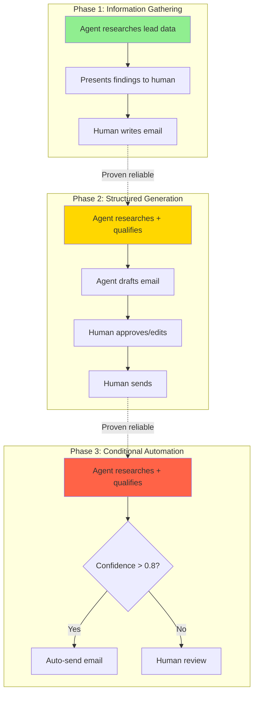

## Problem

Organizations deploy AI agents with overly ambitious capabilities from day one. The result is:

- Unreliable output on tasks beyond current model capability
- Failed implementations that damage stakeholder confidence
- Inconsistent results on complex reasoning tasks
- Engineering effort spent on infrastructure for capabilities that models cannot yet deliver
- Safety risk from autonomous execution of high-stakes operations

The gap between theoretical agent capability and practical reliability creates deployment failures.

## Solution

Start with low-complexity, high-reliability tasks and unlock more complex capabilities as models improve and trust is established. Match task complexity to current model capability, not to theoretical potential.

**Core principles:**

- **Grounded in learning science:** the pattern draws on curriculum learning theory and scaffolding research. Wilson et al. (2019) measure the optimal training signal at roughly 85% success (the "Eighty Five Percent Rule"). Vygotsky's Zone of Proximal Development contributes the related start-within-reach idea, not a percentage. Working memory limits require a gradual complexity increase.
- **Start with proven sweet spots:** low cognitive load tasks with high repetition, tasks "too dynamic for traditional automation, but predictable enough for AI to handle reliably", information gathering and synthesis over complex reasoning, and well-defined success criteria.

**Define capability tiers:**

| Tier | Tasks | Working memory |
|------|-------|----------------|
| 1 (deploy immediately) | Data entry and research, content categorization, information extraction, template-based generation | 2-3 items |
| 2 (unlock with validation) | Multi-step workflows with human gates, conditional logic with structured outputs, integration with multiple tools, personalization and adaptation | 4-5 items |
| 3 (future unlock) | Autonomous decision-making, complex reasoning chains, creative problem-solving, novel task generalization | 7+ items |

**Unlock progressively:** performance metrics trigger capability expansion, human review gates come before promotion to a higher tier, A/B testing compares new capabilities against baselines, and rollout is gradual, with monitoring.

**Scope note:** the Vercel source documents the start-simple principle; the capability tiers and promotion gates in this pattern are this catalogue's extrapolation, not Vercel's framework.

**Example workflow evolution:**



## How to use it

**When to apply:** deploying agents into production environments, building internal automation tools, customer-facing agent applications, high-stakes or regulated domains, and new agent capabilities with unproven reliability.

**1. Classify task complexity:**

| Load | Steps | Tools | Reasoning depth | Error impact |
|------|-------|-------|-----------------|--------------|
| Low | 1-3 | 0-2 | Shallow | Low |
| Medium | 4-8 | 2-5 | Multi-step | Medium |
| High | 8+ | 5+ | Deep or creative | High |

**2. Define promotion criteria (illustrative values, not recommended defaults; tune per domain):**

```yaml
capability_gates:
  tier1_to_tier2:
    - accuracy_threshold: 0.95
    - human_approval_rate: 0.90
    - volume_processed: 1000
    - time_in_production: 30_days
    - success_rate_target: 0.70-0.90  # illustrative

  tier2_to_tier3:
    - accuracy_threshold: 0.98
    - human_override_rate: 0.05
    - volume_processed: 10000
    - stakeholder_confidence: high
```

**3. Gate capabilities behind a tier flag:**

```typescript
class AgentCapabilities {
  constructor(private tier: 1 | 2 | 3) {}

  async processLead(lead: Lead) {
    const research = await this.research(lead); // Tier 1

    if (this.tier >= 2) {
      const qualification = await this.qualify(research);
      const email = await this.generateEmail(qualification);

      if (this.tier >= 3 && qualification.confidence > 0.8) {
        return this.autoSend(email); // Autonomous execution
      }

      return this.requestApproval(email); // Human gate
    }

    return this.presentFindings(research); // Tier 1 only
  }
}
```

**4. Monitor and promote:**

- Track success metrics per tier, and review error patterns and edge cases
- If the success rate is above 90%, increase task difficulty; if it is below 70%, decrease it
- Expand agent authority gradually, and keep a rollback path for each promotion

**Prerequisites:**

- Clear success metrics for each capability tier
- Monitoring and observability infrastructure
- Stakeholder alignment on the progression plan
- Fallback mechanisms for failures

## Trade-offs

**Pros:**

- **Risk mitigation:** limits the blast radius of agent errors
- **Stakeholder confidence:** builds trust through proven reliability
- **Focused engineering:** resources go to proven capabilities, and the architecture is ready for model evolution
- **Graceful degradation:** the system stays useful even at lower tiers

**Cons:**

- **Delayed value:** full automation benefits arrive over time, not immediately
- **Complexity:** tier management and promotion logic must be built and tested
- **Promotion friction:** metrics and promotion decisions need review
- **User confusion:** capabilities differ across deployment phases

**Balancing approaches:**

- Communicate the capability roadmap to stakeholders
- Automate tier promotion on objective metrics
- Keep a simple mental model: what can the agent do today?

**Failure modes / gotchas:**

- **Gates copied as defaults:** the thresholds above are illustrative. A gate that is not tuned to the domain promotes a tier too early or holds it back too long.
- **Building ahead of the evidence:** infrastructure for Tier 3 built before Tier 1 is proven is engineering spent on capabilities the model cannot yet deliver.
- **Promotion without rollback:** a promoted tier that misbehaves needs a way back to the human-gated path. Keep that path live after each promotion.

## References

- [Vercel: What We Learned Building Agents](https://vercel.com/blog/what-we-learned-building-agents-at-vercel) - "Start with low-cognitive-load automation, then evolve as capabilities mature"
- [Anthropic: Building Effective Agents](https://www.anthropic.com/research/building-effective-agents) - Task complexity and model capability matching
- [OpenAI: GPT Best Practices](https://platform.openai.com/docs/guides/prompt-engineering) - Matching task complexity to model strengths
- Bengio et al. ["Curriculum Learning"](https://www.icml.cc/2009/papers/54.pdf) (ICML 2009) - Easy-to-hard training improves generalization
- Vygotsky, L. S. ["Mind in Society"](https://books.google.com/books?id=c3lAAAAAIAAJ) (1978) - Zone of Proximal Development: learning works best just beyond current independent ability
- Wilson et al. ["The Eighty Five Percent Rule for optimal learning"](https://www.nature.com/articles/s41467-019-12552-4) (Nature Communications, 2019) - quantifies the optimal training error rate at about 15%
- Dataiku, [Human-in-the-loop AI agents: governance design patterns](https://www.dataiku.com/blog/human-in-the-loop-ai-agents) (2026) - enterprise agent deployments as contained pilots with human review gates
- Wood, Bruner, Ross ["The role of tutoring in problem solving"](https://doi.org/10.1111/j.1469-7610.1976.tb00381.x) (1976) - Scaffolding theory: temporary support that fades with competence
- Related patterns: [Progressive Autonomy with Model Evolution](progressive-autonomy-with-model-evolution.md) removes scaffolding as models improve, while this pattern expands task scope as reliability is proven; see also [Human-in-the-Loop Approval Framework](human-in-loop-approval-framework.md) and [Spectrum of Control / Blended Initiative](spectrum-of-control-blended-initiative.md)
