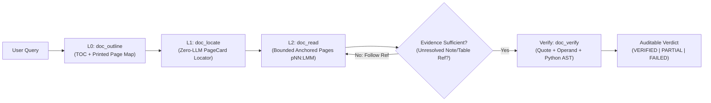

## Problem

When AI agents answer high-precision questions over 100–500 page PDFs (such as financial 10-K filings, legal contracts, or technical specifications), standard context strategies break down in predictable ways:

- **Flat chunking + dense embeddings** sever table headers from rows, miss cross-page continuations and footnote references (`"See Note 7"`), and assign near-identical cosine similarity to opposite boundary tokens (`FY2023` vs `FY2024`, accounting parentheses `$(145)` vs `$145`, `pp` vs `%`).
- **Full-document context stuffing** burns massive uncached prompt tokens and still suffers from middle-context attention decay even when the entire PDF fits within the context window.
- **LLM self-verification** allows subtle arithmetic, unit-scale, and citation errors to slip through because the same model eyeballs its own extracted numbers and quotes.

## Solution

Decouple **LLM reading and reasoning** from **deterministic structural indexing and verification** by exposing a token-bounded, 4-stage progressive protocol (`L0 → L1 → L2 → Verify`):

1. **L0 — Structural Outline (`doc_outline`, hard token cap)**: Build a zero-LLM structural map containing calibrated printed-vs-physical page numbers, section headings/subheadings, and table/statement headers.
2. **L1 — Zero-LLM Candidate Locator (`doc_locate`, hard token cap)**: Score lightweight per-page structural cards (`PageCard`: headings, subheadings, table headers, printed page refs, continuation links) using deterministic lexical/BM25-RRF retrieval to propose high-signal pages.
3. **L2 — Anchored Page Reader (`doc_read`, bounded pages per call)**: Return full selected pages with stable line anchors (`p12:L07`), a duplicate-read ledger, and optional on-demand image/zoom tiles for scanned tables or charts. If the read page contains an unresolved cross-reference (e.g., `"See Note 7"`), a sufficiency check triggers a targeted follow-up read before concluding.
4. **Verify — Deterministic Claim & Formula Gate (`doc_verify`)**: Independently verify verbatim quotes, cell-bound operands (`row_label`, `period`, `unit`, `page`), sign/parentheses polarity, unit scaling, and symbolic formulas via Python AST execution rather than LLM mental arithmetic.

## Evidence

- **Evidence Grade:** `medium`
- **Most Valuable Findings:**
  - In reproducible benchmarks from the open-source AnchorDoc reference implementation (`DeepSeek-V4.1-Flash`, `temp=0`, 15 SEC 10-K/10-Q filings averaging 145 pages), the same host agent using the 4-tool zero-LLM MCP loop achieved **86.7% E2E accuracy** vs **60.0%** for native full-PDF stuffing (**87.5% vs 50.0%** even on the 8 completely untruncated filings), while cutting newly billed uncached tokens by **92.5%** (`5,430` vs `72,827`) and raising verbatim quote verification from `53.3%` to `100%`.
  - Across the full official FinanceBench 150-question suite (84 SEC filings, 12,013 pages), zero-LLM structural indexing ran in `0.33s/PDF` (`0` indexing LLM calls) and achieved **85.3% E2E** (**96.0%** on the 50 hard numerical `metrics-generated` questions) vs `39.3%` single-pass Dense BGE-small RAG on the same base model.
- **Unverified / Unclear:** Purely scanned or image-only PDFs still require selective OCR or on-demand vision-model page reads (`L2` image tiles), which reintroduce per-page latency on non-digital documents.

## How to use it

- Expose the 4 stages as read-only, strictly sandboxed tools (for example, via MCP with a `--root` directory allowlist and hard per-call token budgets).
- Keep the host agent in charge of reasoning and deciding when to follow cross-references, while keeping page indexing, anchor formatting, quote matching, and arithmetic strictly deterministic.
- Never allow an unverified numeric literal or unbound variable inside a verification formula; return an explicit `PARTIALLY_VERIFIED` or `INSUFFICIENT_EVIDENCE` state when referenced footnotes or schedules are absent from the source PDF.

## Trade-offs

- **Pros:**
  - Zero indexing LLM cost and sub-second cold indexing per document (no vector DB to maintain or re-embed on edits).
  - Dramatically lower uncached token bills and stronger protection against middle-context attention decay.
  - Falsifiable, page-anchored evidence trails and deterministic detection of sign flips, period swaps, and arithmetic errors.
- **Cons:**
  - Adds 2–4 tool-call round trips per query compared to a single-shot prompt.
  - Depends on extractable document structure/text unless paired with selective vision/OCR fallback for scanned pages.
  - Less suited to open-ended semantic discovery across massive corpora of unstructured short snippets.

## References

- [AnchorDoc: Zero-LLM Structural PDF Indexing & Claim Verification MCP Server](https://github.com/ryanvii/AnchorDoc) (Apache-2.0, PyPI `anchordoc`, Official MCP Registry `io.github.ryanvii/anchordoc`)
- [AnchorDoc Technical Report (Zenodo DOI)](https://doi.org/10.5281/zenodo.24453581)
