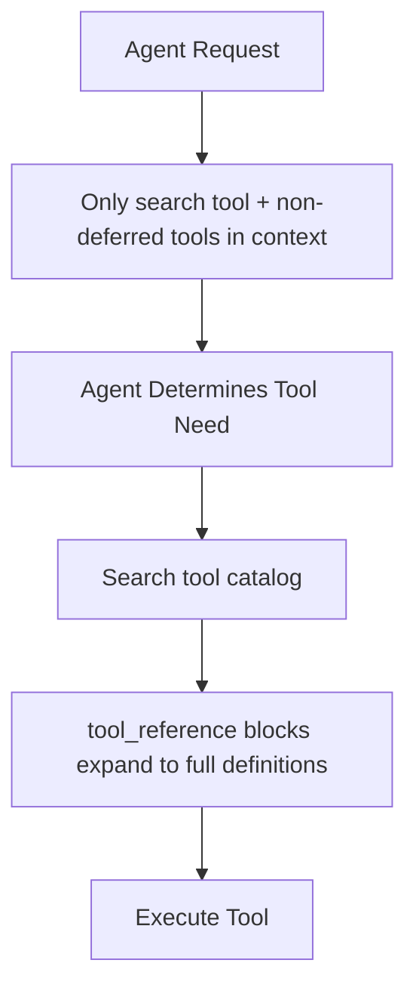

## Problem

When agents have access to large tool catalogs (dozens to thousands of available tools), loading all tool definitions upfront consumes excessive context window space. Most tools will not be used in a given workflow, making this preloading wasteful and limiting the context available for the actual task.

As the Model Context Protocol (MCP) has grown, servers may expose 50+ tools each. Setups with 7+ servers were reported consuming 67k+ tokens just for tool descriptions at tool search's launch announcement, and the API docs describe a typical GitHub/Slack/Sentry/Grafana/Splunk multi-server setup at ~55k tokens of definitions. This creates:

- **Context bloat**: preloaded tool descriptions consume tokens the task needs
- **Latency**: more tools means more processing overhead on every request
- **Discovery challenges**: agents must scan many irrelevant tools to find the right one
- **Degraded selection**: tool selection accuracy normally drops past the 30–50 tool range

## Solution

Load only a small set of core tools upfront and let the agent discover the rest on demand. The pattern has two complementary implementation variants; many systems use both.

### Variant 1: Search-based lazy loading (`defer_loading` / Tool Search)

Keep only the core, frequently used tools and a search tool in the initial context. Mark the remaining catalog `defer_loading: true` and let the agent pull definitions in when needed.



Claude's API ships tool search as a server-side tool in two variants: `tool_search_tool_regex` (the model writes Python regex patterns) and `tool_search_tool_bm25` (natural language queries). You still send every tool definition in the `tools` array, mark deferred ones with `defer_loading: true`, and the API returns `tool_reference` blocks that expand into full definitions. This scales to 10,000 deferred tools per request, and because the system prompt prefix is untouched, prompt caching is preserved. Tool search is on by default in Claude Code (`ENABLE_TOOL_SEARCH=false` opts out).

```pseudo
function build_tools(all_tools) {
    tools = [tool_search_tool_regex]          // never deferred
    for tool in frequently_used(all_tools, n=3..5):
        tools.push(tool)                       // stay non-deferred
    for tool in rest(all_tools):
        tools.push(tool with defer_loading=true)
    return tools                              // API searches server-side
}
```

Keep the `server_tool_use` and `tool_search_tool_result` blocks in the conversation history so the API can expand the references.

### Variant 2: Hierarchical catalog browsing

Expose tools as a filesystem-like hierarchy the agent walks, requesting progressively more detail only for the tools it intends to use. Anthropic documents this as hierarchical tool files with on-demand definition loading in its MCP engineering guidance.

1. **Name only**: minimal context for initial browsing
2. **Name + description**: enough to understand the tool's purpose
3. **Full definition with schemas**: complete API details only when needed

Tools are organized by integration (`servers/google-drive/getDocument.ts`, `servers/slack/sendMessage.ts`) so agents can list the `./servers/` directory to see integrations, navigate into a server directory to find relevant tools, and load full definitions only for the ones they will call.

```pseudo
# Agent workflow
1. list_directory("./servers/")
   → Returns: ["google-drive/", "slack/", "github/", ...]

2. search_tools(pattern="google-drive/*", detail_level="name+description")
   → Returns: Brief descriptions of Google Drive tools

3. get_tool_definition("servers/google-drive/getDocument")
   → Returns: Full JSON schema with parameters, types, examples
```

```
servers/
├── google-drive/
│   ├── getDocument.ts
│   ├── listFiles.ts
│   └── shareFile.ts
├── slack/
│   ├── sendMessage.ts
│   └── getChannels.ts
└── github/
    ├── createIssue.ts
    └── listRepos.ts
```

## Evidence

- Anthropic reports 98.7% (150K → 2K tokens) for tool definitions loaded on demand, and the API docs report tool search typically reduces definitions by over 85% in multi-server setups by loading only the 3–5 tools a request needs.
- The MCP specification added no `tools/search` primitive through the 2025-11-25 spec, so client-side tool search remains the practice rather than a protocol feature.

## How to use it

**When to enable:** Anthropic's guidance is to enable tool search at 10+ tools, when definitions exceed 10k tokens, or when aggregating 200+ tools across MCP servers. Standard tool calling is a better fit below 10 tools or under 100 tokens of definitions.

**For MCP server creators:**

- Enhance the server `instructions` field; it becomes more critical with tool search because it tells the agent when to search for your tools
- Include rich descriptions, tags, and logical grouping to improve searchability

**For MCP client creators:**

- Provide a search interface over tool names, descriptions, argument names, and argument descriptions (agentic search) rather than a fixed embedding index
- Cache tool definitions that are frequently requested together, and use LRU caching for recently used tools to minimize reload overhead
- Allow an explicit opt-out for users who prefer preloading

**Implementation considerations:**

- Organize tools in a clear hierarchy (by integration, domain, or function) with meaningful names at each level
- Support pattern matching (glob or regex) for tool searches
- Use OpenAPI/JSON Schema compatible formats for tool definitions

## Trade-offs

**Pros:**

- Reduces baseline context consumption dramatically (see Evidence)
- Scales to thousands of tools without context issues
- Keeps tool selection accuracy high past the 30–50 tool range where it normally degrades
- Preserves prompt caching, because deferred tools are excluded from the system-prompt prefix
- Allows more MCP servers to be enabled simultaneously

**Cons:**

- Adds discovery overhead (extra tool calls and latency before execution)
- Requires search infrastructure and metadata management
- May miss serendipitous tool discovery that happens when browsing full catalogs
- Server instructions become more critical and require careful authoring
- May require multiple round-trips to find the right tool

**Pitfalls:**

- Deferring every tool, including the search tool itself, is rejected by the API
- Deferring your most frequently used tools forces a search before every call
- Basic RAG may not capture tool capabilities effectively; agentic search is preferred

## References

- Anthropic Engineering: [Code Execution with MCP](https://www.anthropic.com/engineering/code-execution-with-mcp) (November 4, 2025) - hierarchical tool files; 150K → 2K tokens (98.7%) for definitions loaded on demand
- Anthropic Engineering: [Advanced Tool Use](https://www.anthropic.com/engineering/advanced-tool-use) (November 24, 2025) - Tool Search Tool and `defer_loading`; 85% token reduction
- Claude API: [Tool search tool](https://platform.claude.com/docs/en/agents-and-tools/tool-use/tool-search-tool) - `tool_search_tool_regex` / `tool_search_tool_bm25`, `defer_loading`, `tool_reference` expansion, 10,000 deferred tools, >85% reduction, enablement guidance
- Claude API: [Managing tool context](https://platform.claude.com/docs/en/agents-and-tools/tool-use/manage-tool-context) - positions tool search as the standard answer for 20+ tool sets
- Claude Code: [MCP documentation](https://code.claude.com/docs/en/mcp) - tool search on by default, `ENABLE_TOOL_SEARCH`, `WaitForMcpServers` fallback
- Claude Code: [Tool search in the Agent SDK](https://code.claude.com/docs/en/agent-sdk/tool-search)
- [Original announcement tweet](https://x.com/trq212/status/2011523109871108570) by Thariq (@trq212), January 14, 2026 - reported 67k+ token setups and a 10% context threshold at launch; the current MCP docs state no activation threshold
- [MCP specification changelog](https://modelcontextprotocol.io/specification/2025-11-25/changelog) - no `tools/search` primitive added through the 2025-11-25 spec
- Model Context Protocol: https://modelcontextprotocol.io/
