## Problem

Long-running agent conversations with many tool calls can suffer from **quadratic performance degradation**:

- **Growing JSON payloads**: each iteration sends the entire conversation history to the API
- **Expensive re-computation**: without caching, the model re-processes the same static content repeatedly
- **ZDR constraints**: Zero Data Retention (ZDR) policies prevent server-side state, which rules out the `previous_response_id` optimization
- **Configuration changes**: mid-conversation changes (sandbox, tools, working directory) can break cache efficiency

## Solution

Maintain prompt cache efficiency through **exact prefix preservation**: append new messages instead of modifying existing ones, and order messages so that the stable content sits at the front.

**Core insight**: prompt caches work only on **exact prefix matches**. If the first N tokens of a request match a previous request, the cached computation can be reused. Caching operates at the token level, not the message level: the cache checks token by token, independent of message boundaries.

**Message ordering strategy:**

1. **Static content first** (cached across all requests): system message (if server-controlled), tool definitions in a consistent order, developer instructions, then user or project instructions.
2. **Variable content last** (changes per request): user message, assistant messages, and tool call results appended iteratively.

**Configuration change via insertion:** when configuration changes mid-conversation, insert a new message. Do not modify an existing one.

```
[Static prefix...]
<sandbox_config_v1>     // Original config message
[Conversation...]

<sandbox changed>
<sandbox_config_v2>     // NEW message inserted
[Conversation continues...]
```

The insertion preserves the exact prefix of all previous messages, so the cache hits continue.

**What breaks cache hits:**

- Changing the list of available tools (position-sensitive)
- Reordering messages
- Modifying existing message content
- Changing the model (it affects the server-side system message)

**Provider variations:**

- **OpenAI**: caching requires an exact rendered-prefix match ("Cache reuse requires the entire rendered prefix to match"). Older models cache implicitly at model-dependent intervals; newer models also support explicit cache breakpoints (up to four cache writes per request), with cached tokens discounted up to 95% (reads at 0.1x the uncached input rate on most models)
- **Anthropic**: explicit `cache_control` breakpoints plus automatic caching, a 5-minute default TTL with a 1-hour TTL option, cache reads at 0.1x the base input price (0.05x on Opus 5.5/Sonnet 5.5, 0.025x on Fable 5.1/Mythos 5.1), and a per-model minimum cacheable prefix length

**Stateless design for ZDR:**

Avoid `previous_response_id` to support Zero Data Retention. Rely on prompt caching for linear sampling cost:

```
Without previous_response_id:
- Quadratic network traffic (send full JSON each time)
- Linear sampling cost (due to prompt caching)

With previous_response_id:
- Linear network traffic
- But violates ZDR (server must store conversation state)
```

### Example: one prefix, three requests

```mermaid
graph TD
    subgraph "Request 1"
        A1[System message] --> A2[Tools] --> A3[Instructions] --> A4[User message]
    end

    subgraph "Request 2 - Cache Hit!"
        B1[System message] --> B2[Tools] --> B3[Instructions] --> B4[User message] --> B5[Assistant response] --> B6[Tool result]
    end

    subgraph "Request 3 - Cache Hit!"
        C1[System message] --> C2[Tools] --> C3[Instructions] --> C4[User message] --> C5[Assistant response] --> C6[Tool result 1] --> C7[Tool result 2]
    end

    classDef cached fill:#90EE90
    classDef fresh fill:#FFB6C1
    class A1,A2,A3,B1,B2,B3,C1,C2,C3 cached
    class A4,B4,B5,B6,C4,C5,C6,C7 fresh
```



**Green = Cached** (exact prefix match) | **Pink = Recomputed** (new tokens)

## How to use it

**Prompt construction checklist:**

1. Order messages by stability: static, then variable.
2. Never modify existing messages; always append new ones.
3. Keep tool order consistent: enumerate tools in a deterministic order.
4. For configuration changes, insert; do not update.

**Handling configuration changes:**

| Change Type | What NOT to do | What TO do |
|-------------|----------------|------------|
| Sandbox/approval mode | Modify permission message | Insert new `role=developer` message |
| Working directory | Modify environment message | Insert new `role=user` message |
| Tool list | Change mid-conversation | Avoid if possible; breaks cache |

**MCP server considerations:**

MCP servers can emit `notifications/tools/list_changed` to signal tool list changes. Avoid honoring this mid-conversation, because it breaks cache hits. Either delay the tool refresh until a conversation boundary or accept the cache miss as a necessary trade-off.

**Compaction:**

The Codex post that documents this pattern also describes a `/responses/compact` endpoint for auto-compaction: the client posts the conversation and receives a `compaction` item with opaque `encrypted_content` that summarizes prior turns while keeping the request stateless. `auto_compact_limit` controls when compaction triggers. Compaction trades context for a cache reset: everything after the compacted summary is new tokens.

**Implementation sketch:**

```typescript
function buildPrompt(state: ConversationState): Prompt {
  return {
    items: [
      // Static prefix (cached); keep tools in a consistent order
      { role: 'system', content: state.systemMessage },
      { type: 'tools', tools: state.tools },
      { role: 'developer', content: state.instructions },
      // Variable content (appended)
      ...state.history,
    ],
  };
}

// Configuration change: insert a new message, never edit an existing one
function handleConfigChange(state: ConversationState, newConfig: SandboxConfig) {
  return {
    ...state,
    history: [
      ...state.history,
      { role: 'developer', content: formatSandboxConfig(newConfig) },
    ],
  };
}
```

## Trade-offs

**Pros:**

- **Linear sampling cost**: prompt caching makes repeated inference linear rather than quadratic
- **ZDR-compatible**: the stateless design supports Zero Data Retention policies
- **No server state**: avoids `previous_response_id` complexity
- **Simple conceptual model**: exact prefix matching is easy to reason about

**Cons:**

- **Quadratic network traffic**: the JSON payload still grows quadratically; only sampling is cached
- **Cache fragility**: mid-conversation changes to tools or model break prefix matching
- **Disciplined ordering required**: all static content must come before variable content, and tool enumeration must stay consistent

**Failure modes / gotchas:**

- **Silent cache miss:** one reordered tool, one edited earlier message, or one non-deterministic value in the static prefix invalidates all later tokens. Track cached-token counts per request to see the drop.
- **Honoring `tools/list_changed` mid-conversation:** a tool refresh rewrites the static prefix and breaks cache hits for the rest of the conversation.
- **Swapping the model mid-conversation:** the model change alters the server-side system message, so the prefix no longer matches.
- **Compaction resets the cache:** everything after the compacted summary is recomputed, so budget for one full cache rebuild after each compaction.

## References

* [Unrolling the Codex agent loop | OpenAI Blog](https://openai.com/index/unrolling-the-codex-agent-loop/) (September 11, 2026) — exact-prefix caching under ZDR, insert-don't-modify config changes, `tools/list_changed` cache misses, and the `/responses/compact` auto-compaction endpoint
* [Prompt Caching Documentation | OpenAI](https://developers.openai.com/api/docs/guides/prompt-caching) — prefix-match rules, explicit breakpoints on newer models, cache pricing
* [Prompt Caching | Anthropic](https://platform.claude.com/docs/en/build-with-claude/prompt-caching) — `cache_control` breakpoints, TTLs, read pricing, minimum cacheable length
* [Codex CLI | GitHub](https://github.com/openai/codex)
* Related: [Context Window Auto-Compaction](/patterns/context-window-auto-compaction)
