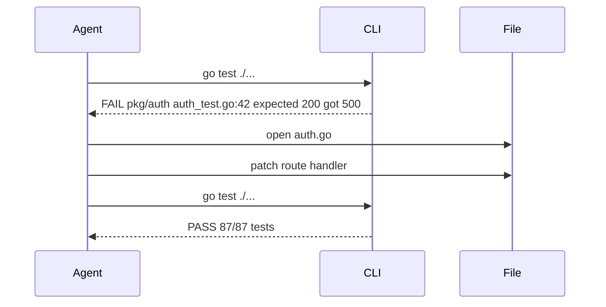

## Problem

Polishing a single prompt can't cover every edge-case; agents need ground truth to self-correct.

Additionally, agents need to integrate **human feedback** (positive and corrective) to improve session quality over time. Projects that better respond to user feedback have fewer corrections and better outcomes.

## Solution

Expose **iterative, machine-readable feedback**—compiler errors, test failures, linter output, screenshots—after every tool call.
The agent uses diagnostics to plan the next step, leading to emergent self-debugging.

**Integrate human feedback patterns:**

- **Recognize positive feedback** to reinforce patterns that work—positive signals are training data, not politeness
- **Learn from corrections** to avoid repeating mistakes
- **Adapt based on user communication style** and preferences
- **Track what works** for specific users over time

**Tool design matters:** Structured outputs (JSON, exit codes, error objects) are more effective than natural language for agent self-correction.

**Observed correlation (small sample):** in the author's own review of roughly 88 sessions across four personal projects, the projects with more positive feedback events (0-8 per project) ended with better outcomes than the correction-heavy ones. Treat this as a correlation in a tiny, non-random sample, not as evidence that reinforcement *causes* better outcomes. The earlier per-project table and its source analysis are no longer online and have been removed.

Modern models like Claude Sonnet 4.5 are increasingly proactive in creating their own feedback loops by writing and executing short scripts and tests, even for seemingly simple verification tasks (e.g., using HTML inspection to verify React app behavior).

Distinct from [Coding Agent CI Feedback Loop](coding-agent-ci-feedback-loop.md), which feeds CI results back through the repo, and from [Output Verification Loop](output-verification-loop.md), which verifies final output against criteria: this pattern is about rich feedback from every tool call plus human reactions within the session.

## Example

## How to use it

- Use this when agent quality improves only after iterative critique or retries.
- Start with one objective metric and one feedback loop trigger.
- Record failure modes so each loop produces reusable learning artifacts.

## Trade-offs

* **Pros:** Turns repeated failures into measurable improvements over time.
* **Cons:** Can increase runtime and operational cost due to iterative passes.

## References

* [Raising An Agent - Episode 1 (March 2025)](https://ampcode.com/podcast/episode-1) and [Episode 3 (March 2025)](https://ampcode.com/podcast/episode-3) - discussions on "give it errors, not bigger prompts."
* [Cognition: Rebuilding Devin for Claude Sonnet 4.5](https://cognition.com/blog/devin-sonnet-4-5-lessons-and-challenges) - observes proactive testing behavior and custom script creation for feedback loops
* [Reflexion: Language Agents with Verbal Reinforcement Learning](https://arxiv.org/abs/2303.11366) (Shinn et al., 2023) - agents learn from past failures through self-reflection and memory
* [Self-Refine: Iterative Refinement with Self-Feedback](https://arxiv.org/abs/2303.17651) (Madaan et al., 2023) - iterative refinement with self-generated critique

[Source](https://www.nibzard.com/ampcode)
