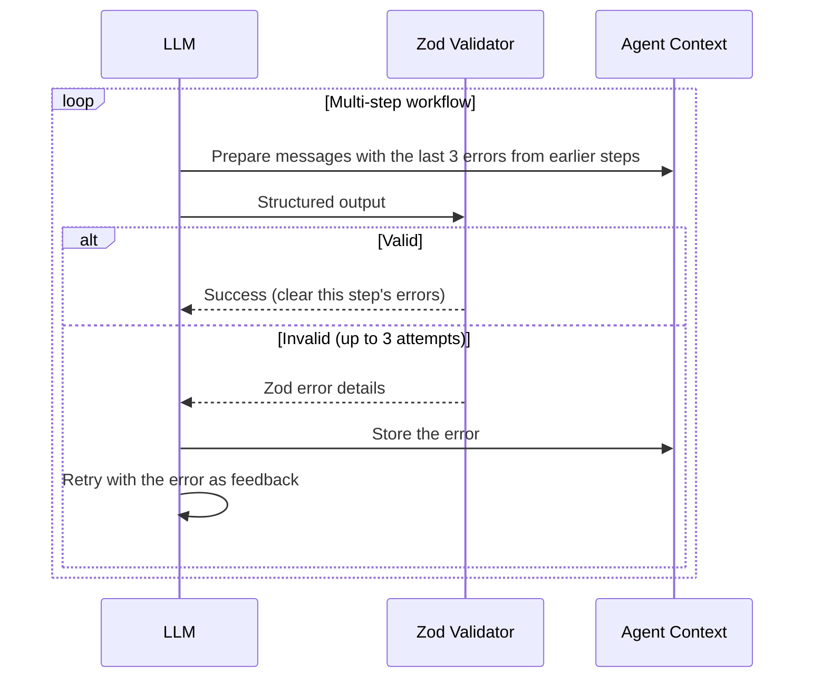

## Problem

LLMs do not always produce valid structured output that matches the expected schema. Single-attempt validation turns a correctable mistake into a task failure, and the issues compound in multi-step workflows:

- **Schema violations**: the LLM generates JSON that does not match the expected Zod or JSON Schema
- **One-and-done failure**: a single failed attempt terminates the whole workflow
- **No learning from mistakes**: each step repeats the same errors independently
- **Wasted tokens**: failed responses still consume context and cost money

## Solution

Retry failed structured outputs with the validation errors as feedback, and add recent errors from earlier steps to later prompts. The agent learns from its validation failures across the whole workflow.

Native server-side schema enforcement has become the default for major providers: OpenAI Structured Outputs and Anthropic structured outputs (JSON outputs plus strict tool use, generally available after a 2025-11-13 beta) constrain decoding so syntactic schema violations cannot occur. Reach for this client-side pattern when your provider lacks enforcement, when you validate constraints that a JSON Schema cannot express (cross-field business rules, for example), or in multi-step workflows that benefit from cross-step error learning.

### 1. Multi-attempt retry with detailed feedback

Industry practice uses 2-3 retry attempts. The Self-Refine line of work (Madaan et al., ICLR 2024) shows that iterative refinement with feedback improves output quality, without quantifying a percentage.

```typescript
async function invokeWithRetry<T>(
  ctx: AgentContext,
  schema: z.ZodType<T>,
  msgs: Message[],
  stepIndex: number,
): Promise<T> {
  const maxAttempts = 3;

  for (let attempt = 0; attempt < maxAttempts; attempt++) {
    const result = await ctx.llm.invokeStructured({ schema }, msgs);

    if (result.parsed) {
      // Success: clear this step's errors so they do not steer later steps
      ctx.schemaErrors = ctx.schemaErrors.filter((e) => e.stepIndex !== stepIndex);
      return result.parsed;
    }

    const error = getZodError(result.rawText);

    // Store for cross-step learning
    ctx.schemaErrors.push({ stepIndex, error, rawResponse: result.rawText || "", timestamp: Date.now() });

    // Append error feedback for the retry
    msgs = [
      ...msgs,
      { role: "assistant", content: result.rawText },
      { role: "user", content: `Validation errors:\n${error}\nPlease fix.` },
    ];
  }

  throw new SchemaValidationError(`Failed after ${maxAttempts} attempts`, {
    stepIndex,
    errors: ctx.schemaErrors.slice(-3),   // Last 3 errors
  });
}

function getZodError(rawText: string): string {
  try {
    const result = zodSchema.safeParse(JSON.parse(rawText));   // One "path: message" line per issue
    return result.success ? "" : result.error.issues.map((issue) => `${issue.path.join('.')}: ${issue.message}`).join('\n');
  } catch {
    return "Failed to parse as JSON";
  }
}
```

### 2. Cross-step error accumulation

The agent keeps a rolling window of recent schema errors and includes them in later LLM calls. Each entry holds `stepIndex`, the Zod validation `error`, the `rawResponse` that the LLM actually output, and a `timestamp`:

```typescript
// Before each step, append recent errors to guide the LLM
const recentErrors = ctx.schemaErrors
  .slice(-3)                               // Only the last 3, to avoid context bloat
  .filter((e) => e.stepIndex < stepIndex)  // Only from previous steps
  .map((e) => `Step ${e.stepIndex}: ${e.error}`)
  .join('\n');

if (recentErrors) {
  msgs.push({ role: "system", content: `Recent schema validation errors to avoid:\n${recentErrors}` });
}
```

### Flow



## How to use it

### 1. Define strict schemas

Use strict schemas with clear error messages:

```typescript
const ActionSchema = z.object({
  type: z.enum(['click', 'fill', 'wait', 'scroll']),
  elementId: z.string().min(1, "elementId is required"),
  arguments: z.array(z.string()).optional(),
  confidence: z.number().min(0).max(1),
});

const StepOutputSchema = z.object({
  action: ActionSchema,
  reasoning: z.string().max(500, "Keep reasoning concise"),
});
```

### 2. Wrap each step in the retry loop

Call `invokeWithRetry` for every step that needs structured output. On success, it drops the errors recorded for that step, so a solved mistake does not steer later prompts. Before each step, add the last 3 errors from previous steps to the messages, as in the cross-step snippet above.

### 3. Configure the error budget

```typescript
const context: AgentContext = {
  schemaErrors: [],
  config: {
    maxValidationAttempts: 3,   // Retry attempts per step
    errorHistorySize: 10,       // How many errors to keep
    crossStepErrorCount: 3,     // How many to inject per step
  },
};
```

## Trade-offs

**Pros:**

- **Higher success rate**: a 3-attempt retry significantly improves structured output reliability
- **Cross-step learning**: the agent avoids repeating mistakes across the workflow
- **Detailed error feedback**: Zod errors guide the LLM to specific fixes
- **Better debugging**: the error history is a diagnostic record
- **Configurable balance**: tune the attempt count against cost and latency

**Cons:**

- **Increased latency, cost, and context**: each retry is another LLM call, failed attempts still consume tokens, and unlimited error history bloats context
- **Not guaranteed**: some LLMs struggle to correct from their errors
- **Complexity**: more retry logic and error state to maintain

**Failure modes / gotchas:**

- **A model that cannot correct from the error:** some LLMs repeat the same mistake on every attempt, so each retry only adds cost and latency. Cap the attempts and fall back.
- **Stale errors steering later steps:** an error from a solved step keeps appearing in later prompts. Clear a step's errors on success, and cap the window at the last 3 errors.
- **Runaway retries:** retries multiply across a long workflow. Set a per-step timeout, and add exponential backoff with jitter in production.
- **Duplicate work under server-side enforcement:** when the API already enforces the schema, the syntactic retry adds cost without benefit. Keep only the checks that the schema cannot express.

**Mitigation strategies:**

- Use caching to skip retries for repeated workflows
- Log failures to improve prompts over time
- Consider models with better structured output adherence

## References

- [HyperAgent GitHub Repository](https://github.com/hyperbrowserai/HyperAgent) - Original implementation (see `src/agent/tools/agent.ts` lines 424-509)
- [Zod Validation Documentation](https://zod.dev/) - Schema validation library
- [Self-Refine: Iterative Refinement with Self-Feedback](https://arxiv.org/abs/2303.17651) - Madaan et al., ICLR 2024 (iterative refinement with feedback; no percentage claim)
- [OpenAI Structured Outputs](https://developers.openai.com/api/docs/guides/structured-outputs) - server-side schema enforcement that removes the syntactic half of this pattern's job
- [Anthropic Structured Outputs](https://platform.claude.com/docs/en/build-with-claude/structured-outputs) - JSON outputs plus strict tool use, generally available after a 2025-11-13 beta
- Distinct from [Structured Output Specification](structured-output-specification.md): that pattern constrains output format at generation time, while this pattern retries validation failures and accumulates errors across steps when enforcement is unavailable or insufficient
- Related patterns: [Structured Output Specification](structured-output-specification.md), [Action Caching & Replay](action-caching-replay.md)
