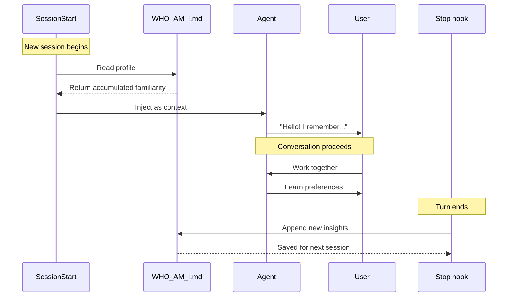

## Problem

AI agents lack continuous memory across sessions. Each conversation starts from zero, causing:

- **Lost familiarity**: The agent doesn't remember user preferences, goals, or working patterns
- **Repetitive explanations**: Users must re-explain context and preferences each session
- **Shallow relationships**: Agent cannot build deeper understanding of user's needs over time
- **Generic responses**: Without accumulated context, agents default to generic behaviors

While episodic memory systems store past *experiences*, they don't address the need for an evolving *self-identity*—who the agent is in relation to the user.

## Solution

Implement **dual-hook architecture** for self-identity accumulation:

1. **SessionStart Hook**: Inject accumulated identity/profile at session start
2. **Refinement hook (Stop or PostCompact)**: Extract new insights and refine the profile as the session runs
3. **Identity Document**: A persistent file (e.g., WHO_AM_I.md, SOUL.md) that evolves over time

Before building this, check what your harness already automates: Claude Code's auto memory has the agent save typed learning notes (`user`, `feedback`, `project`, `reference`) that load into every session, and the Claude API memory tool offers the same store-and-retrieve loop for applications. An explicit identity document is worth keeping when you want one curated, user-editable profile rather than the harness's accumulating notes.



**Core mechanism:**

```python
# SessionStart: Inject accumulated identity
def session_start_hook():
    profile = read_file("WHO_AM_I.md")
    inject_context(profile)

# Stop hook (side effect): append new insights to the profile
def stop_hook(turn_payload):
    new_insights = extract_insights(turn_payload["last_assistant_message"])
    append_file("WHO_AM_I.md", new_insights)
```

**Profile structure typically includes:**

- **Project Goals**: Evolving list of priorities and focus areas
- **Preferences**: Coding opinions, tool choices, architectural preferences
- **Communication Style**: Tone preferences, formatting conventions
- **Workflow Patterns**: Research practices, decision-making patterns
- **Boundaries**: What the agent should/shouldn't do

## Evidence

- **Evidence Grade:** `medium`
- **Most Valuable Findings:**
  - Reflexion (Shinn et al., 2023) achieved 91% pass rate on HumanEval vs 80% baseline through episodic memory with self-reflection
  - MemGPT (Packer et al., 2023) demonstrates hierarchical memory systems with virtual context management in production
  - Claude Code auto memory and the Claude memory tool ship adjacent capabilities (agent-written learnings loaded every session), showing the demand is real even where the identity document itself is not a product feature
- **Unverified / Unclear:** Long-term identity accumulation studies (multi-month) and conflict resolution mechanisms for contradictory identity statements

## How to use it

**Implementation:**

1. Create identity document with initial structure
2. Configure SessionStart hook to read and inject it
3. Configure a Stop or PostCompact hook to append new insights as the session runs
4. Include instructions for when/how to update

**Example SessionStart hook (Claude Code):**

```python
#!/usr/bin/env python3
import json
from pathlib import Path

whoami_path = Path.cwd() / "WHO_AM_I.md"

if whoami_path.exists():
    with open(whoami_path) as f:
        profile = f.read()

    print(json.dumps({
        "hookSpecificOutput": {
            "additionalContext": profile
        }
    }))
```

**Example refinement hook (Claude Code):**

SessionEnd is the wrong place for refinement: it runs after the session terminates, its stdout is discarded (only stderr reaches the user), and it shares a 1.5-second budget that per-hook `timeout` settings can raise to at most 60 seconds — too short for an LLM call that spawns another `claude --continue -p` session. Run refinement from a Stop hook instead, which fires when Claude finishes responding and can read `last_assistant_message` from its input:

```json
{
  "hooks": {
    "Stop": [
      {
        "hooks": [
          {
            "type": "command",
            "command": "python3 .claude/hooks/update_identity.py",
            "timeout": 60
          }
        ]
      }
    ]
  }
}
```

The script exits 0 and only appends distilled insights to `WHO_AM_I.md` as a side effect; reserve heavier consolidation (merging sections, pruning contradictions) for a periodic job you run yourself, or for the first SessionStart of a later session.

## Trade-offs

**Pros:**

- **Continuous familiarity**: Agent "remembers" user across sessions
- **Deepening relationship**: Understanding accumulates over time
- **Reduced friction**: Less repetitive explanation of preferences
- **Personalized behavior**: Agent adapts to user's specific style
- **Transparent**: Identity is visible and editable by user

**Cons:**

- **Staleness risk**: Profile may become outdated if not updated
- **Overfitting**: Agent may become too specialized to one user
- **Context overhead**: Profile consumes tokens each session
- **Extraction noise**: SessionEnd may extract irrelevant "insights"
- **Requires hooks**: Needs lifecycle hook infrastructure

**Operational considerations:**

- Review and prune profile periodically
- Include metadata (created/modified dates) to track evolution
- Consider version control for profile changes
- Design prompts to avoid noise in insight extraction
- Balance specificity (more personalized) vs generality (more flexible)

## Example: WHO_AM_I Structure

```markdown
---
type: familiarity
created: 2025-01-24
modified: 2026-01-26
---

# Who Am I

This document accumulates familiarity across sessions.

## Project Goals

- [Evolving list of priorities, focus areas, and objectives]

## Preferences

- [Coding opinions, tool choices, architectural preferences]
- [Communication style and formatting conventions]
- [Workflow patterns and decision-making approaches]

## Boundaries

- [What the agent should always ask about before doing]
- [Privacy boundaries and ethical red lines]
```

## References

* Based on my personal bot WHO_AM_I system
* Related: [Dynamic Context Injection](dynamic-context-injection.md), [Episodic Memory Retrieval & Injection](episodic-memory-retrieval-injection.md), [Filesystem-Based Agent State](filesystem-based-agent-state.md)

- [Generative Agents: Interactive Simulacra of Human Behavior](https://arxiv.org/abs/2304.03442) - Park et al. (Stanford, 2023)
- [MemGPT: Towards LLMs as Operating Systems](https://arxiv.org/abs/2310.08560) - Packer et al. (UC Berkeley, 2023)
- [Claude Code Hooks Documentation](https://code.claude.com/docs/en/hooks) - hook events, budgets, and output handling (SessionEnd has no decision control and shares a 1.5-second budget, extendable to at most 60 seconds)
- Claude Code auto memory (agent-written learnings loaded into every session): https://code.claude.com/docs/en/memory
- Claude memory tool: https://platform.claude.com/docs/en/agents-and-tools/tool-use/memory-tool
