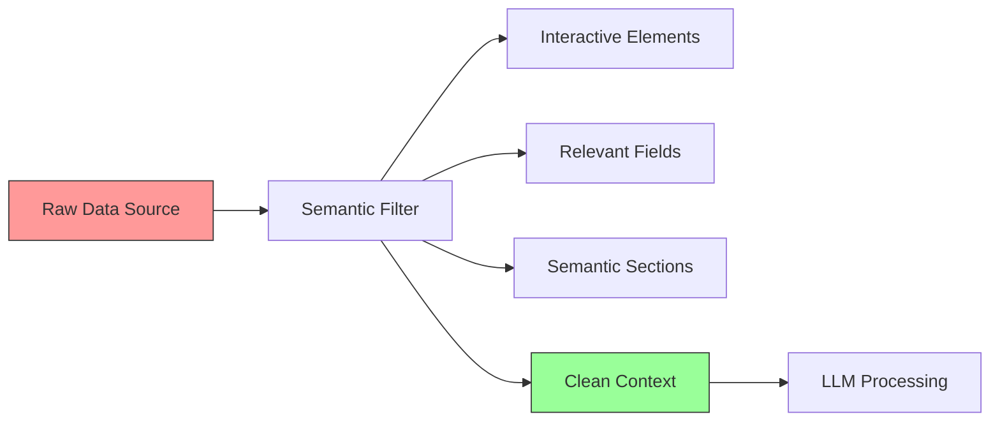

## Problem

Raw data sources are too verbose and noisy for effective LLM consumption. Full representations include invisible elements, implementation details, and irrelevant information that bloat context and confuse reasoning.

Research on boilerplate detection shows that a large fraction of web page content is navigation, templates, ads, and other boilerplate that carries no page-specific signal, which is why shallow text features suffice to strip it (Kohlschütter et al., WSDM 2010).

- **Token explosion**: raw data exceeds context limits or becomes prohibitively expensive
- **Poor signal-to-noise and confused reasoning**: the LLM wastes reasoning capacity on irrelevant details, which leads to hallucinations and wrong conclusions
- **Slower inference**: more tokens mean slower generation and higher costs

The issue appears in web scraping (full DOM with scripts, styles, and tracking iframes), API responses (nested metadata, internal fields, debug info), document processing (headers, footers, navigation), and code analysis (comments, whitespace, boilerplate code).

## Solution

Extract only the semantic, interactive, or relevant elements from raw data. Give the LLM a clean representation that holds what matters for reasoning.

**Core principle: do not send raw data to the LLM. Send semantic abstractions.**

Production systems use this approach: browser automation tools (Puppeteer and Playwright accessibility trees), RAG frameworks (LangChain and LlamaIndex semantic chunking), and code analysis tools (Aider's AST-based repo-map).

### Example 1: Browser accessibility tree instead of HTML

Raw HTML (10,000+ tokens), with scripts, styles, tracking pixels, and ad iframes:

```html
<html>
  <head><script src="analytics.js"></script></head>
  <body>
    <div class="tracking-pixel" style="display:none"></div>
    <iframe src="ad-server.com"></iframe>
    <nav aria-label="Navigation"><a href="/">Home</a></nav>
    <main><button id="login-button">Login</button><input type="email" name="email" placeholder="Email" /></main>
  </body>
</html>
```

The accessibility tree keeps the interactive elements and a locator for each (100-200 tokens):

```json
{
  "interactiveElements": [
    { "role": "link", "name": "Home", "xpath": "/html/body/nav/a[1]" },
    { "role": "button", "name": "Login", "id": "login-button", "xpath": "/html/body/main/button" },
    { "role": "textbox", "name": "Email", "id": "email", "xpath": "/html/body/main/input" }
  ]
}
```

```typescript
// snapshot() already filters aria-hidden, display:none, ad and tracking iframes, and non-semantic divs
const tree = await page.accessibility.snapshot({ interestingOnly: true });
```

### Example 2: API response filtering

Raw API responses include internal metadata (2,000 tokens). Filter to the semantic fields only:

```json
{
  "data": { "users": [{ "id": "123", "name": "Alice", "email": "alice@example.com",
                        "internalFlags": ["vip", "beta_tester"],
                        "metadata": { "created_at": "2024-01-01", "version": 42 } }] },
  "_internal": { "requestId": "req-abc123", "latency": 45, "cache": "HIT", "debug": [] },
  "_links": { "self": "/users", "next": "/users?page=2" }
}
```

```typescript
function filterAPIResponse(response: any, relevantFields: string[]) {
  const users = response.data.users.map((user: Record<string, unknown>) =>
    Object.fromEntries(relevantFields.filter((field) => field in user).map((field) => [field, user[field]])));
  return { users };   // About 200 tokens instead of 2,000
}
```

### Example 3: Document section extraction

Full documents add a header on every page, a legal disclaimer, a navigation menu, and repeated contact information. Keep the named content sections and strip the boilerplate. In this example the result is about 20% of the original size:

```python
BOILERPLATE = ["COMPANY CONFIDENTIAL", "Copyright", "Table of Contents", "Legal disclaimer"]

def extract_semantic_content(document: str) -> dict:
    """Keep the named content sections; drop headers, footers, navigation, and disclaimers."""
    return {name: remove_boilerplate(extract_section(document, name), BOILERPLATE)
            for name in ("EXECUTIVE SUMMARY", "ANALYSIS", "CONCLUSIONS")}
```

### Architecture



### Key benefits

Illustrative comparison for the raw-HTML example above; actual ratios depend entirely on how verbose the source representation is:

| Aspect | Raw Data | Semantic Filter |
|--------|----------|-----------------|
| Token count | 10,000+ (full DOM) | 100-1,000 (accessibility tree) |
| LLM reasoning | Confused by noise | Focused on signal |
| Cost and latency | Scales with raw size; slower with bigger context | Scales with filtered size; faster with smaller context |
| Accuracy | Prone to errors | More reliable |

## How to use it

**1. Identify the semantic elements for your domain:** interactive ARIA roles for web pages (`button`, `link`, `textbox`, `checkbox`, `radio`, `combobox`, `slider`), business fields only for API responses (`name`, `email`, `status`, `amount`), and content sections only for documents (`executive_summary`, `analysis`, `conclusions`).

**2. Build the filter layer:**

```typescript
class SemanticFilter {
  filter(data: any, domain: 'web' | 'api' | 'document'): any {
    if (domain === 'web') return this.filterAccessibilityTree(data);
    return domain === 'api' ? this.filterAPIResponse(data) : this.filterDocumentSections(data);
  }

  private filterAccessibilityTree(dom: any[]): any[] {   // Only interactive, visible, non-ad elements
    return dom.filter((el) => el.interactive && !el.isHidden && !this.isAdIframe(el))
      .map((el) => ({ role: el.role, name: el.name, xpath: el.xpath }));
  }
}
```

**3. Apply the filter before the LLM call:**

```typescript
// Wrong: send raw data
await llm.generate({ prompt: `Analyze this page: ${rawHTML}` });

// Right: filter first
const filtered = semanticFilter.filter(rawHTML, 'web');
await llm.generate({ prompt: `Analyze this page: ${JSON.stringify(filtered)}` });
```

**4. Keep a reference mapping for execution:** the filtered context uses semantic IDs (`btn-1`, "Login", "button"). The execution layer maps each one back to its original reference (`frameIndex-backendNodeId`, or an XPath such as `/html/body/main/button`) before it acts.

## Trade-offs

**Pros:**

- **Dramatic token reduction**: filtered representations are routinely an order of magnitude or more smaller than the raw source
- **Better LLM reasoning and higher reliability**: the model focuses on signal, with less confusion and hallucination
- **Lower costs and faster inference**: fewer tokens are cheaper and quicker to process

**Cons:**

- **Filter complexity**: you build and maintain filter logic that is tailored to each use case
- **Information loss**: the filter can remove elements or context that matter
- **Mapping overhead**: you track filtered-to-original references, and you version filters alongside the data schemas they read

**Failure modes / gotchas:**

- **Hidden but content-rich:** accordions, tab panels, and collapsed content can be excluded by the accessibility tree
- **Dynamic content:** AJAX-loaded content, infinite scroll, and lazy-loaded elements require wait and scroll strategies before the filter runs
- **Canvas and SVG:** charts and custom-rendered content may need OCR or a fallback to HTML
- **Over-aggressive filtering:** the filter removes an element that the task needs. Start conservative (filter obvious noise, include borderline cases), keep a filter bypass for debugging, and widen the filter if accuracy drops

**Security note:** semantic extraction can also provide security benefits. By removing untrusted content after the extraction of safe intermediate representations, agents gain resistance to prompt injection (see the Context-Minimization Pattern).

## References

- [HyperAgent GitHub Repository](https://github.com/hyperbrowserai/HyperAgent) - Accessibility-tree context with no screenshots and automatic ad-frame filtering
- [Playwright MCP](https://github.com/microsoft/playwright-mcp) - browser automation server that exposes the accessibility tree instead of raw DOM or screenshots
- Kohlschütter et al., ["Boilerplate Detection using Shallow Text Features"](https://doi.org/10.1145/1718487.1718542), WSDM 2010 - foundational research showing shallow text features detect boilerplate that carries no page-specific signal
- Beurer-Kellner et al., ["Design Patterns for Securing LLM Agents"](https://arxiv.org/abs/2506.08837), arXiv 2025 - Context-Minimization Pattern (security framework)
- [WAI-ARIA Accessibility Tree](https://www.w3.org/TR/core-aam-1.1/) - Browser accessibility API
- Related patterns: [Context Window Anxiety Management](context-window-anxiety-management.md), [Curated Code Context Window](curated-code-context-window.md)
- Distinct from [Context-Minimization Pattern](context-minimization-pattern.md): that pattern decides how much total context the agent keeps as a security and budget discipline, while this one transforms a specific raw input into its semantic elements before it reaches the context at all
