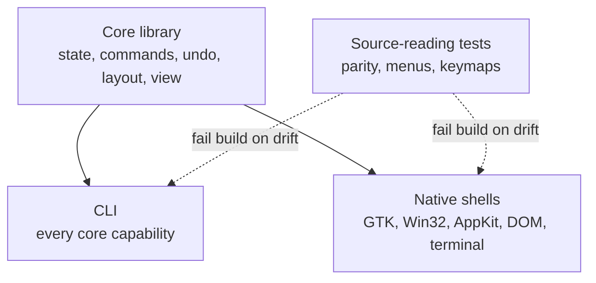

## Problem

Providing a native interface on several platforms often means maintaining separate implementations across languages, toolkits, and build systems. A cross-platform toolkit such as Qt or wxWidgets can reduce that work and is often the right choice, but its shared widgets and interaction model may not match each platform's conventions. It can also constrain teams that need direct access to platform APIs, highly platform-specific behavior, or a UI that uses different technologies on desktop, web, and terminal targets. In those cases, separate native shells may fit better, provided the shared application behavior is kept out of them.

Historically, the implementation cost of several native shells could make this approach impractical for a small team. Coding agents make it more feasible by taking on much of the repetitive per-platform implementation from a shared core API and checklist. They do not ensure consistent behavior, so shells still need parity checks and human review. If shells each implement undo, wrapping, or caret movement independently, those features can diverge. Toolkit text widgets can create further divergence when each shell keeps its own document state and applies the toolkit's editing rules.

## Solution

Place application state and behavior in a shared **core**. Keep each platform **shell** responsible for rendering and forwarding input to that core. Add automated checks at the boundary so shell implementations expose the same core capabilities without duplicating application rules.

The core owns:

- **Document state and history.** Edits are data with an inverse; undo grouping and "modified" are core decisions.
- **Layout.** Vertical movement and click positions depend on the displayed rows, so wrapping is calculated in the core. A shell supplies text-width and row-height metrics from the rendering engine it uses.
- **The list of verbs.** Every menu command is declared once in a table with an id, label and summary.
- **Visible content.** Shells request a view sized to the available frame rather than loading the whole document.

Each shell handles presentation details: key bindings, menu placement, and how an unsaved document is indicated. These details follow platform conventions and can differ between shells.

A **CLI exposes the core capabilities**, including any state persisted between invocations in a session file. Agents and tests can use it to drive the application without a GUI.

Automated parity checks fail the build when a shell or the CLI falls behind the core. In the reference implementation, one test parses the core source to find public methods, while shell tests check the shared command table:

- every public method on the core's application type has a CLI command, or a written reason in a parity table;
- every CLI command appears in a sample script that the test suite runs;
- every command in the verb table appears in every shell's menu, and every caret motion has a key in every shell's keymap.

## Evidence

- **Evidence Grade:** `low`
- **Most Valuable Findings:**
  - Two projects by the same author use the pattern: a text editor template with six Rust front-ends (CLI, terminal, GTK, browser via WebAssembly, Win32, AppKit) and an office suite built the same way at larger scale.
  - The reference implementation documents a case where a headless browser screenshot showed every row measured with a 10px default font, so nothing wrapped, while the jsdom smoke test passed. Source-level checks do not replace looking at the running UI.
- **Unverified / Unclear:** No independent team has reported on the pattern. The macOS shell in the reference implementation is built and rendered in CI but had not been used interactively at the time of writing.

## How to use it

1. **Build and test the core without a UI.** Test that observers can read the core while receiving a notification; this also checks that callbacks run after the core releases its lock.
2. **Add the CLI and parity checks.** Stateless CLI calls help identify core state that is not exposed through the interface.
3. **Create a sample script** that exercises each CLI command, and use its output as a fixture for shell rendering tests.
4. **Build the terminal shell first.** Move behavior that another shell would need into the core before implementing additional shells.
5. **Delegate additional shells with a clear checklist:** keep application state out of shells; do not let toolkit text widgets own document contents; test keymaps and menus outside widget-dependent modules; repaint in response to core notifications.
6. **Check platform code on CI hosts without the target platform.** When shells use one language, run type checks and linting for each target on any host where these checks do not require linking. Keep platform-independent code, such as argument parsing, keymaps, menus, and geometry, outside platform-specific compilation gates so its tests run everywhere.
7. **Render frames headlessly** and compare deterministic output where practical. Review screenshots as well: automated checks verify behavior and rendering consistency, but not whether the interface looks right.

## Trade-offs

- **Pros:**
  - Shared rules reduce behavioral differences in features such as undo, selection, and wrapping.
  - Shell work has a defined boundary and can be checked with repeatable tests.
  - The CLI gives agents and scripts access to core capabilities through a structured interface.
  - Each platform can follow its own interface conventions.
  - Agents can produce and update several shell implementations from the same core contract, reducing the human effort that previously made this architecture costly.
- **Cons:**
  - Custom text rendering requires each shell to address input methods, accessibility, and complex-script shaping. The reference implementation lists these as open gaps.
  - The core API can grow as platform-specific requirements are added.
  - Source-parsing checks can break during refactoring and require maintenance.
  - Appearance and platform conventions still need review on each platform; automated checks do not replace visual inspection.
  - A cross-platform toolkit such as Qt or wxWidgets is usually a better fit when one consistent UI across platforms is acceptable, the team wants a mature shared widget set, or it lacks the capacity to build and review native shells for every target. Agents lower shell implementation costs, but do not remove the cost of validating platform behavior, accessibility, and rendering.

## References

- [fwilhe2/editor: architecture guide](https://github.com/fwilhe2/editor/blob/main/doc/architecture.md): the rules, order of work and checklists (contributor-owned, disclosed).
- [fwilhe2/grind](https://github.com/fwilhe2/grind): an office suite built with the same method, where most of the rules were first applied (contributor-owned, disclosed).
- Alistair Cockburn, [Hexagonal Architecture](https://alistair.cockburn.us/hexagonal-architecture/): ports and adapters, the general idea of an application core with interchangeable front-ends.
- Martin Fowler, [Humble Object](https://martinfowler.com/bliki/HumbleObject.html): keeping hard-to-test UI code thin so behaviour can be tested elsewhere.
- Related patterns: [CLI-First Skill Design](cli-first-skill-design.md), [Dual-Use Tool Design](dual-use-tool-design.md), [Spec-As-Test Feedback Loop](spec-as-test-feedback-loop.md).
