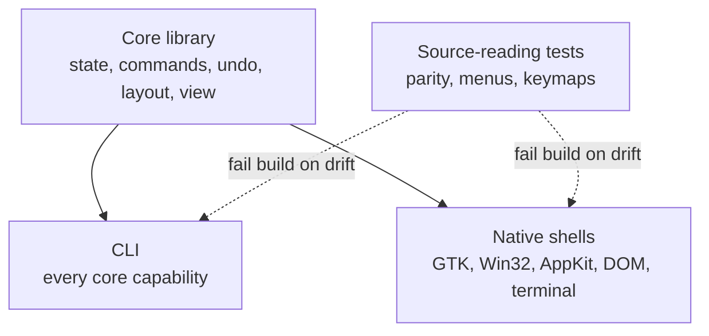

## Problem

A native interface per platform used to mean writing the application several times, in different languages, toolkits and build systems. Few projects could justify that, so most shipped one cross-platform UI that fits no platform well.

Coding agents make the per-platform implementation cheap. They do not make it consistent. An agent asked to build a Windows front-end will re-implement undo, word wrapping and caret movement against whatever it finds in that toolkit, and the result differs from the GNOME and macOS versions in ways no reviewer will catch by reading diffs. Toolkit text widgets make this worse: each holds its own copy of the document, and the toolkit's rules win over the application's.

## Solution

Split the application into one **core** that owns every piece of state and every rule, and several **shells** that only render and forward input. Then make the boundary between them mechanically checked, so agents can work on shells in parallel without redefining the application.

The core decides:

- **Document state and history.** Edits are data with an inverse; undo grouping and "modified" are core decisions.
- **Layout.** Up, Down, Page Down and click positions depend on rows on screen, so wrapping lives in the core. A shell supplies only a small metrics interface (string width, row height), measured with the same engine it draws with.
- **The list of verbs.** Every menu command is declared once in a table with an id, label and summary.
- **What is visible.** Shells read a windowed view sized to their frame, never the whole document.

Each shell decides only presentation: which keys map to which verb, whether commands appear in a menu bar or a header bar, how a dirty document is marked. These follow each platform's own guidelines and are expected to differ between shells.

A **CLI exposes every core capability**, including state that persists between invocations through a session file. It gives agents and tests a way to drive the application without a GUI.

**Ratchet tests** fail the build when the boundary is broken. The parity test parses the core's source to list its public methods; the shell tests iterate over the verb table:

- every public method on the core's application type has a CLI command, or a written reason in a parity table;
- every CLI command appears in a sample script that the test suite runs;
- every command in the verb table appears in every shell's menu, and every caret motion has a key in every shell's keymap.

## Evidence

- **Evidence Grade:** `low`
- **Most Valuable Findings:**
  - Two projects by the same author use the pattern: a text editor template with six Rust front-ends (CLI, terminal, GTK, browser via WebAssembly, Win32, AppKit) and an office suite built the same way at larger scale.
  - The reference implementation documents a case where a headless browser screenshot showed every row measured with a 10px default font, so nothing wrapped, while the jsdom smoke test passed. Source-level checks do not replace looking at the running UI.
- **Unverified / Unclear:** No independent team has reported on the pattern. The macOS shell in the reference implementation is built and rendered in CI but had not been used interactively at the time of writing.

## How to use it

1. **Build the core with tests and no UI.** Include a test that observers can read back from the core while being notified, so the core must release its lock before calling them.
2. **Add the CLI and the parity test next.** Stateless CLI calls show which state the core failed to expose.
3. **Write one sample script** that exercises every CLI command; reuse its output as the fixture each shell renders.
4. **Build the terminal shell first.** It is the cheapest real event loop. Move anything it invents that a second shell would also need into the core before starting the next shell.
5. **Hand further shells to agents** with a checklist: no application state in the shell, no toolkit text widget owning the text, keymap and menus in widget-free modules with tests, repaint on core notification only.
6. **Check platform code where the platform is absent.** With all shells in one language, type-checking and linting for each target run on any CI host, because checking does not link. Keep window-independent code (argument parsing, keymaps, menus, geometry) outside platform `cfg` gates so its tests run everywhere.
7. **Render frames headlessly** (`--render-to` style) and compare two renders byte for byte. A human still has to look at screenshots: tests prove wiring, not appearance.

## Trade-offs

- **Pros:**
  - Behaviour is defined once, so shells cannot disagree about undo, selection or wrapping.
  - Shell work is a bounded, repeatable task with a checklist and failing tests, which suits agents.
  - The CLI gives agents and scripts the same capabilities as the GUIs, with structured output.
  - Each platform gets its own conventions instead of a lowest-common-denominator UI.
- **Cons:**
  - Rendering text yourself instead of using toolkit widgets means re-doing input methods, accessibility and complex-script shaping per shell. The reference implementation lists these as open gaps.
  - The core API grows faster than in a single-UI application, because every shell-local need becomes a core feature.
  - Ratchet tests that parse source code are brittle under refactoring and need maintenance.
  - Appearance and platform conventions still require human inspection on each platform, which limits how much review the tests replace.

## References

- [fwilhe2/editor: architecture guide](https://github.com/fwilhe2/editor/blob/main/doc/architecture.md): the rules, order of work and checklists (contributor-owned, disclosed).
- [fwilhe2/grind](https://github.com/fwilhe2/grind): an office suite built with the same method, where most of the rules were first applied (contributor-owned, disclosed).
- Alistair Cockburn, [Hexagonal Architecture](https://alistair.cockburn.us/hexagonal-architecture/): ports and adapters, the general idea of an application core with interchangeable front-ends.
- Martin Fowler, [Humble Object](https://martinfowler.com/bliki/HumbleObject.html): keeping hard-to-test UI code thin so behaviour can be tested elsewhere.
- Related patterns: [CLI-First Skill Design](cli-first-skill-design.md), [Dual-Use Tool Design](dual-use-tool-design.md), [Spec-As-Test Feedback Loop](spec-as-test-feedback-loop.md).
