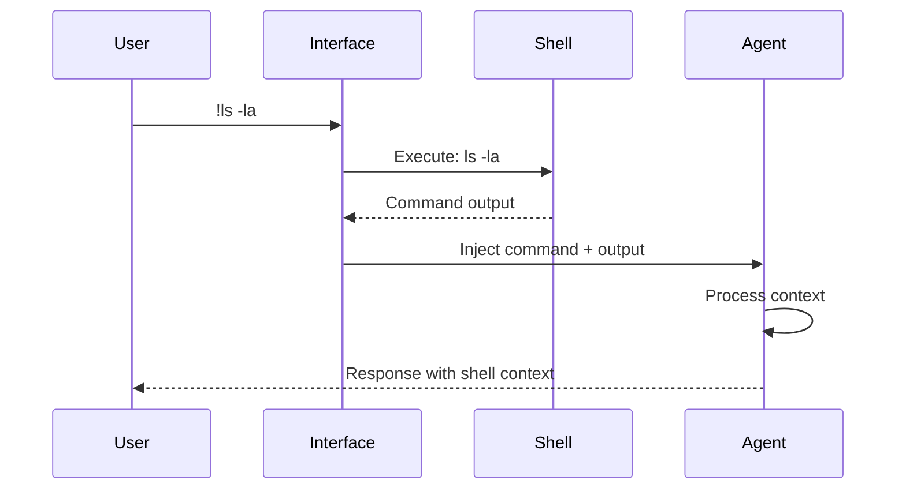

## Problem

When an AI agent interacts with a local development environment, it often needs to execute shell commands (e.g., run linters, check git status, list files) and then use the output of these commands as context for its subsequent reasoning or actions. Manually copying and pasting command output into the prompt is tedious and error-prone.

## Solution

Provide a dedicated mechanism within the agent's interface (e.g., a special prefix like `!` or a specific command mode) that allows the user to directly issue a shell command to be executed in the local environment. Crucially, both the command itself and its full output (stdout and stderr) are automatically captured and injected into the agent's current conversational or working context.

The `!` prefix syntax originates from IPython (2001). Among AI coding platforms, Claude Code documents it officially as shell mode; the examples below list other platforms' mechanisms, which are separate affordances and not a shared `!` convention.

This ensures that the agent is immediately aware of the command that was run and its results, allowing it to seamlessly incorporate this information into its ongoing tasks without requiring manual data transfer by the user.

## Example (shell integration flow)

## Example

-   Claude Code: typing `!ls -la` in interactive mode executes `ls -la` locally, and the command plus its output enter the conversation context (officially documented as shell mode).
-   Cursor: the agent can be granted terminal access and reads the results of commands it or the user runs in the IDE's integrated terminal - a UI-triggered mechanism, not a `!` prefix.
-   Continue.dev: the assistant reads from the IDE's integrated terminal on demand, a different injection path again.
-   OpenAI Code Interpreter: executes Python in a sandboxed cell and returns the output - same user-visible effect (command plus output become context), different mechanism.

## How to use it

- Use this when agent success depends on reliable tool invocation and environment setup.
- Implement PTY-aware execution with graceful fallback for non-interactive commands.
- Validate commands before execution (allowlist-based, dangerous pattern detection).
- Capture full output (stdout, stderr, exit codes) for complete context.
- Add observability around tool latency, failures, and fallback paths.

## Trade-offs

* **Pros:** Eliminates manual copy-paste workflow; enables seamless context injection; a documented first-party implementation (Claude Code shell mode) with a long IPython lineage; related tool-use foundations (ToolFormer, ReAct).
* **Cons:** Introduces integration coupling and environment-specific upkeep; requires security considerations (validation, sandboxing); output size can impact token costs.

## References

-   [Claude Code interactive mode](https://code.claude.com/docs/en/interactive-mode) - official documentation of the `!` shell mode: run a command, add it and its output to the session (primary source)
-   Based on the `!` (Exclamation mark) keybinding for Bash mode in "Mastering Claude Code: Boris Cherny's Guide & Cheatsheet," section V (author's supplementary writeup, May 2025: https://www.nibzard.com/claude-code)
-   Schick, T., et al. (2023). [ToolFormer: Language Models Can Teach Themselves to Use Tools](https://arxiv.org/abs/2302.04761). ICLR 2024.
-   Yao, S., et al. (2022). [ReAct: Synergizing Reasoning and Acting in Language Models](https://arxiv.org/abs/2210.03629). ICLR 2023.
-   [IPython Documentation](https://ipython.org/) - Origin of `!` shell escape syntax (2001)
