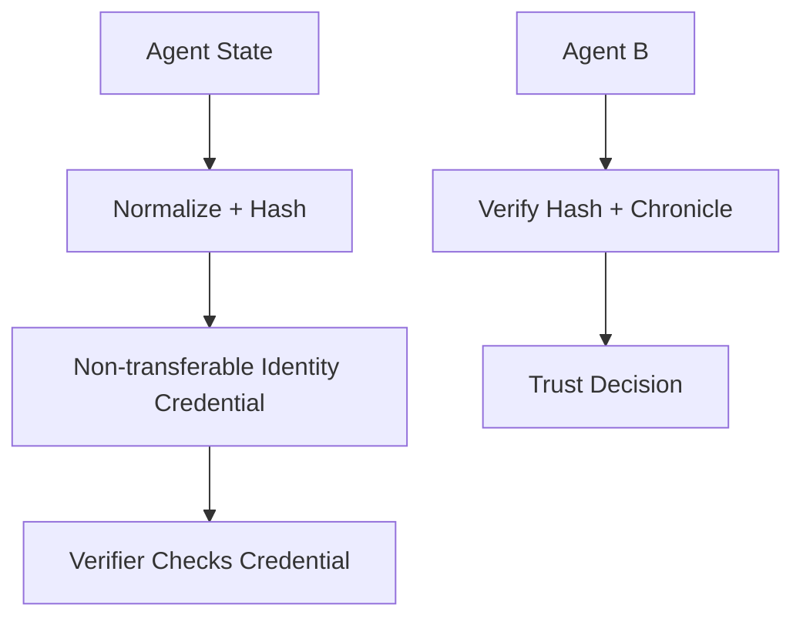

## Problem

As autonomous agents interact across networks, verifying identity and detecting prompt/operator drift becomes difficult. Without durable identity and an immutable change history, agents can impersonate others or silently diverge from authorized configurations. Standardization is nascent: ERC-8004 ("Trustless Agents", Draft since August 2025) proposes on-chain identity, reputation, and validation registries for agents, but no widely deployed neutral standard exists yet.

## Solution

Bind agent identity and mutable metadata to a non-transferable credential and record identity-bearing state transitions in a tamper-resistant log.

**Pattern flow:**

1. Compute a stable hash of the normalized system prompt/state and commit it at registration.
2. Issue a non-transferable identity credential (for example an SBT-style token).
3. Record meaningful changes (prompt updates, operator changes, policy updates) as signed events.
4. Require verifiers to check both credential validity and state continuity before trusting outputs.

## Evidence

- **Evidence Grade:** `low`
- **Most Valuable Findings:** Non-transferable credentials prevent credential theft and impersonation; hash-based state commitments enable verifiable continuity checks without requiring identity disclosure.
- **Unverified / Unclear:** The only public implementation we could verify (Chitin) is launch-stage — registration is free for the first 10,000 agents, its contracts repository is young, and its MCP server npm package has a single early release. Long-term operational costs and scalability across large agent fleets are unproven.

## When to use

- Before delegating work to another agent.
- In agent marketplaces or multi-org delegations.
- For compliance workflows requiring auditable agent-state continuity.

## Trade-offs

- **Pros:** Non-transferability prevents credential delegation and theft; tamper-resistant logging provides auditable state history; enables verification without identity disclosure.
- **Cons:** Requires external registry and append-only log infrastructure; hash commitments verify state integrity but not semantic correctness; operational overhead for issuing/rotating credentials; standards are still drafts and adoption is unproven.

## Known Implementations

- [Chitin](https://chitin.id) — on-chain agent identity on Base L2: EIP-5192 soulbound tokens, Merkle-proof selective disclosure, and a Chronicle log on Arweave; ERC-8004 passport compatible; launch-stage.
- [Chitin MCP Server](https://www.npmjs.com/package/chitin-mcp-server)
- [Chitin Contracts](https://github.com/chitin-id/chitin-contracts)

## How to use it

- Hash the normalized system prompt and configuration at registration, and commit the hash with the identity credential.
- Issue the non-transferable credential to the agent's own address so it cannot be reassigned.
- Record every prompt, operator, or policy change as a signed event in the append-only log.
- Before delegating, verify all three: the credential is valid and locked, the agent's current state hash matches the latest committed hash, and the change log has no gaps.

## References

- Primary source: [Chitin](https://chitin.id) — the launch-stage implementation this entry's mechanism description follows: EIP-5192 soulbound identity on Base L2, state-hash commitments, selective disclosure, and a Chronicle log on Arweave. A vendor site, cited because no neutral deployment exists yet.
- [ERC-5192: Minimal Soulbound NFTs](https://eips.ethereum.org/EIPS/eip-5192) — Final standard for a minimal non-transferability lock on EIP-721 tokens. It defines non-transferability only and does not mention AI agents.
- [ERC-8004: Trustless Agents](https://eips.ethereum.org/EIPS/eip-8004) — Draft standard (August 2025) for on-chain AI-agent identity, reputation, and validation registries; the closest neutral standardization effort.
- [W3C Decentralized Identifiers v1.0](https://www.w3.org/TR/did-core/) — the neutral identifier layer this pattern complements: verifiable, decentralized identifiers resolvable to cryptographic material.
