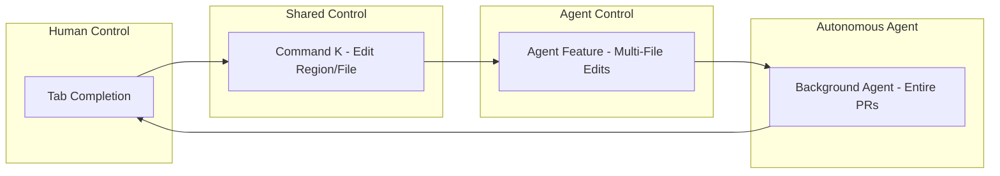

## Problem

AI agents for tasks like coding can offer various levels of assistance, from simple completions to complex, multi-step operations. A one-size-fits-all approach to agent autonomy doesn't cater to the diverse needs of users or the varying complexity of tasks. Users need to fluidly shift between direct control and delegating tasks to the agent.

## Solution

Design the human-agent interaction to support a spectrum of control, allowing users to choose the level of agent autonomy appropriate for the current task or their familiarity with the codebase. This involves providing multiple modes or features for interaction:

-   **Low Autonomy (High Human Control):** Simple, inline assistance like tab-completion for code, where the human is primarily driving and the AI augments their input.
-   **Medium Autonomy:** Agent assistance for more contained tasks, like editing a selected region of code or an entire file based on a specific instruction (e.g., "Command K" functionality). The human defines the scope and the high-level goal.
-   **High Autonomy:** Agent takes on larger, multi-file tasks or complex refactorings, potentially involving multiple steps, with less direct human guidance on each step (e.g., an "Agent" feature).
-   **Very High Autonomy (Asynchronous):** Background agents that can take on entire complex tasks like implementing a feature or fixing a set of bugs and creating a pull request, operating largely independently.

Users can seamlessly switch between these modes depending on their needs, allowing for a "blended initiative" where both human and AI contribute effectively.

**Distinct from** [Seamless Background-to-Foreground Handoff](seamless-background-to-foreground-handoff.md), which covers the takeover mechanics for one unfinished background task: this pattern is the menu of autonomy levels itself and how users move between them.

## Evidence

- **Evidence Grade:** `high`
- **Most Valuable Find:** Concept has strong academic foundations dating to Sheridan-Verplank (1978) establishing Levels of Automation (LOA); Parasuraman et al. (2000) provided widely-cited 4-stage model; universal adoption across major AI coding tools with similar 4-5 level spectrums
- **Unverified:** Longitudinal studies on optimal control level selection heuristics

## Example

## How to use it

- Offer several distinct autonomy levels (inline completion, scoped edit, multi-file agent, background agent) rather than one continuous slider.
- Make mode switching explicit and cheap: keyboard shortcuts or UI toggles that name the level being selected.
- Let users pick the level per task, and default unfamiliar code or risky changes to the lower levels.
- Pair the highest autonomy levels with human-in-the-loop approval for high-risk operations.

## Trade-offs

- **Pros:** Creates clearer human-agent handoffs, builds trust through progressive autonomy, enables error containment at lower levels, allows context-appropriate control selection
- **Cons:** Multiple modes can confuse users if not clearly presented, requires building/maintaining several interaction paths, users may struggle to choose appropriate autonomy level

## References

- Aman Sanger (Cursor) extensively discusses this spectrum at 0:05:16-0:06:44, detailing different features like tab completion, Command K, Agent for multi-file edits, and Background Agent for entire PRs, describing it as "almost a spectrum."
- Sheridan, T. B., & Verplank, W. L. (1978). Human and Computer Control of Undersea Teleoperators. MIT Man-Machine Systems Laboratory technical report, available at https://ntrs.nasa.gov/citations/19790007441 (this report has no IEEE journal DOI)
- Parasuraman, R., et al. (2000). A Model for Types and Levels of Human Interaction with Automation. https://doi.org/10.1109/3477.866864
- Horvitz, Eric (1999). Principles of Mixed-Initiative User Interfaces. CHI '99. https://doi.org/10.1145/302979.303030

- Primary source: https://www.youtube.com/watch?v=BGgsoIgbT_Y
