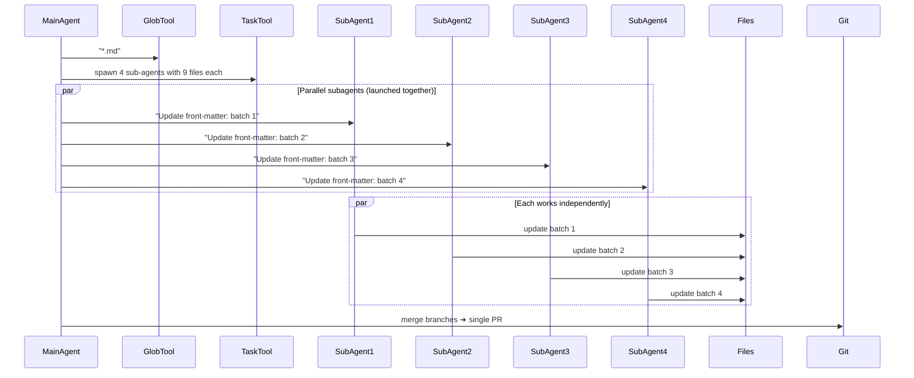

## Problem

Large multi-file tasks blow out the main agent's context window and reasoning budget. You need a way to delegate work to specialized agents with isolated contexts and tools.

## Solution

Let the main agent **spawn focused sub-agents**, each with its own fresh context, to work in parallel on shardable subtasks. Aggregate their results when done.

**Critical requirement**: each subagent invocation must have a clear, specific task subject for traceability. Empty or generic subjects make parallel work untraceable and synthesis difficult. See [Subject Hygiene](subject-hygiene.md) for details.

### 1. Declarative YAML configuration

Define subagent types in configuration files with their own system prompts, allowed tools, and context windows:

```yaml
# agents.yaml: which subagents each agent may spawn
subagents:
  planning:
    file: subagents/planning.yaml
    allowed_in: [main_agent, research_agent]
  think:
    file: subagents/think.yaml
    allowed_in: [main_agent]

# subagents/planning.yaml: the subagent's own prompt and tools
name: planning
system_prompt: "Break down complex tasks into steps..."
tools: [list_files, read_file]   # or inherit: all (from the parent agent)

# subagents/think.yaml
name: think
system_prompt: "Analyze and refine reasoning..."
tools: [read_file, search]
```

The main agent invokes a subagent through a dedicated tool, `subagent(agent_name, prompt, files)`, which gives:

- **Virtual file isolation**: the subagent sees only the files explicitly passed to it
- **Tool scoping**: subagents can inherit all parent tools or use a subset
- **Specialized system prompts**: each subagent type has predefined behavior

### 2. Dynamic spawning for parallel work

Spawn subagents on demand for parallel task execution:

```pseudo
# Main agent creates a todo list
files = glob("**/*.md")
batches = chunk(files, 9)

# Spawn subagents for each batch IN PARALLEL
for batch in batches:
    spawn_subagent(
        task="Update YAML front-matter in markdown files",  # Clear, specific subject
        files=batch,
        context=instructions
    )
# All subagents run concurrently, not sequentially
```

**Parallel delegation best practices:**

- **Launch independent tasks simultaneously**: do not explore A, then B, then C sequentially
- **Use clear task subjects**: each subagent needs a traceable identity (see [Subject Hygiene](subject-hygiene.md))
- **Plan synthesis upfront**: define how the main agent will combine the subagent findings
- **Limit to 2-4 subagents**: the observed maximum in effective sessions; more adds coordination overhead

Recent developments show that improved agent [state externalization capabilities](proactive-agent-state-externalization.md) may make subagent delegation more practical, because they help agents better identify which tasks suit delegation and how to communicate the necessary context to subagents.

### Example: YAML front-matter refactor



**Real-world example from nibzard-web:** four parallel subagents launched simultaneously:

- `"Newsletter component exploration"` → agent-a7911db
- `"Modal pattern discovery"` → agent-adeac17
- `"Search implementation research"` → agent-a03b9c9
- `"Log page analysis"` → agent-b84c3d1

The main agent synthesized the findings and implemented a unified approach.

## How to use it

**Use cases for subagents:**

1. **Context window management**: upload large files to a subagent, extract the specific data, and return a summary to the main agent
2. **Concurrent work**: run several subagents in parallel and join on completion, which reduces clock-time for I/O-bound workflows because network API calls can happen simultaneously
3. **Code-driven LLM invocation**: a code workflow calls the subagent, the subagent makes an LLM-powered decision, and control returns to the code with the result
4. **Security isolation**: separate tools and contexts in mutually isolated subagents, so external resource retrieval stays apart from internal access and the blast radius of sensitive operations shrinks

**Virtual file passing:**

```pseudo
# Main agent
result = subagent(
    agent_name="planning",
    prompt="Analyze these files and create migration plan",
    files=["file1.ts", "file2.ts", "file3.ts"]
)
# Only these 3 files are visible to the planning subagent
```

**Recursive architecture:** some implementations treat every agent as a subagent, which enables flexible composition and consistent behavior across the system.

**Swarm migrations:** for massive parallelization (10+ subagents) and large-scale code migrations, see the [Swarm Migration Pattern](swarm-migration-pattern.md).

**Failure modes / gotchas:**

- **Generic subjects:** an empty or generic task subject makes parallel work untraceable and synthesis difficult. Give each subagent task a clear, specific subject.
- **Sequential launches:** exploring A, then B, then C removes the latency benefit. Launch independent tasks simultaneously.
- **Unplanned synthesis:** without a defined way to combine findings, the main agent must merge conflicting results ad hoc. Plan the synthesis before you spawn.
- **Too many subagents:** more than 2-4 subagents adds coordination overhead.
- **Subagents by default:** the source author reports, "frequently thought we needed subagents, then found more natural alternative". Look for the simpler design first.

## Trade-offs

**Pros:**

- **Context isolation**: each subagent has a clean context window
- **Parallelization**: concurrent execution reduces workflow latency
- **Specialization**: different subagent types for different tasks (planning, thinking, analysis)
- **Virtual files**: precise control over what each subagent can see
- **Tool scoping**: limit subagent capabilities for security and simplicity
- **Declarative config**: reusable subagent definitions through YAML

**Cons:**

- **Overhead**: spawning and coordinating subagents adds complexity
- **Cost**: running multiple agents simultaneously increases token usage
- **Coordination**: the main agent must track and aggregate subagent results
- **Not always necessary**: see the "found more natural alternative" note above
- **Latency visibility**: user-facing latency is an "invisible feature" until it becomes problematic

**When subagents matter most:** context window management (large file processing), I/O-bound workflows (network API calls), code-driven workflows that need LLM delegation, and massive parallelization (10+ concurrent agents).

## References

* Claude Code documentation, [Create custom subagents](https://code.claude.com/docs/en/subagents) - the official subagent configuration reference
* Vezhnevets, A., et al. (2017). [FeUdal Networks for Hierarchical Reinforcement Learning](https://arxiv.org/abs/1703.01161). ICML. - Manager-worker separation with goal-setting in latent space
* Raising An Agent - Episode 6: Claude 4 Sonnet edits 36 blog posts via four sub-agents.
* Boris Cherny (Anthropic) on swarm migrations for framework changes and lint rules
* [AI & I Podcast: How to Use Claude Code Like the People Who Built It](https://every.to/podcast/transcript-how-to-use-claude-code-like-the-people-who-built-it)
* [Cognition AI: Devin & Claude Sonnet 4.5](https://cognition.ai/blog/devin-sonnet-4-5-lessons-and-challenges) - discusses how improved model judgment about state externalization may make subagent delegation more practical
* [Building Companies with Claude Code](https://claude.com/blog/building-companies-with-claude-code) - Ambral's "robust research engine" uses dedicated sub-agents specialized for different data types, enabling parallel research across system areas
* [Building an internal agent: Subagent support](https://lethain.com/agents-subagents/) - Will Larson on YAML-configured subagents with virtual file isolation and code-driven LLM invocation
* [Cursor: Scaling long-running autonomous coding](https://cursor.com/blog/scaling-agents) - Hierarchical spawning with hundreds of concurrent agents validated in production

[Author's session anecdote](https://www.nibzard.com/ampcode) - the four-parallel-subagent website refactor described above
